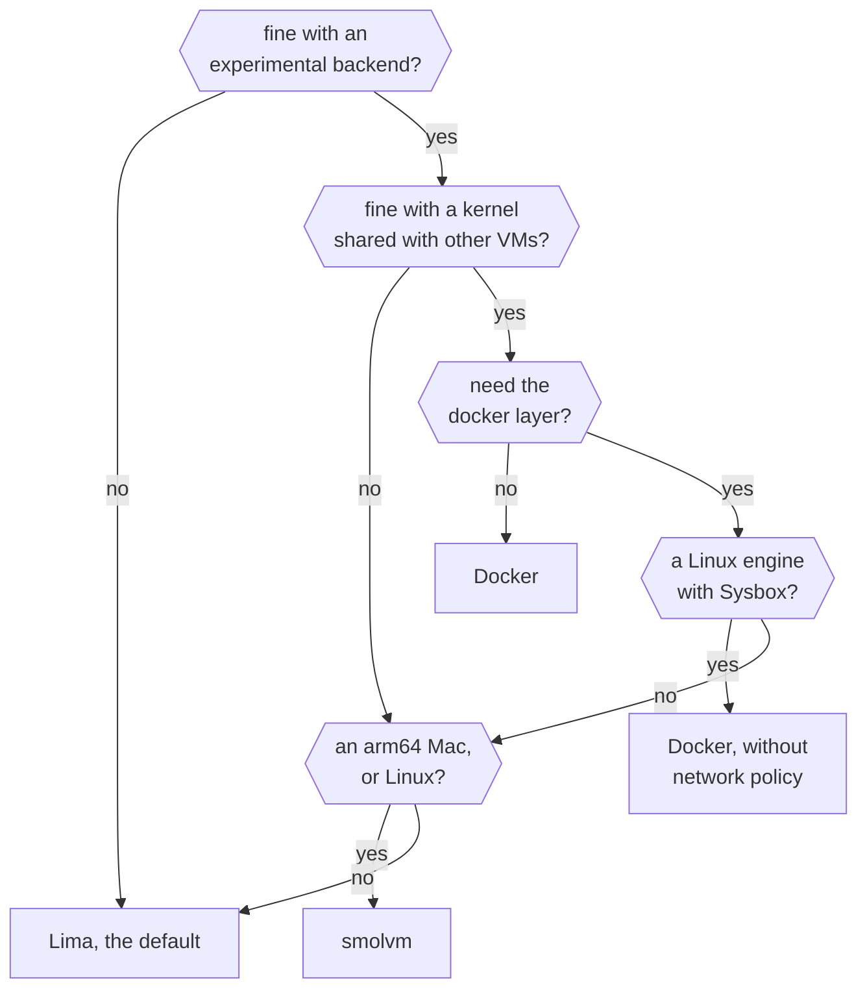

A backend is the program that runs devvm's VMs and builds their images. devvm decides what goes into a VM, such as its image, its folders, its size and its network policy, and the backend runs it. [Lima](lima.md) is the default backend, and [smolvm](smolvm.md) and [Docker](docker.md) are experimental.

## Comparing the backends

| | Lima | smolvm  | Docker  |
| --- | --- | --- | --- |
| Each project gets | a full VM with a kernel of its own | a microVM that runs the image as a container, with no init system | a container, not a VM, which shares a kernel with every other Docker VM ([isolation](docker.md#isolation-a-container-is-not-a-vm)) |
| Hosts | macOS 13 or newer, or Linux, on arm64 or x86_64 | an arm64 Mac, or Linux on arm64 or x86_64, but only the Mac is tested | macOS with Docker Desktop, or Linux with Docker's engine |
| You need | Lima 2.0 or newer, and on Linux QEMU and access to `/dev/kvm` ([requirements](lima.md#requirements)) | smolvm 1.32 or newer, and on Linux access to `/dev/kvm` ([requirements](smolvm.md#requirements)) | Docker 29.1 or newer with its engine running, and on Linux the `docker` group ([requirements](docker.md#requirements)) |
| Network policy |  yes |  yes | yes on Docker Desktop and on an engine on this Linux machine, but not with the docker layer |
| The docker layer |  yes |  yes | only under Sysbox, on a Linux engine ([the docker layer](docker.md#the-docker-layer)) |
| Limits | paths with commas, and shrinking a disk ([limits](lima.md#limits)) | paths with colons, and with SSH agent forwarding on, the agent is in the VM the whole time it runs ([what's different](smolvm.md#whats-different)) | a disk size, raw packet tools, firewalls and VPNs, mounting and nested virtualization ([what Docker VMs can't do](docker.md#what-docker-vms-cant-do)) |

Read [Isolation: a container is not a VM](docker.md#isolation-a-container-is-not-a-vm) before you choose Docker. On Linux every Docker VM shares your machine's kernel, and on macOS Docker Desktop runs all of them in one VM, so a kernel flaw reaches your machine on Linux and every other VM on both.

`.git` protection uses your machine's file flags, so it works the same on every backend.

Each backend has its own images. An image's key includes its backend, so one backend never uses another's images.

`devvm doctor` lists each backend's features, which are what the backend does itself, what devvm builds from other parts of it, and what it can't do. These are backend features, not the base image features you choose with `devvm setup`, even though `devvm doctor` calls both "features". [How it works › Backends](../internals/backends.md) explains them, backend by backend.

## Choosing a backend

To choose, follow the comparison above:



A new VM gets the first of:

1. `--backend`.
2. The default, which devvm keeps in `~/.config/devvm/backend` as one line with the backend's name.
3. `lima`.

To set the default:

```sh
devvm setup                  # asks, then for base's features
devvm setup --backend NAME   # without asking; the features stay as they are
```

In a terminal, `devvm setup` lists every backend, with the experimental ones marked, starting from the current default. The up and down keys (or `k` and `j`) move, and Enter confirms. devvm saves and prints the choice, then asks for [base's features](../using/customizing.md#choosing-features). With `--features` alone, or without a terminal, it doesn't ask for the backend.

A VM's state records its backend, and the VM stays on that backend, so devvm ignores `--backend` on an existing VM. When the backend file or a VM's state names a backend devvm doesn't have, devvm stops and lists the ones it has.

A launch runs only the backends your VMs use. A backend that no VM uses never runs during a launch, so it can't slow one down, even when it isn't running or isn't installed.

## When a backend lacks something

When a VM needs something its backend can't do, devvm stops and says so in one line, naming the VM and what to do. It never falls back to something weaker, so a VM that asks for network policy never starts with an open network. To get what's missing, use a backend that has it. A VM keeps its backend, so that means making a new VM on the other backend.

Network policy is the one exception, because it's on by default. When a backend can't give a new VM network policy, devvm makes the VM without it and warns you, unless you gave `--network-policy`, which devvm then refuses ([turning it on or off](../safety/network.md#turning-it-on-or-off)).
