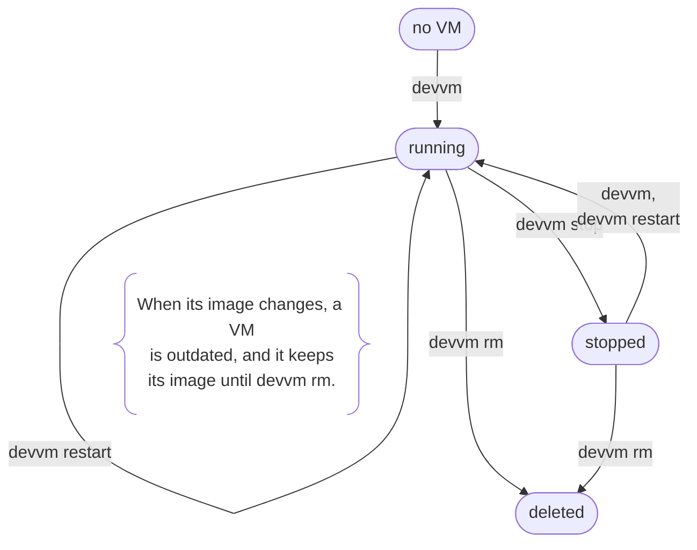

This page lists devvm's commands in the order you'll need them, and each row links to the page with the details. The [CLI reference](../cli/_index.md) has every command with all its flags.

## VMs

```sh
devvm          # a VM with the project's toolchain, or a shell in the folder's VM
devvm claude   # the same, with Claude Code: added to an existing VM after asking
devvm codex    # the same, with Codex
```

[Adding to a VM](#adding-to-a-vm) explains what adding an agent to an existing VM does.

| | |
| --- | --- |
| `devvm [IMAGE]` | open a shell in this folder's VM, at the same path, making the VM first from IMAGE or from the image the folder's files call for ([details](../using/images.md#which-image-a-new-vm-gets)) |
| `devvm restart` | stop this folder's VM, start it again and open a shell in it, for changes that apply only when it starts |
| `devvm stop` | stop this folder's VM ([details](../internals/overview.md#stopping-a-vm)) |
| `devvm update` | move this folder's VM to the newest shared tools, then open a shell in it ([details](../using/images.md#adding-and-removing-tools)) |
| `devvm remove TOOLS` | take shared tools out of this folder's VM, such as `devvm remove python+claude`, then open a shell in it |
| `devvm export [FILE]` | save the history of this folder's VM's agents to FILE, or to a new `.tar.gz` in `~/.local/share/devvm/exports` ([details](../using/coding-agents.md#history)) |
| `devvm rm [-f]` | delete this folder's VM, exporting its agents' history first ([details](../internals/overview.md#deleting-a-vm)) |
| `devvm adopt` | use the VM made for an earlier folder at this path here ([details](#a-folder-made-again)) |
| `devvm ls` | list the project VMs ([details](#listing-vms)) |
| `devvm ports [all\|none\|LIST]` | show or change which ports this folder's VM forwards to this machine's `localhost`, even while it runs ([details](../using/ports-size.md#ports)) |
| `devvm ports add\|rm LIST` | forward more ports, or stop forwarding some ([details](../using/ports-size.md#ports)) |
| `devvm ports -g ...` | show or change what new VMs forward ([details](../using/ports-size.md#ports)) |
| `devvm size [--cpus N] [--memory GiB] [--disk GiB]` | show or change this folder's VM's CPUs, memory and disk ([details](../using/ports-size.md#size)) |
| `devvm size -g ...` | show or change the size new VMs get ([details](../using/ports-size.md#size)) |
| `devvm git-protect [on\|strict\|off]` | show or change this folder's VM's `.git` protection, while it's stopped ([details](../safety/git-protection.md#turning-it-on-or-off)) |

In a folder without a VM of its own, every command here that acts on this folder's VM, except `devvm adopt`, uses the VM of the nearest folder with one that it's inside, and devvm says which VM that is. `devvm rm` also asks before it deletes that VM, and so does each command that gives that VM more access before it changes the VM ([a subfolder](#a-subfolder)).

devvm makes a new VM from its image, building the image first if it isn't built yet, then starts the VM and opens a shell in it in devvm's place, so devvm ends when the shell does. The VM mounts only the project folder, read-write, and the shared tools and its [agents' config folders](../using/coding-agents.md), read-only, or with `--clone` it gets its own clone of the repo instead of the folder. [Overview](../internals/overview.md) has each step devvm takes for a new VM and an existing one.

A VM is running or stopped from the time devvm makes it until you delete it.



Options for a new VM:

| | |
| --- | --- |
| `--network-policy` | create the VM with [network policy](../safety/network.md), which is the default: it reaches only the hosts you allow, through a proxy on this machine, and your secrets stay on this machine |
| `--no-network-policy` | create the VM without network policy, so it reaches anything this machine can |
| `--clone` | create the VM with its own clone of the repo instead of mounting the folder ([details](../using/clone.md)) |
| `--no-git-protect` | create the VM without `.git` protection |
| `--ssh-agent` | create the VM forwarding your SSH agent, so while you're connected, anything in it can use your keys ([details](../using/ssh.md#agent-forwarding)) |
| `--unsafe-folder` | mount a folder that devvm refuses, such as one that is or holds your home folder ([details](../using/settings.md#project-folders-devvm-refuses)) |
| `--cpus N`, `--memory GiB`, `--disk GiB` | the VM's size ([details](../using/ports-size.md#size-and-ports)) |
| `--ports all\|none\|LIST` | which ports the VM forwards ([details](../using/ports-size.md#size-and-ports)) |
| `--backend NAME` | the [backend](../backends/_index.md#choosing-a-backend) that runs it |
| `--from IMAGE` | start its base from a container image, such as `node:24`, instead of Ubuntu's cloud image ([details](../using/from.md)) |
| `--no-devcontainer` | create the VM without reading the folder's `devcontainer.json` ([details](../using/devcontainer.md)) |
| `--here` | create a VM for this folder even when a folder it's inside has one, without asking whether to use that VM ([details](#a-subfolder)) |

Options that take a value also work with an equals sign, such as `--cpus=N`.

If you give neither network policy flag, devvm asks in a terminal, recommending yes, and without a terminal the VM gets network policy. [Turning it on or off](../safety/network.md#turning-it-on-or-off) covers the VMs that can't have it.

A folder with a `.devcontainer/devcontainer.json` or `.devcontainer.json` gets the VM that file describes, as far as devvm supports it. That covers its image, ports, environment and commands, and the features devvm has layers for, as [`devcontainer.json`](../using/devcontainer.md) explains. The options you give take priority over the file.

### Adding to a VM

`devvm IMAGE` in a folder whose VM exists names an image as it does for a new VM, with agents alone on top of the folder's toolchains. devvm adds whatever of it the VM's image lacks in place, after you confirm in a terminal. Without a terminal, devvm stops and changes nothing.

- devvm builds the shared tools that the share lacks, and they join the VM's list at once.
- devvm mounts an agent's config folders, which stops the VM first, so anything running in it stops.
- A layer's script runs in the VM, as when devvm builds an image. If the script fails, the VM is otherwise left as it was.

The VM's image is then its old one with these added. `devvm remove TOOLS` takes shared tools out again. You can't take layers out, because their scripts changed the VM's disk, so to drop one, save your work outside the project folder, run `devvm rm`, and make the VM again.

### A folder made again

A VM belongs to the folder it was made for, which devvm knows by its path and by the folder itself ([one VM per folder](../internals/security.md#one-vm-per-folder)). When that folder was deleted and a new one made at the same path, devvm, `devvm restart`, `update` and `remove` refuse the VM. Two commands deal with it, and each acts only after you confirm in a terminal:

- `devvm rm` deletes the VM, with `-f` or without it, and never exports its history, because its folder is gone. The VM may hold that project's work.
- `devvm adopt` gives the VM to this folder, with its files, secrets and allowlist. Its `.git` protection starts again, as if `.git` had just appeared.

### A subfolder

A VM mounts its whole project folder, so the folders inside it are in the VM at the same paths. When the folder you run a command in has no VM of its own, devvm looks for one in the folders it's inside, starting with the nearest. It stops before your home folder and the filesystem root, so it never uses a VM made for either. It stops at the nearest folder that has a VM, and when that VM was made for an earlier folder at its path ([a folder made again](#a-folder-made-again)), or its backend has lost it, the folder you're in has no VM, so devvm never reaches past it to a VM further out. Using a parent folder's VM mounts nothing new, because the subfolder is already inside the folder that VM mounts.

When you run `devvm` in such a subfolder in a terminal, devvm asks whether to open the parent folder's VM there instead of making a new VM, with yes as the default. If you answer yes, the shell opens in the VM at the subfolder's path. If you answer no, devvm makes a new VM for the subfolder alone. Without a terminal, devvm opens the parent folder's VM and names it and its folder first. An IMAGE you give, after the same question, adds to the parent folder's VM in place as it would in that folder ([adding to a VM](#adding-to-a-vm)). `devvm --here` makes a new VM for the subfolder without asking, and so does `devvm --clone`, which makes the subfolder's own clone VM. Once the subfolder has its own VM, devvm opens that one and asks nothing. In a parent folder's `--clone` VM, the shell opens in the subfolder when the clone has it ([subfolders](../using/clone.md#subfolders)).

The other commands that act on this folder's VM, such as `devvm stop`, `restart`, `size`, `ports`, `ssh` and `code`, use the parent folder's VM in the same way, without asking. Each one first prints a line that names the VM and the folder it was made for. `devvm rm` is the exception, because it never deletes a parent folder's VM unasked. In a terminal, it names the VM and its folder and asks before deleting it, with no as the default, even with `-f`, which still skips only its export and clone checks. Without a terminal, it refuses and tells you to run `devvm rm` in the parent folder instead. The commands that give the VM more access ask in the same way, because the parent folder's project may not expect them. They are `devvm secret use`, `devvm ssh-agent on` and `devvm ssh-agent devvm`, `devvm network off`, `devvm policy allow`, `devvm policy rm` when it removes a deny, and `devvm git-protect off`. In a terminal, each one names the VM and its folder and asks before it changes the VM, with no as the default. Without a terminal, it refuses and tells you to run it in the parent folder, or in a terminal to confirm. The commands that take access away, such as `devvm secret unuse` and `devvm policy deny`, ask nothing. `devvm ssh` gives the subfolder as the folder to open in the VM, and `devvm code` opens the subfolder. `devvm adopt` acts only on the VM made for this folder's own path, never on a parent folder's.

A subfolder that is a git repo of its own is treated as a separate project, and so is a subfolder inside such a repo, when the repo is below the folder with the VM. That covers a nested repo, a submodule and a worktree, which each have a `.git` folder or file of their own. When you run `devvm` there in a terminal, devvm still asks, but the default is a new VM for the subfolder, so the parent folder's VM opens only if you answer yes. Without a terminal, devvm makes the new VM. The other commands never use the parent folder's VM there, and they say this folder has no VM, as in any folder without one.

### Listing VMs

`devvm ls` prints a table of the project VMs on every backend, sorted by name, with a header first. Images and build VMs aren't in it.

| Column | |
| --- | --- |
| `NAME` | the VM's name, `devvm-<folder>-<hash>` |
| `STATUS` | its state as its backend reports it, such as `Running` or `Stopped` |
| `IMAGE` | its image, with what was added to it in place, and a base from a container image as `base (from node:24)` ([details](../using/from.md)) |
| `GIT` | its [`.git` protection](../safety/git-protection.md), `on`, `strict` or `off`, or `clone` for a [`--clone`](../using/clone.md) VM |
| `NET` | its [network policy](../safety/network.md), `on`, `off`, or `unenforced` ([the self-check](../internals/network.md#the-self-check)) |
| `BACKEND` | the [backend](../backends/_index.md) that runs it |
| `FOLDER` | its project folder |

A value the VM's state doesn't have shows as `-`, so a VM whose creation didn't finish shows only its name, status and backend.

## Working on a clone

| | |
| --- | --- |
| `devvm --clone` | make this folder's VM with its own clone of the repo, copy your branches into it and open a shell in the clone ([details](../using/clone.md)) |
| `git fetch devvm` | on this machine, fetch the VM's work as `devvm/<branch>`, to review before you merge it ([details](../using/clone.md#fetching-the-vms-work)) |
| `devvm rm` | delete the VM, first offering to keep the work you haven't fetched as `saved/devvm/<branch>` branches ([details](../using/clone.md#deleting-the-vm)) |

## Network policy

| | |
| --- | --- |
| `devvm network [on\|off]` | show this folder's VM's network policy, `on`, `off` or `unenforced`, or change it from its next start with `devvm restart` ([details](../safety/network.md#turning-it-on-or-off)) |
| `devvm policy` | show the allowlist of this folder's VM, file by file ([details](../safety/network.md#changing-rules)) |
| `devvm policy allow\|deny\|rm RULE... [-g]` | add allow or deny rules to this folder's VM's own, or remove them, at once, and with `-g`, change yours for every VM ([details](../safety/network.md#changing-rules)) |
| `devvm log [-f] [-n N] [--blocked]` | show what this folder's VM connected to and what its network policy blocked ([details](../safety/network.md#logs)) |
| `devvm secret set claude\|github [--stdin]` | save your Claude Code token or GitHub token on this machine, so that with network policy VMs get a placeholder and their proxy puts the secret in ([details](../safety/network.md#saving-and-binding-secrets)) |
| `devvm secret use\|unuse NAME` | let this folder's VM use a secret, or stop it, though a VM whose image has `claude` always uses `claude` ([details](../safety/network.md#saving-and-binding-secrets)) |
| `devvm secret`, `devvm secret rm NAME` | list the secrets, whether each is saved and the VMs using it, or delete a saved one ([details](../safety/network.md#saving-and-binding-secrets)) |

## SSH

| | |
| --- | --- |
| `devvm ssh-agent [on\|devvm\|off]` | show this folder's VM's SSH agent forwarding, which is `off`, `on` for yours or `devvm` for devvm's own, then the keys devvm's own agent holds and those added to it, or change the forwarding from the VM's next start ([details](../using/ssh.md#agent-forwarding)) |
| `devvm ssh-agent add KEY_FILE [--confirm] [--lifetime DURATION]` | load a key into devvm's own agent, and load it again whenever a VM needs it ([details](../using/ssh.md#devvms-own-agent)) |
| `devvm ssh-agent rm KEY_FILE` | take a key out of devvm's own agent, so devvm doesn't load it again ([details](../using/ssh.md#devvms-own-agent)) |
| `devvm ssh` | get this folder's VM ready for ssh and editors, and show the name they reach it by, such as `devvm-website` ([details](../using/ssh.md#devvm-ssh-and-devvm-code)) |
| `devvm code` | the same, then open its folder in VS Code over Remote-SSH ([VS Code](../using/ssh.md#vs-code)) |
| `devvm desktop [--clipboard] [--no-open]` | serve this folder's VM's desktop on `127.0.0.1` with its password until Ctrl+C, and open it in Screen Sharing on macOS ([details](../using/desktop.md)) |

## Images

| | |
| --- | --- |
| `devvm build IMAGE` | build an image, the images under it and the shared tool images it names, unless they're built, such as `devvm build foo+bar` or `devvm build node+claude` |
| `devvm rebuild IMAGE` | build an image again from its parent as it is, and delete the stale images no VM uses, while shared tools follow the tools lock instead ([details](../using/images.md#rebuilding)) |
| `devvm layer new NAME` | start a layer of your own, `~/.config/devvm/layers/NAME.sh`, with its allowlist, `NAME.policy` ([details](../using/customizing.md#your-own-layers)) |
| `devvm images` | list the images on every backend, then the shared tool images ([details](../using/images.md#listing-images)) |
| `devvm images rm IMAGE\|KEY...` | delete images, by name or by the key `devvm images` shows ([details](../using/images.md#deleting-images)) |
| `devvm gc` | delete the stale and unfinished images and the tool images no VM uses, after listing them, and never a VM ([details](../using/images.md#cleaning-up)) |
| `devvm space [--json]` | show what devvm keeps on this machine, the disk each kind takes, and what frees it ([details](../using/space.md#devvm-space)) |
| `devvm retention [KEY=VALUE...]` | show the retention settings, which say what devvm deletes on its own, or change them, with `KEY=off` turning one off ([details](../using/settings.md#retention)) |

With `--backend NAME`, these commands build or delete on that backend instead of the one new VMs get. With `--from IMAGE`, they work on a base made from that container image ([details](../using/from.md)).

## devvm itself

| | |
| --- | --- |
| `devvm setup [--backend NAME] [--features LIST\|none]` | choose the default backend and base's features, and in a terminal also new VMs' size and network policy ([details](../using/settings.md#devvm-setup)) |
| `devvm doctor` | check what devvm needs on this machine and say how to get what's missing ([details](install.md#checking-what-devvm-needs)) |
| `devvm --version` | print devvm's version alone, as `devvm version` also does |
| `devvm help [COMMAND]` | print the help for devvm or a command, as `--help` and `-h` do |
| `devvm completion SHELL` | print the shell completion script for `bash`, `zsh` or `fish` ([details](#shell-completion)) |
| `devvm limactl ARGS...` | run Lima's `limactl` on the VMs and images in devvm's own Lima home, not `~/.lima` ([details](../backends/lima.md#running-limactl)) |

devvm never reads a command's name as an IMAGE, so `devvm build` runs the build command. To use one of your layers that's named like a command, write it as `base+NAME`.

The folders devvm keeps its state in and the environment variables it reads are in [Settings and files](../using/settings.md).

### Shell completion

The completion script completes commands, flags and image names, including names joined with `+` after the parts you've already typed. It also completes shared tools for `devvm remove`, `--backend` values, and `all` and `none` for `--ports` and `devvm ports`. Load it from your shell's startup file:

| Shell | Line | In |
| --- | --- | --- |
| bash | `source <(devvm completion bash)` | `~/.bashrc`, with the bash-completion package installed |
| zsh | `source <(devvm completion zsh)` | `~/.zshrc`, after `compinit` |
| fish | `devvm completion fish \| source` | `~/.config/fish/config.fish` |
