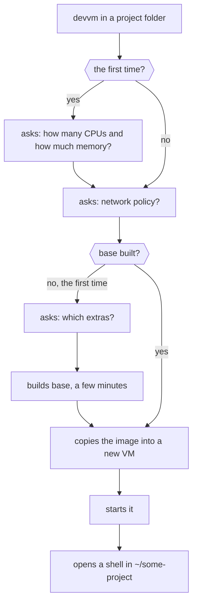

This page assumes you've [installed devvm](install.md) and that `devvm doctor` finds nothing missing.

## Making the VM

In a project folder, run one of these:

```sh
cd ~/some-project
devvm          # a VM with the project's toolchain
devvm claude   # the same, with Claude Code
devvm codex    # the same, with Codex
```

devvm picks the toolchain from the folder's files, such as node for `package.json` or python for `pyproject.toml` ([which image a new VM gets](../using/images.md#which-image-a-new-vm-gets)).

The first time, devvm asks for the CPUs and memory that new VMs get. It shows how many CPUs and how much memory this machine has, and offers the base image's 4 CPUs and 8 GiB, or less on a machine that doesn't have room for them. Press Enter to keep each value, or type another, and devvm asks again when this machine can't give what you typed. devvm saves what you type as the size new VMs get, which you can change later with `devvm setup` or `devvm size -g`, and when you keep both values it saves nothing ([choosing new VMs' size](../using/ports-size.md#choosing-new-vms-size)).

For each new VM, devvm asks whether it gets network policy. To answer once for every new VM, run `devvm network -g on`.

> [!TIP]
> Answer yes, the default. [Network policy](../safety/network.md) limits the VM to the hosts you allow and keeps your secrets on your machine.

The first time, devvm also asks which optional extras every VM gets, such as oh-my-bash and fzf, then builds the base image, which takes a few minutes once:

```console
==> building image base (e9f517dddef1)
    a few minutes, and Ubuntu's cloud image to download the first time
    (details: ~/.local/share/devvm/logs/runs/20261024-090616-83541.log)
==> image base ready
==> creating devvm-some-project-71a99b1076d92c from base
==> starting devvm-some-project-71a99b1076d92c
```

Later VMs start in seconds.



## Claude Code's token

Claude Code in a VM needs a Claude Code token, which you make once on this machine:

```sh
claude setup-token        # approve in the browser, then copy the sk-ant-oat01-… token it prints
devvm secret set claude   # paste it
```

With network policy, the VM gets a placeholder, and the proxy on your machine puts the real token into Claude's requests. Every agent gets your settings, skills and MCP servers, but never your history ([coding agents](../using/coding-agents.md)).

## What's in the VM

devvm opens a shell in the VM at the same path, `~/some-project`, with `(devvm)` at the start of the prompt.

- **Your project folder**, read-write, so your editor and the VM share the same files. It's the only folder of yours the VM sees, and its `.git` hooks and config are locked ([.git protection](../safety/git-protection.md)).
- **The toolchains**, ready at once ([toolchains](../using/toolchains.md)).
- **Your git name and email**, so commits made in the VM are yours.
- **Ports**: a dev server on `:5173` in the VM opens at `localhost:5173` on your machine ([ports](../using/ports-size.md#ports)).
- **sudo** without a password, so `apt install` works as on any Ubuntu machine.

## Working on a clone instead

To keep the VM out of your working tree and `.git` entirely, give it its own clone of the repo. You choose this when the VM is made:

```sh
devvm --clone                 # a VM with its own clone of your branches
git fetch devvm               # later, on this machine: the VM's work as devvm/<branch>
git log -p main..devvm/main   # review it before you merge it
```

Use it for an agent working unattended, a repo you don't trust, or on Linux hosts, which have no `.git` protection ([working on a clone](../using/clone.md)).

## Coming back to it

The VM belongs to its folder:

```sh
devvm                   # a shell in this folder's VM, started if it's stopped
devvm tools add claude  # add Claude Code to this folder's VM
devvm code              # open it in VS Code
devvm stop              # stop it
devvm ls                # list every VM
devvm rm                # delete it, saving its agents' history first
```

The VM also covers the folders inside the project folder, because it mounts the whole folder. When you run `devvm` in a subfolder such as `~/some-project/src`, which has no VM of its own, devvm asks whether to open the project's VM there. If you answer yes, which is the default, the shell opens in `~/some-project/src` in the project's VM. If you answer no, devvm makes a new VM for the subfolder alone. Without a terminal to ask in, devvm opens the project's VM and says so. `devvm --here` makes the subfolder's own VM without asking, and once the subfolder has one, devvm always opens that VM there. A subfolder that is a git repo of its own counts as a separate project, so there the default answer is a new VM, and without a terminal devvm makes one ([a subfolder](commands.md#a-subfolder)).

[Everyday commands](commands.md) lists the rest. Before you let an agent loose in the VM, read [staying safe](../safety/_index.md#the-habits).
