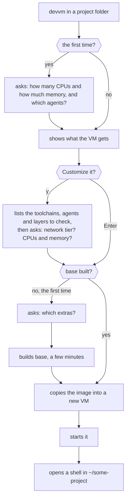

This page assumes you've [installed devvm](install.md) and that `devvm doctor` finds nothing missing.

## Making the VM

In a project folder, run devvm:

```sh
cd ~/some-project
devvm
```

The first time, devvm asks for the CPUs and memory that new VMs get. It shows how many CPUs and how much memory this machine has, and offers the base image's 4 CPUs and 8 GiB, or less on a machine that doesn't have room for them. Press Enter to keep each value, or type another, and devvm asks again when this machine can't give what you typed. devvm saves what you type as the size new VMs get, which you can change later with `devvm setup` or `devvm size -g`, and when you keep both values it saves nothing ([choosing new VMs' size](../using/ports-size.md#choosing-new-vms-size)). It also asks which coding agents new VMs get, and you can change them later with `devvm setup --agents`.

Then devvm shows what the new VM gets and asks whether you want to change it:

```text
==> devvm-some-project-71a99b1076d92c gets:
  toolchain node, for package.json
  agent claude, from devvm setup
  layers: none
  size: 4 CPUs, 8 GiB of memory and a 100 GiB disk
  network tier: allowlist
  ports: all
Customize it? [y/N]
```

The toolchains are the ones your folder's files call for, each with the file that calls for it, such as node for `package.json` or python for `pyproject.toml`. The agents and layers are the ones you chose for new VMs, and the network tier is allowlist, which reaches only the hosts you allow. Press Enter to make the VM as shown.

If you type y, devvm lists what the new VM can get, under three headings: its toolchains, its coding agents and its layers, with what the summary showed already checked. Move with the arrow keys, press space to check or uncheck a row, and press enter when the list is what you want:

```text
Choose what devvm-some-project-71a99b1076d92c gets. Use up and down to move, space to toggle and enter to confirm.
Toolchains
> [x] node       for package.json
  [ ] python
  [ ] rust
  [ ] go
Coding agents, which you start in the VM's shell
  [x] claude     from devvm setup
  [ ] codex
  [ ] opencode
Layers, which a VM gets only when devvm makes it
  [ ] desktop    an Xfce desktop, which devvm desktop opens
  [ ] docker     Docker's engine, CLI, BuildKit and Compose
  [ ] nix        Nix, direnv and nix-direnv
```

Check Claude Code, Codex or opencode to give the VM a coding agent. You can add toolchains and agents later, but a VM gets layers only when devvm makes it. To have a layer checked for every new VM, such as `desktop`, choose it with [`devvm setup --layers`](../using/settings.md#layers-for-new-vms).

After the list, devvm asks for the VM's network tier, and pressing Enter gives it the tier the summary showed, which is allowlist unless you saved another for new VMs with `devvm network -g`, such as `devvm network -g internet`. Then it asks for the VM's CPUs and memory, and pressing Enter keeps each value the summary showed. What you type here is for this VM alone, and devvm saves none of it for new VMs. Flags such as `--tools`, `--agents`, `--layers`, `--network`, `--cpus` and `--memory` choose a part beforehand, as in `devvm --agents claude`, and each part you leave out keeps what the summary would have shown. devvm asks nothing when the flags choose everything ([what a new VM gets](../using/images.md#what-a-new-vm-gets)).

> [!TIP]
> Keep allowlist, the default, unless the VM needs more. [Network policy](../safety/network.md) limits the VM to the hosts you allow and keeps your secrets on your machine.

The first time, devvm also asks which optional extras every VM gets, such as oh-my-bash and fzf, then builds the base image, which takes a few minutes once:

```console
==> building image base (e9f517dddef1)
    a few minutes, and Ubuntu's cloud image to download the first time
    (details: ~/.local/share/devvm/logs/runs/20261024-090616-83541.log)
==> image base ready
==> creating devvm-some-project-71a99b1076d92c from base
==> starting devvm-some-project-71a99b1076d92c
```

Later VMs start in seconds.



## Claude Code's token

Claude Code in a VM needs a Claude Code token, which you make once on this machine, in a terminal of its own rather than the VM's shell:

```sh
claude setup-token        # approve in the browser, then copy the sk-ant-oat01-… token it prints
devvm secret set claude   # paste it
```

The VM gets a placeholder, whatever its network tier, and the proxy on your machine puts the real token into Claude's requests. Every agent gets its settings, skills, MCP servers and logins from devvm's agent store, but never your history. When you already use an agent on this machine, `devvm agent import` copies its settings and logins into the store once ([devvm's agent store](../using/coding-agents.md#devvms-agent-store)).

## Starting the agent

devvm opens a shell in the VM at the same path, `~/some-project`, with `(devvm)` at the start of the prompt, so you can tell it from your machine's shells. The agent runs where you start it, so start it in this shell:

```console
~/some-project $ devvm
(devvm) ~/some-project $ claude
```

Run `claude`, `codex` or `opencode`, whichever you checked. devvm installs the agent in the VM, so you never install it on this machine. In the VM the agent sees only your project folder, and your agents' settings from devvm's agent store read-only, so whatever it runs stays in the VM.

## What's in the VM

- **Your project folder**, read-write, so your editor and the VM share the same files. It's the only folder of yours the VM sees, and its `.git` hooks and config are locked ([.git protection](../safety/git-protection.md)).
- **The toolchains**, ready at once ([toolchains](../using/toolchains.md)).
- **Your git name and email**, so commits made in the VM are yours.
- **Ports**: a dev server on `:5173` in the VM opens at `localhost:5173` on your machine ([ports](../using/ports-size.md#ports)).
- **sudo** without a password, so `apt install` works as on any Ubuntu machine.

## Working on a clone instead

To keep the VM out of your working tree and `.git` entirely, give it its own clone of the repo. You choose this when the VM is made:

```sh
devvm --clone                 # a VM with its own clone of your branches
git fetch devvm               # later, on this machine: the VM's work as devvm/<branch>
git log -p main..devvm/main   # review it before you merge it
```

Use it for an agent working unattended, a repo you don't trust, or on Linux hosts, which have no `.git` protection ([working on a clone](../using/clone.md)).

## Coming back to it

The VM belongs to its folder:

```sh
devvm                   # a shell in this folder's VM, started if it's stopped
devvm tools             # check or uncheck its toolchains and agents in the same list
devvm tools add claude  # add Claude Code to this folder's VM without the list
devvm code              # open it in VS Code
devvm stop              # stop it
devvm ls                # list every VM
devvm rm                # delete it after asking, saving its agents' history first
```

`devvm tools` shows the VM's layers too, greyed out, because a VM keeps the layers it was made with, and `devvm layer add` and `devvm layer rm` make the VM again to add or take out one ([adding layers to a VM](../using/images.md#adding-layers-to-a-vm)). When you add an agent to a running VM, devvm asks before it restarts the VM to mount the agent's config.

Each question devvm asks here has a flag that answers it beforehand, such as `--network allowlist` or `devvm rm --force`, and `--no-input` makes devvm ask nothing at all ([questions devvm asks](commands.md#questions-devvm-asks)).

The VM also covers the folders inside the project folder, because it mounts the whole folder. When you run `devvm` in a subfolder such as `~/some-project/src`, which has no VM of its own, devvm opens the project's VM there, with the shell in `~/some-project/src`, and says which VM it opened. `devvm --here` makes the subfolder's own VM instead, and once the subfolder has one, devvm always opens that VM there. A subfolder that is a git repo of its own counts as a separate project, so there devvm makes a new VM for it, and `devvm --parent` opens the project's VM there instead ([a subfolder](commands.md#a-subfolder)).

[Everyday commands](commands.md) lists the rest. Before you let an agent loose in the VM, read [staying safe](../safety/_index.md#the-habits).
