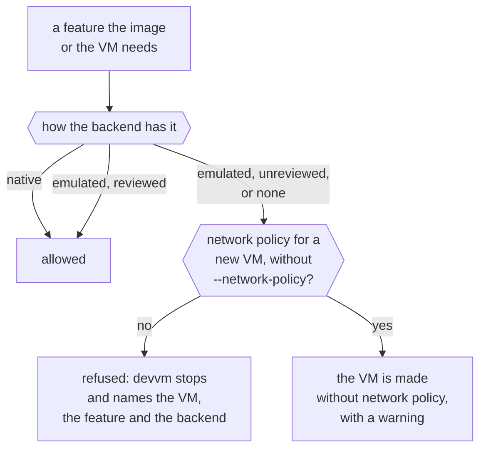

This page explains how a backend gives devvm what it needs to run a VM, what devvm does when a backend lacks something, and how devvm names VMs. devvm runs its VMs on [Lima](../backends/lima.md), and another backend would plug in the same way, through the features below ([how a backend plugs in](../contributing/_index.md#how-a-backend-plugs-in)).

## Features

Each thing devvm needs from a backend is a feature, such as building images, mounting the project folder or confining a VM to its proxy. `devvm doctor` lists them as "features" too, but they aren't the base image features you choose with `devvm setup`. Each backend declares how it has each feature:

- **native**: the backend does it itself.
- **emulated**: devvm builds it from other parts of the backend.
- **none**: the backend can't do it.

devvm uses an emulation only once its review has passed, and until then it refuses the emulation. A review takes a [design note](design.md#emulated-features), a threat check with the security-audit skill, and end-to-end checks that prove the guarantee.

`devvm doctor` lists Lima's features, and `devvm doctor --json` those of every backend devvm has. Both show an emulation whose review hasn't passed as `unreviewed`.

### The feature table

| Feature | What it is | Lima |
| --- | --- | --- |
| `build-image` | build images from the layer and feature scripts | native |
| `build-confinement` | builds reach the internet but not the host's loopback, or nothing | native: Seatbelt on macOS. On Linux, QEMU's `restrict=on` confines a build with no network, but a build with the internet reaches the host's loopback ([details](lima.md#confinement)) |
| `from` | `base` from a container image (`--from`) | native: devvm converts the image to a disk |
| `clone` | a project VM from an image | native: an APFS copy-on-write copy on macOS, and a qcow2 overlay on Linux ([details](lima.md#clones-and-overlays)) |
| `project-mount` | the project folder, read-write | native: virtiofs on macOS, and 9p on Linux |
| `agent-folders` | agents' host folders, read-only | native: read-only mounts, enforced by the host |
| `tools-share` | the shared tools, read-only | native: a read-only mount, enforced by the host |
| `egress-proxy` | network traffic only through devvm's proxy | native: Seatbelt on macOS, and on Linux QEMU's `restrict=on` with a `guestfwd` to the proxy ([details](lima.md#confinement)) |
| `ssh` | ssh for editors | native: Lima's ssh forward and config |
| `ports` | the listed ports forwarded to the host's loopback | emulated (reviewed): devvm's forwarder over Lima's ssh, for the listed ports alone, with Lima's own forwards off ([details](lima.md#ports)) |
| `ports-all` | every port forwarded, servers on the VM's loopback included | emulated (reviewed): the same forwarder, for whatever listens in the VM from port 1024 up, and never a port the host has ([details](lima.md#ports)) |
| `agent-forwarding` | ssh-agent forwarding, chosen when the VM is made | native |
| `agent-toggle` | turning a VM's ssh-agent forwarding on or off later | native |
| `cpus` | a VM's CPUs | native |
| `memory` | a VM's memory | native |
| `disk` | a VM's disk size | native: it grows but never shrinks |
| `docker-layer` | the [docker layer](../using/images.md#built-in-layers): Docker's engine running in the VM | native |
| `nix-layer` | the [nix layer](../using/images.md#nix): Nix's daemon and its store in the VM, with builds in Nix's sandbox | native ([details](images.md#the-nix-layer)) |
| `link` | links between VMs: a program in one VM reaches a port another VM publishes, by name | native: a link session of devvm's own over Lima's ssh, with remote forwards to `127.77.0.0/16` alone ([details](ports.md#links-between-vms)) |

### What each backend emulates

On Lima, devvm emulates forwarding ports, both the listed ones and every one, through its forwarder, and the emulation is reviewed ([port forwarding](ports.md)). Everything else on Lima is Lima's own.

## Missing and unreviewed features

devvm checks each feature an image or a VM needs this way:

Before devvm builds an image, makes or starts a VM, or changes a VM's settings, it checks that the backend has every feature the image or the VM needs. When the backend lacks one, devvm stops and names the VM, the feature and the backend (`backend_lacks`). It does the same for a feature the backend only emulates when that emulation's review hasn't passed (`backend_unreviewed`). devvm never falls back to something weaker, so a VM that asks for network policy never starts with an open network.

To get the feature, use a backend that has it. A VM keeps its backend, so that means making a new VM.

Network policy is the one exception, because it's on by default, and [When a backend lacks something](../backends/_index.md#when-a-backend-lacks-something) says what devvm does instead.

## VM names

A project VM's name is `devvm-<folder>-<hash>`. The folder part is up to 20 characters of the folder's name, in lowercase, with characters other than letters and digits turned into dashes, and the hash part is 14 hex digits of a hash of the folder's path.

A backend may need shorter names, and then devvm cuts the folder's part to fit. When fewer than 4 characters of it would fit, devvm refuses (`vm_name_no_room`). On Lima the room for a name depends on the Lima home's path, because Lima keeps each VM's ssh socket under it, so there the fix is a shorter Lima home (`lima_home_too_long`, [limits](../backends/lima.md#limits)).

Only a new VM gets a name, which fits the limit of the backend that makes it. devvm finds a folder's VM by the hash of the folder's path, which also names the VM's folder in devvm's data folder (`vms/<hash>/`), so an existing VM keeps the name and the backend its state records, whichever backend new VMs get.

## Which backends a launch asks

A launch asks a backend about its VMs only when some VM's state names that backend. It asks them to write the [ssh config](../using/ssh.md) and to check the SSH agent's folders. So a backend that no VM uses never runs during a launch, even when it isn't running or isn't installed ([a VM's backend](../backends/_index.md#a-vms-backend)).
