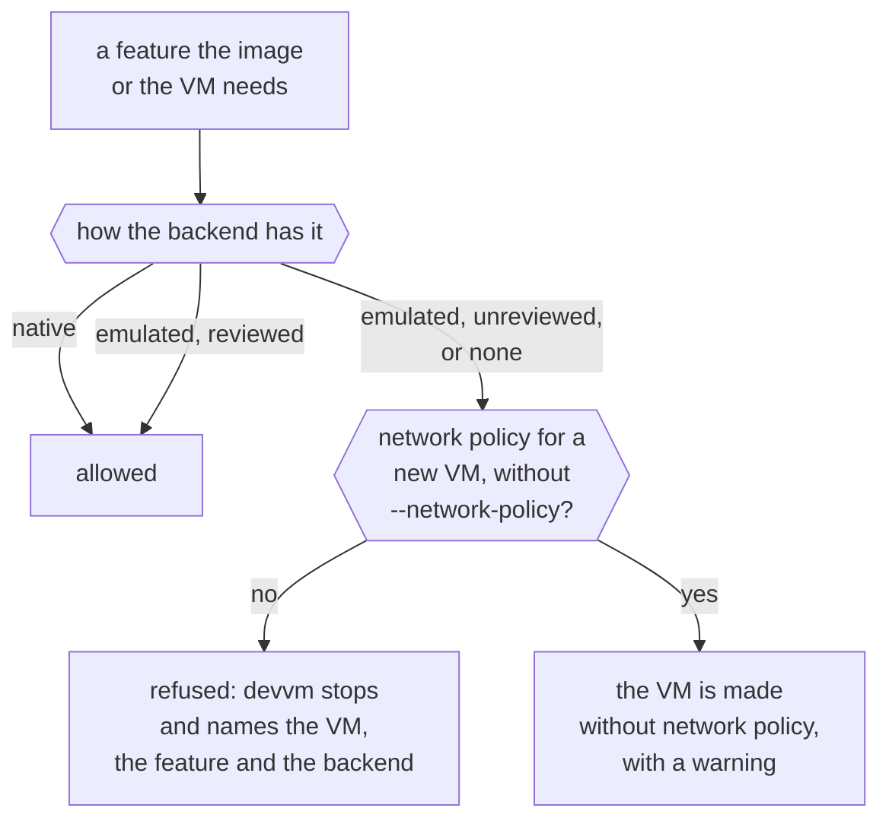

This page explains how each backend gives devvm what it needs to run a VM, what devvm does when a backend lacks something, and how devvm names VMs. [Backends](../backends/_index.md) compares the backends to help you choose one.

## Features

Each thing devvm needs from a backend is a feature, such as building images, mounting the project folder or confining a VM to its proxy. `devvm doctor` lists them as "features" too, but they aren't the base image features you choose with `devvm setup`. Each backend declares how it has each feature:

- **native**: the backend does it itself.
- **emulated**: devvm builds it from other parts of the backend.
- **none**: the backend can't do it.

devvm uses an emulation only once its review has passed, and until then it refuses the emulation. A review takes a [design note](design.md#emulated-features), a threat check with the security-audit skill, and end-to-end checks that prove the guarantee.

`devvm doctor` lists the features of every backend devvm has, and it shows an emulation whose review hasn't passed as `unreviewed`. Docker's `build-confinement` and `egress-proxy` depend on its engine, so the Docker column shows them only once devvm has asked the engine, which `devvm doctor --backend docker` does.

### The feature table

| Feature | What it is | Lima | smolvm (experimental) | Docker (experimental) |
| --- | --- | --- | --- | --- |
| `build-image` | build images from the layer and feature scripts | native | native: a machine from Ubuntu's container image runs the scripts, and devvm then packs it (`pack create --from-vm`). Each image is a full pack, about 450 MB for `base` ([details](smolvm.md#building-images)) | native: a container from Ubuntu's container image runs the scripts with no init system, and devvm then commits it (`docker commit`). Each image shares its parent's layers ([details](docker.md#building-images)) |
| `build-confinement` | builds reach the internet but not the host's loopback, or nothing | native: Seatbelt on macOS. On Linux, QEMU's `restrict=on` confines a build with no network, but a build with the internet reaches the host's loopback ([details](lima.md#confinement)) | native: its default network refuses the host's loopback, and a build that reaches nothing gets no network | native on an engine of this Linux machine, whose default network doesn't reach the host's loopback, and a build that reaches nothing gets no network. Emulated (reviewed) on Docker Desktop, whose default network reaches the host's loopback (`host.docker.internal`): the build gets an internal network of its own, no `NET_RAW`, and a proxy of devvm's that allows any host but the host's own and internal addresses. None on other engines ([details](docker.md#building-images)) |
| `from` | `base` from a container image (`--from`) | native: devvm converts the image to a disk | native: smolvm boots registry images, by digest | native: any image Docker has or pulls |
| `clone` | a project VM from an image | native: an APFS copy-on-write copy on macOS, and a qcow2 overlay on Linux ([details](lima.md#clones-and-overlays)) | native: a machine from the image's pack ([details](smolvm.md#its-machines)) | native: a container from the image, which shares the image's layers and has its home in a volume of its own ([details](docker.md#whats-devvms-in-docker)) |
| `project-mount` | the project folder, read-write | native: virtiofs on macOS, and 9p on Linux | native: virtiofs. Files the VM makes are the user's on the host, with mode 0600 | native: a bind mount. Docker Desktop mounts only folders in its file sharing list, and on Linux, files that root makes in the VM are root's on the host ([details](docker.md#what-devvm-sets-on-a-vm)) |
| `agent-folders` | agents' host folders, read-only | native: read-only mounts, enforced by the host | native: read-only mounts, enforced by the host | native: read-only bind mounts, which root in the container can't unmount (no `CAP_SYS_ADMIN`). When an agent's folder is added or removed, devvm makes the container again from a commit of its own ([details](docker.md#changing-what-docker-fixes)) |
| `tools-share` | the shared tools, read-only | native: a read-only mount, enforced by the host | native: a read-only mount, enforced by the host. The tool images are uncompressed, because its kernel's EROFS has no compression | native: devvm unpacks the tools into a Docker volume, which VMs mount read-only and link, so tools added later show up in running VMs. Docker VMs don't use the EROFS images, because containers get no loop devices without `--privileged` ([details](docker.md#shared-tools)) |
| `egress-proxy` | network traffic only through devvm's proxy | native: Seatbelt on macOS, and on Linux QEMU's `restrict=on` with a `guestfwd` to the proxy ([details](lima.md#confinement)) | emulated (reviewed): an allow list of the host alone, DNS closed but for one name, and devvm's proxy deciding each connection ([details](smolvm.md#network-policy)) | emulated (reviewed) on Docker Desktop and on an engine of this Linux machine: the VM runs without `NET_RAW` on an internal network of its own with no address of the host's, and a relay on that network, which is devvm's Linux build in an empty image, passes its connections to devvm's proxy's socket on the host. None on other engines ([details](docker.md#network-policy)) |
| `ssh` | ssh for editors | native: Lima's ssh forward and config | emulated (reviewed): an sshd of devvm's on a port forwarded from the host's loopback, started after each start with new host keys and the VM's own key alone. Its ssh config entries ask for no forwarding out ([details](smolvm.md#ssh-for-editors)) | emulated (reviewed): no sshd listens. Each connection is an sshd of its own in the container (`sshd -i`), which `docker exec` runs through `devvm _docker-connect` as ssh's `ProxyCommand`, with new host keys at each start and the VM's own key alone ([details](docker.md#ssh-for-editors)) |
| `ports` | the listed ports forwarded to the host's loopback | emulated (reviewed): devvm's forwarder over Lima's ssh, for the listed ports alone, with Lima's own forwards off ([details](lima.md#ports)) | emulated (reviewed): devvm's forwarder over the VM's ssh, for the listed ports alone. smolvm forwards nothing itself but the VM's ssh ([details](smolvm.md#ports)) | emulated (reviewed): devvm's forwarder over the VM's ssh, for the listed ports alone, and the container publishes nothing ([details](docker.md#ports)) |
| `ports-all` | every port forwarded, servers on the VM's loopback included | emulated (reviewed): the same forwarder, for whatever listens in the VM from port 1024 up, and never a port the host has ([details](lima.md#ports)) | emulated (reviewed): the same forwarder, for whatever listens in the VM from port 1024 up, and never a port the host has ([details](smolvm.md#ports)) | emulated (reviewed): the same forwarder, over the VM's ssh through `docker exec` ([details](docker.md#ports)) |
| `agent-forwarding` | ssh-agent forwarding, chosen when the VM is made | native | native | emulated (reviewed): only ssh sessions forward an agent (`ForwardAgent`), which are devvm's shell and the sessions of its ssh config's entries, and no socket is mounted ([details](docker.md#ssh-agent-forwarding)) |
| `agent-toggle` | turning a VM's ssh-agent forwarding on or off later | native | emulated (reviewed): every VM is made forwarding, and each start gives it your agent, devvm's, or none, which is a path where no socket can be. devvm stops a VM that was started outside devvm ([details](smolvm.md#ssh-agent-forwarding)) | emulated (reviewed): devvm chooses the agent each session forwards at each start, as on Lima ([details](docker.md#ssh-agent-forwarding)) |
| `cpus` | a VM's CPUs | native | native | native: a quota, although BusyBox's `nproc` still counts every CPU |
| `memory` | a VM's memory | native | native | native |
| `disk` | a VM's disk size | native: it grows but never shrinks | native: it grows but never shrinks | none: Docker Desktop refuses a size, and Docker's containerd image store ignores it. `devvm size` shows what a VM holds ([details](docker.md#what-devvm-sets-on-a-vm)) |
| `docker-layer` | the [docker layer](../using/images.md#built-in-layers): Docker's engine running in the VM | native | native: devvm starts its daemon after each start | emulated (reviewed) where the engine has Sysbox's runtime (Linux): the VM's container runs under Sysbox, in a user namespace of its own, on a network of its own, with volumes for its engine and without network policy. None elsewhere, so use a VM backend ([details](docker.md#the-docker-layer)) |
| `nix-layer` | the [nix layer](../using/images.md#nix): Nix's daemon and its store in the VM, with builds in Nix's sandbox | native ([details](images.md#the-nix-layer)) | native: devvm starts its daemon after each start | none: its containers can't make the kernel namespaces that Nix's build sandbox needs, so use a VM backend ([details](../backends/docker.md#what-docker-vms-cant-do)) |

The backends also differ in isolation, which [Backends](../backends/_index.md#comparing-the-backends) compares.

### What each backend emulates

On Lima, devvm emulates forwarding ports, both the listed ones and every one, through its forwarder, and the emulation is reviewed, so devvm forwards ports by the same rules on every backend ([port forwarding](ports.md)). Everything else on Lima is Lima's own.

The smolvm column is tested with smolvm 1.32.2 on an arm64 Mac, and Linux hosts are untested. On smolvm, devvm emulates network policy, ssh for editors, forwarding ports (the listed ones and every one) and turning agent forwarding on or off, and each of these emulations is reviewed.

The Docker column is tested with Docker Desktop 4.94 (Docker 29.8) on an arm64 Mac and with Docker 29.1 on Ubuntu 26.04 (arm64). Docker Desktop and an engine on a Linux machine differ in what a container reaches on the host. devvm emulates ssh for editors, ports (the listed ones and every one) and agent forwarding, including turning it on or off, over one transport, which is a `docker exec` into the container that runs an sshd of devvm's for each connection. It emulates network policy, and build confinement on Docker Desktop, through an internal network of the VM's own and a relay to devvm's proxy. Where a Linux engine has Sysbox, devvm emulates the docker layer under Sysbox, and it refuses what Sysbox lacks ([design](design.md#docker)). Each of Docker's emulations is reviewed.

## Missing and unreviewed features

devvm checks each feature an image or a VM needs this way:

Before devvm builds an image, makes or starts a VM, or changes a VM's settings, it checks that the backend has every feature the image or the VM needs. When the backend lacks one, devvm stops and names the VM, the feature and the backend (`backend_lacks`). It does the same for a feature the backend only emulates when that emulation's review hasn't passed (`backend_unreviewed`). devvm never falls back to something weaker, so a VM that asks for network policy never starts with an open network.

To get the feature, use a backend that has it. A VM keeps its backend, so that means making a new VM.

Network policy is the one exception, because it's on by default, and [When a backend lacks something](../backends/_index.md#when-a-backend-lacks-something) says what devvm does instead.

## VM names

A project VM's name is `devvm-<folder>-<hash>`. The folder part is up to 20 characters of the folder's name, in lowercase, with characters other than letters and digits turned into dashes, and the hash part is 14 hex digits of a hash of the folder's path.

A backend may need shorter names, and then devvm cuts the folder's part to fit. When fewer than 4 characters of it would fit, devvm refuses (`vm_name_no_room`). On Lima the room for a name depends on the Lima home's path, because Lima keeps each VM's ssh socket under it, so there the fix is a shorter Lima home (`lima_home_too_long`, [limits](../backends/lima.md#limits)).

## Which backends a launch asks

A launch asks a backend about its VMs only when some VM's state names that backend. It asks them to write the [ssh config](../using/ssh.md) and to check the SSH agent's folders. So a backend that no VM uses never runs during a launch, even when it isn't running or isn't installed ([choosing a backend](../backends/_index.md#choosing-a-backend)).
