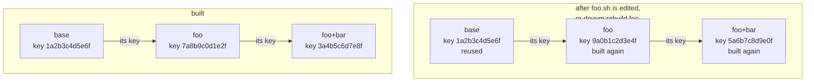

This page explains how devvm builds images and shared tools, how it keys and caches them, and how it checks what they start from: Ubuntu's cloud image, a container image from `--from`, and each tool's downloads. [Images and tools](../using/images.md) covers choosing, rebuilding and cleaning up images, and [Starting from a container image](../using/from.md) covers `--from`.

## Building

devvm builds each image in a VM of its own, and that VM then is the image:

1. For base, devvm makes a new VM from [Ubuntu's cloud image](#ubuntus-cloud-image) with `base.yaml`'s settings, or, with `--from`, from a container image [converted into a disk](#how-its-converted). A layer's VM is a copy of its parent image.
2. The VM starts confined, so it reaches the internet but not the host's own services on loopback, and it forwards no ports. How that's enforced depends on the backend, as [Lima](lima.md#confinement) and [Docker](docker.md#building-images) describe. devvm can't build images on Docker Desktop yet.
3. The script runs. For base, that's `assets/layers/base.sh` and then the [features](../using/customizing.md) you chose, and for a layer, it's the layer's script.
4. The VM stops. devvm writes the image's record last, with its chain, what base started from, and its C library.

Nothing from the host is mounted into a build, because layer scripts run third-party installers, which mustn't see your files. Behind a company proxy, a build on Lima or Docker goes through a proxy of devvm's on this machine for that build alone, which goes through the company proxy. The scripts' commands get only that proxy's address, with a password devvm makes for the build, so neither the build nor its image ever has the company proxy's password ([a company proxy](design.md#a-company-proxy)). base gets `base.yaml`'s CPUs, or as many as the host has when it has fewer. It gets `base.yaml`'s memory, or half the host's memory when `base.yaml`'s would leave the host less than 2 GiB. The images built on base, and their VMs, keep that size ([base's size](#bases-size)).

## Keys and caching

devvm builds images in layers and caches them, as Docker does. `base` comes first, and each layer is built on its parent, so `foo+bar` is `bar` on `foo` on `base`. A layer starts from its parent and runs its script inside it, and devvm stores it under a key, which is a hash of everything that goes into it. When an image with that key already exists, devvm uses it, and otherwise it builds one.

| Image | Its key hashes |
| --- | --- |
| `base` | the backend, `assets/base.yaml`, `assets/layers/base.sh`, the chosen features in order (each name and its script), its rebuild counter, and with `--from`, the image, its digest and the scripts that convert it; on Lima, Ubuntu's pinned cloud image for the host (its release and SHA-256); on smolvm and Docker, their scripts for containers and Ubuntu's container image, pinned by digest |
| a built-in layer | its parent's key, its name, its script (`assets/layers/<name>.sh`) and its rebuild counter |
| a custom layer | its parent's key, its name, its script (`~/.config/devvm/layers/<name>.sh`) and its rebuild counter |

A key is the first 12 hex digits of a SHA-256. Each input goes into the hash with its length, so different inputs never hash the same bytes. An image's record keeps its chain, which is the key of each image it's built on, from `base` up.

Each key hashes its parent's, so a new key anywhere in the chain changes the key of every image above it:

This means:

- When you edit a script, its layer and every layer above it rebuild the next time they're used, and the layers below are reused.
- Each backend builds its own images and never uses another backend's.
- With `--from`, base's key has the image's [digest](#digests), so when the tag moves to a new image, base and everything on it rebuild.
- A layer whose script is gone hashes as missing, so its images don't match any more.
- Nothing else counts. Features you haven't chosen change no key, and neither do network policy files (`*.policy`), which the proxy reads at run time and which never go into an image.

An image whose key doesn't match its inputs any more is stale. It stays until it's deleted ([cleaning up](../using/images.md#cleaning-up)), and the next use builds a new one.

## Rebuilding

`devvm rebuild` works through the rebuild counter, which each image's key hashes. The counter is the file `~/.local/share/devvm/images/rebuilds/<image>`, or `<image>@<from>` with `--from`, so each image that base starts from has a counter of its own. A rebuild writes a new value into it, made of the time and a random part, so the image gets a new key, and so does every image built on it. devvm lists those images first (`rebuild_replaces`). After the build, it deletes every stale image that no VM uses, which includes the old image and those built on it, and they're built again, on the new image, the next time they're needed. On Linux hosts, an image whose disk VMs are overlays of stays, and devvm says which VMs use it.

A VM keeps the image it was made from, and its state keeps that image's chain. When a key in the chain changes, after an edited script or a rebuild, devvm warns on each launch that the VM is outdated (`vm_outdated`) and leaves the VM as it is ([outdated VMs](../using/images.md#outdated-vms)). Shared tool images have keys of their own, which [building tools](#building-tools) describes.

## Ubuntu's cloud image

On Lima, base starts from a pinned, dated release of Ubuntu 26.04's cloud image (`release-YYYYMMDD` on cloud-images.ubuntu.com), and devvm pins the image's SHA-256 for arm64 and amd64 with it. The pin moves with base's package snapshot to the newest release dated before the snapshot, as smolvm's and Docker's container image does ([maintaining](../contributing/maintaining.md#updating-pinned-versions)). A release with newer packages than the snapshot's would leave apt unable to install the packages that depend on their exact versions.

devvm checks the image before it uses it:

- The release's `SHA256SUMS` must list the pinned SHA-256 for the host's image, and the download must match it. devvm refuses any other checksum (`ubuntu_checksum_unpinned`).
- When `gpgv` is installed (`brew install gnupg`, or `apt install gpgv`), `SHA256SUMS` must be signed by Ubuntu's cloud image key, which is pinned in `assets/layers/ubuntu-cloud.gpg` (fingerprint `D2EB44626FDDC30B513D5BB71A5D6C4C7DB87C81`). No other key counts. When the signature is missing or doesn't match, devvm refuses the image (`ubuntu_bad_signature`).
- When `gpgv` isn't installed, devvm says so (`ubuntu_unsigned`), and the pinned SHA-256 still decides.

Ubuntu removes its dated releases after a few months. Once the pinned release is gone, base can't be built on Lima (`no_ubuntu_image`) until you update devvm to a version with a newer pin ([troubleshooting](../using/troubleshooting.md)).

The pinned release and its SHA-256 are part of base's key, so a new pin rebuilds base. base's record keeps the address and SHA-256 of the image it was built from.

## Base's settings and pins

`assets/base.yaml` holds base's VM settings, which are 4 CPUs, 8 GiB of memory and a 100 GiB disk, and devvm fits the CPUs and memory to the host ([base's size](#bases-size)). `assets/layers/base.sh` installs base, and the optional [features](../using/customizing.md) you chose follow it.

Each download in `assets/layers/base.sh` is pinned to a version and a SHA-256 at the top of the script, and the build fails if a checksum doesn't match. Each feature pins its downloads in the same way, at the top of its script, `assets/features/<name>.sh` in the repo, which is built into devvm. While base builds, apt's packages come from a dated snapshot of Ubuntu's archive (`apt_snapshot`, from snapshot.ubuntu.com), and project VMs use the live archive ([base](../using/images.md#base)).

## Base's size

devvm fits base's CPUs and memory to the host with one rule that every backend uses. Base gets `base.yaml`'s 4 CPUs, or the host's count when the host has fewer. Docker refuses a `--cpus` above its machine's count, and a Lima `vz` VM given more CPUs than the Mac has can start so slowly that its ssh never comes up, as [Lima's issue](https://github.com/lima-vm/lima/issues/1621) reports. Base gets `base.yaml`'s 8 GiB of memory, or half the host's whole GiB when 8 GiB would leave the host less than 2 GiB, because a VM asking for all of the host's memory doesn't start.

- **Lima** passes the fitted size to `limactl create` as `--cpus` and `--memory`, for base and for the VM that converts a `--from` image. The images built on base are clones of it, so they and their VMs keep that size.
- **smolvm** sets the fitted size on base's build machine and on every VM you give no size, because a pack would otherwise give a VM its build machine's CPUs and memory.
- **Docker** fits to the engine's machine, as `docker info` reports its CPUs and memory, for base's build container and every VM you give no size. Until devvm has read `docker info`, base gets `base.yaml`'s size.

A size you set with `--cpus`, `--memory` or `devvm size -g` replaces the fitted one. devvm checks that size against the same rule, so it refuses more memory than the host's whole GiB less 2, or half of them on a host of 4 GiB or less, and the fitted memory always passes ([size](../using/ports-size.md#size-and-ports)). The fitted size isn't in image keys, because the host's size doesn't change what an image holds.

## The docker layer

The built-in [`docker` layer](../using/images.md#built-in-layers)'s script is `assets/layers/docker.sh`, embedded in devvm, and its [allowlist](../safety/network.md#allowlists) is `assets/layers/docker.policy`. The script pins the checksum of the signing key of Docker's apt repository and each package's version at the top. On `--from alpine`, it installs Alpine's own packages, which aren't pinned. Running Docker's engine in a VM is a backend feature of its own, `docker-layer` ([features](backends.md#features)).

## The nix layer

The built-in [`nix` layer](../using/images.md#nix)'s script is `assets/layers/nix.sh`, and its allowlist is `assets/layers/nix.policy`. The script pins Nix's release tarball, the direnv binary and nix-direnv's `direnvrc` at the top, each with its version and SHA-256, which are per architecture for Nix and direnv, and fetches them with `devvm-fetch`. `scripts/bump.sh nix direnv nix-direnv` moves them. Nix's version is the one nixos.org's installer fetches, at least 2.35.3, which fixes the scripted installer's store ownership (GHSA-hf6w-2rg9-v84g) and the daemon's store corruption through `repair` (CVE-2026-110450). Nix's newer releases come with another installer, from artifacts.nixos.org, so the layer's pins change shape when it moves to one of them.

The script runs the tarball's own installer as `install --daemon --yes --no-channel-add`, which copies the tarball's store into `/nix`, downloading nothing, makes the `nixbld` build users and, under systemd, starts `nix-daemon`. On OpenRC, which a base `--from alpine` runs, the script adds a service of devvm's, `/etc/init.d/nix-daemon`, to the default runlevel and starts it, and before the install it adds Alpine's `xz`, unpinned, which GNU tar needs for the tarball. Nix's own binaries are static or linked against the C library in its store, so they run on musl. A VM with no init system, which is how smolvm runs an image, gets its daemon from the script and then from devvm after each start ([smolvm](smolvm.md#no-init-system)). Its extra settings turn on flakes and the `nix` command and keep `trusted-users = root`, so only root can choose caches and signing keys. They also set `sandbox = true` and `sandbox-fallback = false`, so a build fails where the kernel can't sandbox it, rather than run outside the sandbox without a word. The installer writes any proxy variables it finds into a systemd drop-in for the daemon, which would put a build's proxy into the image, so the script runs it without them. It points Nix at the system's CAs, which hold devvm's and yours. After the install, the script checks that every path in the store is root's, and it fails otherwise.

It also adds Nix's default profile to the end of sudo's `secure_path`, through `/etc/sudoers.d/devvm-nix`, so `sudo nix` works, and appends Nix's profiles to the `PATH` that `BASH_ENV` gives shells that read no profile. direnv goes into `/usr/local/bin` and nix-direnv into `/usr/local/share/nix-direnv`. A file in `~/.config/direnv/lib` loads nix-direnv and puts each project's direnv layout under `~/.cache/direnv/layouts`, named by a hash of the project's path, so its cached dev shell and garbage collector roots stay in the VM's home and out of the project folder. direnv's shell hook is in `~/.bashrc.d/direnv.sh`, which bash loads before `mise.sh`, and since each hook puts itself first in `PROMPT_COMMAND`, direnv's runs after mise's, and a dev shell's `PATH` comes before the shared tools'.

The daemon doesn't read `/etc/environment`, so the [VM's setup](network.md#the-vms-setup) gives it the proxy when network policy is on, in a drop-in of its own under systemd, or else in `/etc/conf.d/nix-daemon`, which OpenRC reads for the service. With network policy, the setup also puts the [shared Nix cache](network.md#the-shared-nix-cache) first in Nix's substituters, in `/etc/nix/devvm-cache.conf`, which it removes when network policy is off. Running the layer is a backend feature, `nix-layer` ([features](backends.md#features)), and building it also needs the feature, so a backend without it refuses `devvm build nix`. Docker lacks it, because its containers can't make the kernel namespaces that Nix's sandbox needs, and with `sandbox-fallback = false` every build there would fail.

## How it's converted

With `--from`, devvm turns the container image into a disk in a throwaway VM, `devvm-oci-build`, which it makes from Ubuntu's cloud image with `base.yaml`'s settings. No Docker is needed:

1. [crane](https://github.com/google/go-containerregistry/tree/main/cmd/crane) downloads exactly the [digest](#digests) in `base`'s key, for this machine's architecture, and flattens its layers. crane is pinned like every download: its version and SHA-256 are at the top of `assets/oci/build.sh`, checked with `sha256sum`.
2. `assets/oci/bootify.sh`, in a chroot of the image, adds what a container lacks to boot as a VM: a kernel and initramfs, an init system (systemd, or OpenRC on Alpine), cloud-init, sshd and sudo, and your user in the VM.
3. `mke2fs` writes the image's files into a raw ext4 disk, and `base` grows it to `base.yaml`'s size.

devvm then deletes the build VM and creates `base` from the disk, booting its kernel and initrd directly. One conversion runs at a time, so another devvm's conversion waits for it. A conversion also takes over the turn of a devvm that ended without giving it up.

## Digests

`base` is keyed by the container image's digest, not its tag. When devvm builds, it asks the image's registry for the digest anonymously, with a `HEAD` request for the image's manifest, which doesn't count against Docker Hub's pull limit. When the registry asks for a token, devvm gets one from the registry's token service, at an `https` address only. The digest goes into `base`'s key, and devvm records it for each image in `~/.local/share/devvm/images/from-digests`. An existing VM's state records what its base was made from (`from=`).

devvm refuses a reference it can't read (`bad_from`). When it can't reach the registry, it uses the digest it recorded last, with a warning (`from_cached_unreachable`), and with none recorded, it fails (`from_unreachable`). [Tags and digests](../using/from.md#tags-and-digests) covers when a moved tag rebuilds base, how `@sha256:` pins an image, and how devvm reads a reference.

## The image is untrusted

The container image's own code runs as root in the build VM, so devvm treats what it writes as hostile:

- The build VM is [confined](lima.md#confinement) like any build, so it reaches the internet, for crane, but not this machine's own services. It mounts only devvm's `oci/` folder ([written out](install.md#devvms-own-files) in `~/.local/share/devvm/assets/<hash>`), read-only, with devvm's `guest/` folder beside it, also read-only, when there are [company CAs](#a-companys-ca-in-builds), and one writable folder of devvm's own, `vm/` in a temporary folder, `devvm-oci.<random>`. devvm writes nothing there itself except an [image only Docker has](#images-only-docker-has), before the VM starts.
- devvm checks what comes out once the build VM is gone. Each file must be a regular file, because a link could point Lima at a file on this machine. The kernel command line can hold only letters, digits, spaces and `=,./:_-`, because it goes into Lima's config. The C library must be `gnu` or `musl`. The disk must be raw ext4, because another format, such as qcow2, can name a file on this machine as its backing file. devvm refuses anything else (`convert_bad_output`), and it doesn't create `base`.
- devvm deletes the build VM and the temporary folder however the run ends, Ctrl+C included.

## Images only Docker has

When the registry doesn't give devvm the image ([images only Docker has](../using/from.md#images-only-docker-has)), devvm keys `base` by Docker's image ID instead of a digest. devvm exports the image with `docker save` into the build VM's folder, where crane reads it, and it checks that the export is the image it looked up. The image is saved by name, so if the tag has moved since, for example after a rebuild, devvm stops and asks you to run it again. devvm only asks Docker about images, with `docker image inspect`, `docker info` and `docker save`.

## Versions

devvm doesn't pin the shared tools' versions ([shared tools](../using/images.md#shared-tools)). Instead, `assets/shared-tools/mise.toml` says which releases to follow, which is the latest of each tool, and Node 24. The first time a tool is needed, devvm resolves it to upstream's newest release and writes that into the tools lock, `~/.local/share/devvm/mise.lock`, with each download's checksum for every platform that VMs run (Linux, with glibc and with musl). Builds install exactly the lock's versions and check them against those checksums. Resolving needs this machine to be online once, and until it has been, devvm says so (`tools_need_resolve`).

The resolving runs on this machine with a mise of devvm's own. That mise is a pinned release, which devvm downloads once into `~/.local/share/devvm/mise/<version>` and checks against its SHA-256 before it runs it (`mise_checksum`). devvm never uses the mise you have installed, and nothing it does reaches your own mise config. Each run of that mise gets temporary folders for its data, cache, state and config, which devvm deletes afterwards, so `mise/<version>` holds only the binary. `devvm gc` deletes the folders of other versions (`Versions.StaleMise`), unless one changed in the last hour.

Sometimes a tool's newest version isn't published for every platform yet, for example when a release is still uploading, when a tag has no release, or for a few days after a Node release until its musl builds appear. devvm then takes the newest of the next five older versions that is published everywhere, and says so (`tool_stepped_back`). When none of them is, devvm says that too (`tool_no_download`). The next check tries the newest version again.

A new VM gets the lock's versions, and devvm checks the lock again first when the last check was more than a day ago. When a check fails, devvm uses the versions it found last (`tools_check_failed`). When `assets/shared-tools/mise.toml` changes, as it can in a devvm upgrade, devvm resolves the tools again. A VM lists its tool images in its state, so a newer version never changes a VM that has an older one. Older versions that no VM has are unused, and `devvm gc` deletes them.

## Building tools

devvm builds the tool images that an image name needs together with the image (`devvm build node+claude`), unless the share already has them. They build in a throwaway VM that devvm makes from base and confines like an image build. That VM never sees the share. It writes into a folder of its own, `~/.local/share/devvm/tools-build.<random>`, which devvm deletes once it's done. devvm then checks that each image is a plain file and not a link (`tool_bad_output`), moves it into the share and records its hash. Go builds in a VM of its own, never together with other tools. Only one build at a time writes to the share, so another devvm waits for it and gives up after ten minutes (`share_lock_held`).

Each tool image is named `<tool>-<version>-<key>.erofs`. Its key hashes the tool's entry in the tools lock (its version, its downloads and their checksums), `assets/shared-tools/build.sh`, the C library the image is built for and the backend's format. Lima's format is `build.sh`'s own, compressed EROFS, which adds nothing to the key. smolvm's is `plain-<hash>`, the same image rewritten uncompressed by `assets/smolvm/plain.sh`. Docker's is `dir-<hash>`, a compressed image that `assets/docker/unpack.sh` unpacks into Docker's tools volume. Each hash is of that backend's script. A new version, a new download or an edited build script builds the image again, and a base with a different C library, such as Alpine's musl, or a VM on another backend gets an image of its own. The share can therefore hold up to six builds of one version. When the lock has no download of a tool for the VM's platform, devvm doesn't build it and says to try again later (`tool_unbuilt`).

`devvm rebuild` refuses shared tools, because they aren't images and their versions come from the lock (`tools_not_images`).

## A company's CA in builds

Build VMs trust the CA certificates in `~/.config/devvm/ca` ([a company's CA](../using/settings.md#a-companys-ca)) while they build, and images never keep them. [Network policy](network.md#a-companys-ca) describes how devvm reads them and how `assets/guest/ca.sh` installs them.

A build's `ImageSpec.Trust` holds two scripts made from `ca.sh`, which run as root: `Add`, which writes the certificates from heredocs to a temporary folder and installs them, and `Remove`, which is `ca.sh` without a folder. Each script of the build also gets `trust.Env` exported at its start, so its tools find the CAs, and nothing of that is written in the VM. Each backend runs `Add` before anything in the build VM downloads, and `Remove` once the scripts are done, before the VM stops:

- **Lima:** `Add` runs right after the start, through `sudo sh`, then base's or the layer's scripts, then `Remove`, before the final `sync` and the stop.
- **Lima with `--from`:** the conversion's build VM, which is deleted afterwards, also runs `Add`. `oci/build.sh` gets `ca.sh`, from devvm's `guest/` folder mounted read-only, and runs it in the image's chroot with the CAs before `bootify.sh` and without them after it, so that Alpine's `apk` reaches its HTTPS mirrors. The converted base then builds as Lima's does.
- **smolvm and Docker:** `Add` runs right after the start, before `prepare.sh`, whose downloads come first in a container image (`apk` over HTTPS on Alpine), and `Remove` runs after `sshd.sh`, before the stand-ins go and the machine is packed or the container committed.
- **Shared tools:** `ToolsSpec.Trust.Add` runs before `build.sh` on every backend. devvm deletes the build VM and keeps only its output folder, so it needs no `Remove`.

An image is therefore the same with or without CAs, which is why its key holds none of them, and a tool image's key stays its lock entry, `build.sh` and the C library. When there are CAs, the build's numbered steps include the two scripts. A layer script that copies the system's bundle elsewhere keeps that copy.

**End-to-end checks** (`tests/e2e.sh`, `images`): a layer built with a test CA in the folder trusts it while its script runs, keeps its key once the folder is emptied, and a copy of its image booted without devvm has none of devvm's CA files. The smolvm and Docker sections check the same build, and Docker's also checks a container of the committed image.

## The share

devvm builds each tool version once for each backend and C library into a read-only image (EROFS) in `~/.local/share/devvm/tools`, with its hash next to it in `<image>.sha256`. Lima's and Docker's images are compressed, and smolvm's are uncompressed, because smolvm's kernel mounts no other format. That folder is mounted read-only in every VM at `/mnt/devvm-tools`, and each VM mounts the images its tools need at `/opt/devvm/tools/<tool>/<version>`, at boot and on every launch. On [Docker](docker.md#shared-tools), devvm unpacks the images into a volume, mounts that volume instead, and links each tool's folder where its image would be mounted. A VM can't change the shared images, even as root.

A tool that doesn't mount fails the launch (`tools_unmounted`). mise's `auto_install` stays on for a project's own version files, so without this check a tool that isn't mounted would download into the VM on first use without a word. The VM's mount script, `devvm-tools`, tries every image in the VM's list. It leaves out the empty mount point of one that fails, lists each failed image in `/run/devvm/tools-unmounted` and exits non-zero, which fails the launch's setup. The setup removes that list before anything else it runs, so a list left from the VM's boot isn't read after a failure that has nothing to do with the tools. devvm then reads the first 16 KiB of that list from the VM, and it gives up after 10 seconds, because root in the VM could make the read hang. It counts only a whole line that is one of the VM's own tool images from its state, so the error shows devvm's own names, never the VM's text. devvm reads the list with a command of its own because the setup's output goes straight to the run log, and a pipe for reading it would keep devvm waiting on any process that the setup left running.

At boot the same failure fails only the `devvm-tools` service, and the boot goes on. smolvm's machines and Docker's containers run no init system, so devvm mounts their tools at each start, and a failure there also lets the start go on. In every case, the launch's setup runs the mount script again and stops on the failure.

## Listing and cleaning up

[Listing images](../using/images.md#listing-images) describes the columns of `devvm images`. An `unfinished` image is a build that didn't finish, so it has no record. A tool image's `STATE` compares it with the tools lock and with the VMs' state:

- `current` is the tools lock's version, for the C library of the base that new VMs get, which `--from` changes.
- `in use` is another version, which a VM has in its state.
- `unused` is neither.
- `not built` is the lock's version of a tool that the share has other versions of.
- `not installed` means the share has nothing of that name's.

Listing never resolves the tools lock. Before there is a lock, no tool image is current, and the tool images that no VM has show no state.

A tool image's name doesn't say which backend and C library it's built for, so each build writes `<image>.target` beside it in the share, with its C library and its backend's format. `BACKEND` comes from that format, matched to the backend that has it, or to one with a format of the same kind (`plain-`, `dir-`) when the backend's script has changed since. An image without that file takes the target it's current for, else that of a VM whose state lists it, and otherwise shows `-`.

`devvm images rm` deletes images with their records. `devvm gc` deletes stale and unfinished images with their records, and unused tool images with their hashes and target records. With `--tools`, it also deletes the current tool images that no VM's state lists (`Share.NoVM`), but not one whose hash was written in the last hour, because a VM's launch builds its tools before it records them in its state. gc names the ones it keeps for that reason (`Share.NoVMRecent`), after the same filters as the ones it deletes, and with `--force` it deletes them too. Retention's `tools.unused-age` always keeps the hour.

`--force` needs a reliable sign that no VM is being made, which is the making lock, `~/.local/share/devvm/making.lock` (`Dirs.MakingLock`, held through `tools.Making`). Each devvm that makes a VM holds it shared from before it picks the VM's tools, and `devvm update` and adding a layer in place hold it until the VM's state lists the new tools. A new VM's devvm keeps it until just before the VM's first shell. Any number of devvms hold it at once, on every backend, because it's taken before the backend does anything. `devvm gc --tools --force` takes it exclusively without waiting (`flock` with `LOCK_NB`), after the share's lock, and holds it until it's done, so no VM picks its tools between gc's list and its deletions, and a devvm starting to make a VM meanwhile waits. When a VM is being made, gc gets `gc_force_making` and deletes nothing. It's an OS lock on an open file, which the system releases when the last descriptor closes, so a devvm that crashes or is killed lets go of it. Its descriptor is close-on-exec, so neither the processes devvm starts (a Lima host agent, a proxy) nor the shell that takes devvm's place inherit it. gc never waits for it, so it can't block, and the order the two locks are taken in can't deadlock: a devvm making a VM takes the making lock and then the share's, and gc takes the share's and only tries the making lock.

When a tool image that a new VM's state lists is gone by the VM's setup, `devvm-tools` can't mount it, the setup fails with `tools_unmounted`, and the VM and its state stay, because only an interrupt undoes a new VM. Every launch of the VM fails the same way until `devvm update` builds the missing images, as `Launch.buildTools` builds whatever the share lacks.

With `--backend`, gc acts only on that backend's images and on the tool images whose `BACKEND` is that backend, so one whose backend devvm can't tell stays. gc holds the share's lock throughout, so no tool build or `devvm update` changes the share meanwhile. A tool image is unused only when compared with the tools lock, so before there is a lock, gc deletes none. Because `current` is for the C library of the base that new VMs get, the musl tool images of an Alpine VM are unused once it's gone, unless you give gc that `--from`.

Without `--backend`, gc also trims the [shared Nix cache](network.md#the-shared-nix-cache) to its cap, deleting its least recently used files under the lock that the VMs' proxies take, and with `--nix-cache`, it deletes all of the cache's files. `devvm images` ends with what the cache takes of its cap when it holds anything.
