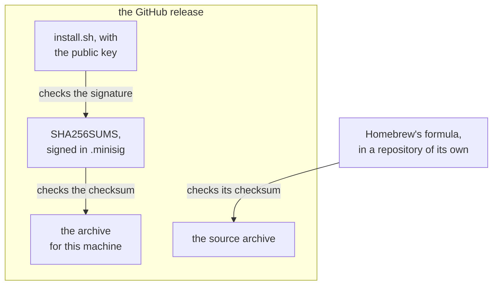

This page explains what devvm's install script downloads and checks, what `devvm doctor --json` reports, where devvm keeps its own files, and what happens to older versions when you upgrade. [Installing](../getting-started/install.md) covers the commands you run.

## The install script

The script installs the release it comes with, or the one that `--version` names. Before it downloads anything, it checks whether Homebrew installed devvm, which it does when `brew` is on `PATH`. The check never runs `brew`, because Homebrew can download its own Ruby when it runs. Instead, the script looks for a version folder in `Cellar/devvm` in each place Homebrew keeps its Cellar: the folder next to the `brew` it found on `PATH` (`<brew's folder>/../Cellar`), `HOMEBREW_CELLAR` and `HOMEBREW_PREFIX/Cellar` when they're set, and the Cellar in `/opt/homebrew`, `/usr/local` and `/home/linuxbrew/.linuxbrew`. When Homebrew has devvm, the script stops with an error that says to run `brew upgrade devvm`, or `brew uninstall devvm` first, and exits with status 1, in a terminal or without one. `--force` skips this check. Then it installs in four steps:

1. It downloads the archive for this machine and the release's `SHA256SUMS`, over HTTPS only. The archive is `devvm-<version>-<os>-<arch>.tar.gz`, where the OS is `darwin` or `linux` and the processor is `arm64` or `amd64`. On Apple silicon, the script picks `arm64` even when it runs under Rosetta.
2. It checks the signature of `SHA256SUMS`, then the archive's checksum, as [the signature](#the-signature-and-what-it-trusts) describes. When either check fails, it installs nothing.
3. It puts devvm, which is one binary with its README, changelog and license, in `~/.local/lib/devvm/<version>`, and links `~/.local/bin/devvm` to it. When `~/.local/bin` isn't on `PATH`, the script says how to add it.
4. Unless you pass `--no-deps`, it runs `devvm doctor --json` and offers the [fixes](#devvm-doctor---json) that devvm reports, asking before each one. Then it runs `devvm doctor`, which shows doctor's warnings too, even when nothing is missing.

At the end, when `~/.local/bin` is on `PATH`, the script looks up which devvm `PATH` finds first with `command -v devvm`. It resolves that path's links and those of `~/.local/bin/devvm` with `readlink -f`, and when they differ it warns, naming the other copy's path and saying to remove it or to put `~/.local/bin` first. It only looks the other copy up and never runs it. When `~/.local/bin` isn't on `PATH`, the script prints only how to add it, so you don't get both.

`devvm doctor` makes the same check. It looks up `devvm` on `PATH`, resolves its links and those of the running binary, and when they differ it prints a warning naming both. It skips the check when no devvm is on `PATH`. The warning doesn't change its exit status, and `--json` lists it among the warnings rather than the problems, so the install script doesn't offer it as a fix.

On macOS, the [Docker](../backends/docker.md#requirements) backend fetches one more file the first time a Docker VM or build needs it. That file is the same release's Linux archive, and devvm checks the devvm in it against the SHA-256 that the installed devvm has of it before using it. Homebrew's devvm already has its Linux build, which Homebrew builds from source.

## The signature and what it trusts

`curl … | bash` trusts everything in the release, and Homebrew checks the source against a checksum kept outside it:



The release's `SHA256SUMS` is signed in `SHA256SUMS.minisig`, made with the maintainer's minisign key. The key's public half is in the script and in `packaging/minisign.pub`. Without [minisign](https://jedisct1.github.io/minisign/) (`brew install minisign`), the script says so, prints the command to check the signature by hand, and checks only the checksum. A script that isn't from a release has no key, and it also checks only the checksum.

The signature catches an archive or a `SHA256SUMS` that someone replaced, which the checksum alone can't. It can't catch a release that was replaced whole, because `curl … | bash` runs the `install.sh` from that same release, key included, so the one-liner trusts GitHub's release files. Homebrew doesn't trust them, because the formula's checksum lives in a repository of its own, and a replaced GitHub release wouldn't match it. You can also download `install.sh` and read it before you run it.

## devvm doctor --json

`devvm doctor --json` prints what doctor finds as one JSON object, for scripts such as the install script, as [output for scripts](../getting-started/commands.md#output-for-scripts) describes. It prints nothing else, because its problems and warnings are in the JSON, and it succeeds whatever is missing. A failure that stops the check, such as a backend devvm doesn't have, still goes to standard error and makes it fail.

- `backend` is the backend that doctor checked, the one new VMs get or the one `--backend` names.
- `problems` has what that backend is missing, each with its `key`, the `fix` command, and the `message` that `devvm doctor` prints for it. The `fix` is a command whose words are separated by spaces, without shell syntax, or `null` when there's none to run, for example when virtualization is turned off in the firmware.
- `warnings` has the messages of doctor's warnings, which have no keys, because there's nothing for a script to fix. They're about another devvm on `PATH`, low free space, a machine with less than 8 GiB of memory or fewer than 4 CPUs, and each line of `~/.config/devvm/policy`, `~/.config/devvm/layers/*.policy` and `~/.local/share/devvm/vms/*.policy` that isn't a rule (`policy_not_rule`).
- `docker` says whether Docker is installed, which only `--from` with an image that only Docker has needs.
- `features` has, for each backend, how it has each feature, as `native`, `emulated`, `unreviewed` or `none`. The example below shows two of Lima's features.

```json
{
  "version": 1,
  "backend": "lima",
  "problems": [
    {
      "key": "lima",
      "fix": "brew install lima",
      "message": "Lima isn't installed. Run brew install lima to install it."
    }
  ],
  "warnings": [],
  "docker": true,
  "features": {
    "lima": {
      "agent-forwarding": "native",
      "disk": "native"
    }
  }
}
```

These are the keys:

| Key | Missing | Fix |
| --- | --- | --- |
| `os`, `arch` | a host the backend runs on | none |
| `macos` | macOS 13 or newer | none |
| `lima` | Lima 2.0 or newer, working | `brew install lima` (`upgrade`, `reinstall`) with Homebrew, otherwise none |
| `qemu` | QEMU, on Linux | your package manager's install (apt, dnf, pacman or zypper), otherwise none |
| `kvm` | `/dev/kvm`, on Linux | none: turn on virtualization |
| `kvm-access` | access to `/dev/kvm` | `sudo usermod -aG kvm USER`, then log in again |
| `lima-config` | no Lima global configs in devvm's Lima home ([details](lima.md#a-lima-home-of-its-own)) | none: move them out |
| `docker` | Docker, for the Docker backend | none: install Docker Desktop, or Docker's engine on Linux |
| `docker-engine` | Docker's engine, running and reachable | none: start it |
| `docker-access` | access to Docker's socket, on Linux | `sudo usermod -aG docker USER`, then log in again |
| `docker-version`, `docker-os`, `docker-arch` | Docker 29.1 or newer, running Linux containers of this machine's processor | none |

The install script reads `problems` with `awk`, so it needs no JSON tool on this machine. It relies on the layout that devvm writes, with one field on each line, and it reads a problem's `key`, `fix` and `message` from their lines, with their escapes undone. It offers to fix three of these keys, asking first, and prints the message for the others:

- For `lima`, it runs the fix when there is one, which is Homebrew's. Without Homebrew, it offers Lima's latest release instead, which it checks against that release's `SHA256SUMS` and installs into `~/.local`.
- For `qemu` and `kvm-access`, it runs the fix when there is one, and the fix uses sudo. After you join the `kvm` group, the script doesn't run `devvm doctor`, because the group applies only to new logins, and it tells you to log out and back in first.

With `--yes`, the script answers yes to every question. Without a terminal and without `--yes`, it installs none of the fixes and says so.

## devvm's own files

devvm is one binary. Its own files are built into it, so a copy of it runs anywhere. They are `base.yaml`, base's scripts and policy, the features, the shared tools' config and build script, what devvm sends into VMs, and `--from`'s conversion. The binary is the only copy, and devvm never writes them to a folder of its own that outlives a run. Lima gets `base.yaml` on `limactl create`'s standard input, VMs' proxies read devvm's built-in policies from the binary, and `--from`'s build writes the conversion's scripts into its own temporary folder, which it deletes when the build ends. So editing a file on disk can't change devvm's built-in rules or what goes into an image.

## Upgrading

When the script installs a new version, it removes the older versions in `~/.local/lib/devvm`, except a version that a running VM's proxy, or QEMU on Linux, still runs. A later install removes that version once nothing runs it. A VM's proxy moves to the new version at the VM's next launch (`devvm` in its folder), and QEMU moves when the VM next starts.
