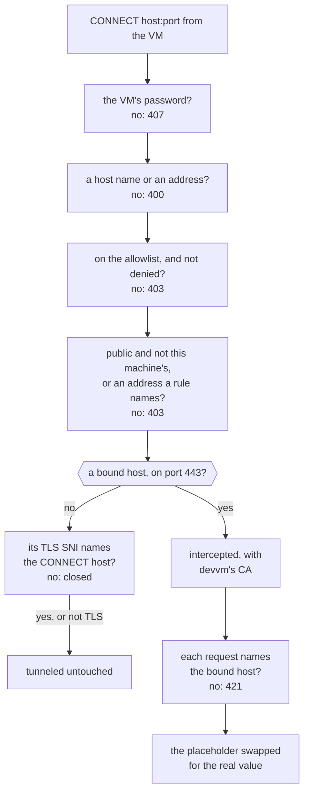
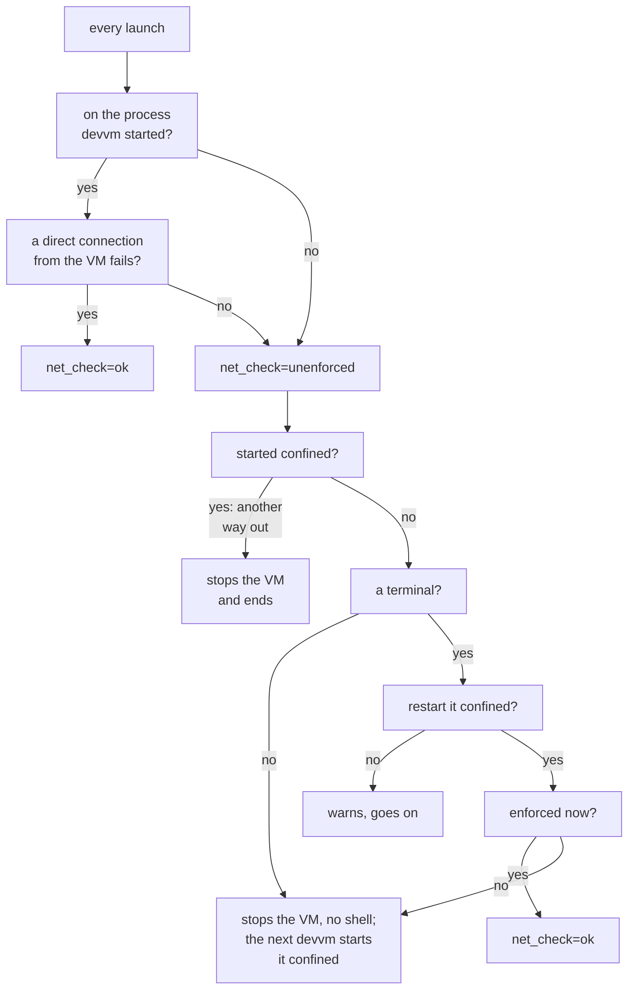

This page explains how devvm confines a VM to its proxy, what the proxy does with each connection, and how your secrets get into the VM's requests without the VM holding them. [Network policy](../safety/network.md) covers turning it on, the allowlists and their rules, the secrets and the logs as you use them.

## Starting a VM with network policy

A VM's state records its choice as `net=on` or `net=off`. When devvm starts a VM with network policy, it takes these steps in order:

1. It makes its CA, unless it has one with over a week left, and on macOS it keeps the CA out of Time Machine.
2. It writes the VM's [secrets](#secrets) as the VM's proxy sees them.
3. It starts the VM's [proxy](#the-proxy) on a free port on the host's loopback, and waits for the proxy to say it's listening.
4. It starts the VM [confined](lima.md#confinement), with the VM's proxy settings pointing at the proxy. On smolvm and Docker the confinement is emulated ([smolvm](smolvm.md#network-policy), [Docker](docker.md#network-policy)).
5. It runs [the self-check](#the-self-check) before the VM's setup and before its shell.
6. It sets the VM up, as [the VM's setup](#the-vms-setup) describes. The setup puts devvm's CA in the VM, points the tools that don't read the environment at the proxy, and writes the VM's placeholders and its [agents' logins and settings](#agents-logins-and-settings) with your keys taken out.

## VMs that can't have it

devvm makes a VM without network policy, and warns you, when the VM's backend can't confine it to its proxy (`net_off_backend`) or when it's a Docker VM with the docker layer (`net_off_docker_layer`).

## The proxy

One proxy runs for each VM. It runs on the host as `devvm _proxy`, a hidden command, and listens on a loopback port. The VM reaches nothing else, so every connection the VM makes goes through its proxy.

Other programs on the host can also reach that port, so the port alone doesn't identify the VM. Every request must carry the VM's password in `Proxy-Authorization`, with the user `devvm`, or it gets `407`. Each VM has its own random password in its proxy settings. The proxy reads the password from a file only you can read, never from its arguments, which other users can see, and it refuses to start without one. The VM's settings also get the password through files ([Lima](lima.md#a-lima-home-of-its-own), [smolvm](smolvm.md#what-devvm-sets-on-a-vm)).

For each connection, the proxy does the following:

- It checks `CONNECT host:port` and absolute-form requests (`GET http://host/…`) against the VM's [policy files](#policy-files), and then tunnels or forwards the allowed ones untouched.
- It takes only host names, made of letters, digits, `-`, `_` and `.`, and addresses. Anything else gets `400` before the policy or the log sees it.
- It resolves names itself and dials the addresses it checked. It refuses the host's own addresses and internal ones unless a rule names the address. Internal addresses are loopback, private, link-local, multicast, unspecified, CGNAT `100.64.0.0/10` and the other ranges that aren't the public internet, and a NAT64 address `64:ff9b::a.b.c.d` counts as its IPv4 address.
- It requires a TLS ClientHello in a tunnel to name the `CONNECT` host in its SNI. The proxy doesn't see the `Host` inside the encrypted traffic, so a CDN that routes by it can reach other sites it serves.
- For a host with a bound secret, it replaces the placeholder in one header with the real value, as [how the proxy puts them in](#how-the-proxy-puts-them-in) describes. Everything else passes unread.
- It logs every decision ([log files](#log-files)).

A `CONNECT` tunnel meets the proxy's checks in this order:

On smolvm the proxy also decides each connection the VM opens, before smolvm makes it. It takes over the connections to itself and refuses the rest ([details](smolvm.md#network-policy)). Docker's VMs can't reach the host's loopback, so on Docker the proxy also listens on a unix socket only you can reach, and a relay on the VM's own network passes the VM's connections to that socket, unread ([details](docker.md#network-policy)).

### How long a proxy runs

The proxy exits when the VM's Lima hostagent does, which it learns from the hostagent's pid file (`-lifeline`). On smolvm it watches the machine's process instead, and on Docker a `docker container wait` on the VM's container. If the hostagent never appears, the proxy exits 15 minutes after it started, and `devvm stop` stops it at once.

A VM that starts again gets a new proxy on the same port. A running VM also gets a new proxy when its allowlist files changed, when its CA was replaced, when its proxy is from another devvm binary, or when the [CAs in your CA folder](#a-companys-ca) changed.

devvm counts a proxy as started only once the proxy says it's listening on the VM's port and is still running, because a program that took the port first would otherwise get the VM's traffic. If the proxy doesn't start, devvm stops and names the proxy's log (`proxy_start_failed`). When a stopped VM's port was taken by another program, devvm chooses a new free port. A running VM's backend holds the port it started with, so when a running VM's proxy is gone and another program took its port, devvm can't start the proxy again (`proxy_port_taken`). devvm then stops the VM (`net_proxy_down_stopped`), and it does the same when the proxy fails to start for any other reason, because a VM with network policy never runs on without its proxy. The next `devvm` starts both.

## Policy files

A VM's proxy reads these policy files, in this order, as one list. [Allowlists](../safety/network.md#allowlists) describes what they allow and the rules they hold.

| File | Rules for |
| --- | --- |
| `assets/layers/base.policy` (devvm's, [written out](install.md#devvms-own-files)) | every VM: OS packages, mise's version lists, GitHub |
| `assets/shared-tools/<name>.policy` (devvm's, written out) | each shared tool in the VM's image (`node`, `claude`, …): its registries, downloads and APIs |
| `assets/layers/<name>.policy` (devvm's, written out) | each built-in layer in the VM's image: `docker`'s has Docker's packages and the container registries Docker Hub and ghcr.io |
| `~/.config/devvm/layers/<name>.policy` | each of your layers in the VM's image |
| `~/.config/devvm/policy` | every VM: your own rules (`devvm policy -g`) |
| `~/.local/share/devvm/vms/<vm>.policy` | that VM only (`devvm policy`) |
| `~/.local/share/devvm/run/<vm>.secrets.policy` | the hosts of the VM's secrets and logins, on port 443 (devvm writes it) |

Each change that `devvm policy` makes rewrites the file whole, through a link if the file is one, so a proxy never reads half of it.

## The VM's setup

On every launch, the VM's setup does the following:

- It installs devvm's CA into the VM's trust store, so the proxy's certificates for hosts with a bound secret verify, in this VM only.
- It points the programs that ignore the proxy variables at the proxy. Those are apt, sudo (which keeps the variables), every ssh connection and, with the [docker layer](../using/images.md#built-in-layers), Docker's daemon and containers. An ssh connection gets a `ProxyCommand` that tunnels through the proxy, and the proxy checks its host and port against the allowlist.
- It puts the VM's placeholders in `~/.config/devvm/env`, which login shells read, as `CLAUDE_CODE_OAUTH_TOKEN` and `GH_TOKEN`. When `github` is bound, it also sets up git's credential helper for GitHub over HTTPS.
- It adds `devvm-why`, the note before each prompt, and the notes for Claude Code and Codex ([inside the VM](../safety/network.md#inside-the-vm)).

Each placeholder ends in a random value of the VM's own, its salt, which isn't its password.

## A company's CA

The CA certificates in `~/.config/devvm/ca` ([a company's CA](../using/settings.md#a-companys-ca)) reach every project VM, with network policy or without, and the VM's proxy. Builds trust them too, as [Images and caching](images.md#a-companys-ca-in-builds) describes.

**Reading them.** `trust.Read` reads the folder's `*.pem` and `*.crt` files at each launch, each build and each proxy start, and nothing outside the folder. It decodes every PEM block and refuses a block that isn't `CERTIFICATE` (`ca_not_certificate`), a certificate that `crypto/x509` can't parse (`ca_invalid`) and a certificate without CA basic constraints (`ca_not_ca`). It also refuses a file with no certificate in it. It tells a private key apart by its PEM type, not by the file's name, and a refusal fails the whole launch or build. What leaves the host is each certificate encoded again from its parsed bytes, once each, so the text around a block never does.

**Installing them.** `assets/guest/ca.sh DIR` runs as root and makes devvm's CAs in `/usr/local/share/ca-certificates` exactly DIR's `devvm-*.crt` files: the proxy's `devvm-proxy.crt` and the user's `devvm-extra-N.crt`. When anything changed, it runs `update-ca-certificates --fresh`, so a CA that went leaves neither the bundle nor its hashed link. It also writes them all to `/etc/ssl/devvm.pem`, for Node. In a system without `update-ca-certificates`, such as a container image before its `ca-certificates` package, it adds them to `/etc/ssl/certs/ca-certificates.crt` itself. It keeps the bundle as it was in `/var/lib/devvm-ca`, or a mark that there was none, and puts it back once they go, and a package that arrives in between makes the bundle again from the same folder. Run without DIR, `ca.sh` removes every one of devvm's files. Its unit tests run it in a folder that stands for `/` (`DEVVM_CA_ROOT`).

**Project VMs.** The setup that devvm sends at each launch carries `ca.sh` and the certificates in `ca/`, and `sync.sh` runs it, so a change applies at the next launch and a running VM needs no restart. Every project VM starts with `trust.Env` in its environment, whatever its network policy and whether there are CAs or not, so adding a CA changes nothing that its backend sets at a start. On Lima, the clone that makes the VM sets the environment too (`VMSpec.Env`), so a start without network policy needs no `limactl edit` and the VM keeps its host keys. The variables are `NODE_EXTRA_CA_CERTS=/etc/ssl/devvm.pem`, which is empty when there are none (Node warns only about a missing file), `SSL_CERT_FILE`, `REQUESTS_CA_BUNDLE` and `PIP_CERT`, set to the system's bundle, and `UV_SYSTEM_CERTS=1`.

**The proxy.** `netpolicy.Proxy.Prepare` reads the folder too, and writes the bundle to the VM's `run/<vm>.proxy.cas`, which `devvm _proxy -upstream-cas` adds to the system's roots for the proxy's own TLS connections. A VM can't change that file or the folder, so the proxy's roots grow only by what you put there. A proxy whose bundle differs from the folder's starts again, as one whose CA was replaced does.

**End-to-end checks** (`tests/e2e.sh`): in `project`, a VM trusts a test CA from its next launch (`openssl verify` against the system's bundle, and curl reaching an HTTPS server on the host that the CA signed), has the variables, fails its launch on a file that isn't a certificate, and trusts the CA no more once the folder is emptied; in `tools`, Node fetches from that server.

## Secrets

[Secrets](../safety/network.md#secrets) lists each secret with its hosts and header. This section describes where devvm keeps them and how the proxy puts them into requests.

### Where secrets are saved

On macOS, devvm saves a secret in the Keychain, under the service `devvm` and the account `claude` or `github`. It saves it through `security -i`, giving the value on its input, so the value is in no process's arguments. `DEVVM_SECRET_SERVICE` names another service, made of letters, digits, `.`, `_` and `-` only. On other systems, devvm saves a secret in `~/.config/devvm/secrets/<name>`, a file only you can read.

### How the proxy puts them in

A secret's hosts join the VM's allowlist on port 443, whether a value is saved or not.

For each secret that has a value, devvm writes the VM's bindings to `~/.local/share/devvm/run/<vm>.secrets.json`. A binding holds the secret's name, hosts, header and placeholder, and never its value. For a bound host, the proxy intercepts `:443` tunnels instead of passing them through. It terminates TLS with a certificate from devvm's own CA (`~/.local/share/devvm/ca`), which is ECDSA P-256, valid for 30 days and has no host name in it. It then replaces the placeholder in the binding's header with the real value, also inside `Basic` credentials, and forwards the request over a new TLS connection. Absolute-form `https://` requests get the same. Each request must name the bound host, and one that names another host gets `421`. The proxy reads the bindings again for every request, so removing a binding applies to tunnels that are already open.

The proxy gets a value by running `devvm secret get NAME`, which prints it, but never to a terminal unless you add `--force`. The proxy caches values for 5 minutes, or 30 seconds for agents' logins, and never logs them. It refuses with `403` the GitHub API calls that would make a credential of their own with the GitHub token, which are adding an account or deploy key, registering a runner and adding a webhook.

## Agents' logins and settings

Agents' login files also stay on the host. When a VM's image has the agent and the host has a login file for it, the login's bindings join the VM's, and their hosts join its allowlist on port 443.

Codex's login is `~/.codex/auth.json` and opencode's is `~/.local/share/opencode/auth.json`. The VM's copy holds placeholders, shaped like a JWT where the tools read claims, and the bindings put the host's API key or access token into requests for the provider's hosts:

- For Codex, those are OpenAI's hosts, `api.openai.com`, and `chatgpt.com` for a ChatGPT login.
- For opencode, they're the hosts of Anthropic, OpenAI and OpenRouter keys, and of OpenAI and GitHub Copilot logins, but not Copilot Enterprise.

devvm refreshes OAuth logins on the host, one lookup at a time, and writes them back to the host's file, so a VM never holds a refresh token. devvm copies logins it doesn't know as they are, and warns you (`codex_login_kept`, `opencode_login_kept`). If devvm can't make the VM's copy of a login, it stops the VM's setup (`login_copy_failed`).

[Coding agents](../using/coding-agents.md) lists which files each agent shares.

### MCP servers

On each launch, devvm merges this machine's settings and MCP servers from `~/.claude.json` into the VM's own `~/.claude.json`:

- Each of your servers replaces the VM's server of that name whole.
- devvm removes the servers it copied before that you no longer have.
- Servers added in the VM stay.

The copy holds only your settings, onboarding and account state, and MCP servers. The VM keeps its own per-project entries, such as trust and allowed tools, and yours never go in.

With network policy, an HTTPS server's headers become bindings for its host, which must be a DNS name on port 443. devvm replaces these with `devvm-redacted`: env values, plain-HTTP servers' headers, user info and secret-looking values in URLs, and secret-named or key-shaped arguments. Without network policy, devvm copies the servers' env values and headers as they are, and names the servers that have them (`claude_mcp_secrets_copied`).

### Keys in settings files

With network policy, devvm also takes the keys out of the VM's copies of the agents' settings files, which are `~/.claude/settings.json`, `~/.codex/config.toml` and opencode's `.json`, `.jsonc` and `.toml` files. Those are JSON, JSONC or Codex's TOML. Every value under a key that looks like a secret's (`*key*`, `*token*`, `*secret*`, `*password*`, `Authorization`) becomes `devvm-redacted`, and devvm names what it replaced (`config_redacted`).

Values that only name where a secret is stay as they are. Those are an environment variable's name (`env_key = "OPENAI_API_KEY"`), `{env:X}`, `${X}` and a path. devvm refuses a file it can't read that way, such as one with a TOML multi-line string, instead of copying it unread, so the VM doesn't get that file (`config_not_copied`). An MCP server or a provider that needs one of those keys in the VM has to get it another way.

## The self-check

Network policy holds only while the VM runs on the process that devvm started confined. A process can't leave its sandbox, but `limactl start` starts a new Lima process, unconfined. So on every launch, whether devvm started the VM or found it running, devvm checks two things, from the host:

1. That the VM still runs on the process devvm started. The VM can't fake this check.
2. That a direct connection from the VM to the internet fails. The VM answers this check, so it catches only the honest case.

devvm records the result in the VM's state, as `net_check=ok` or `net_check=unenforced`. When the check fails, what devvm does depends on why:

- **The VM wasn't started confined,** because it was started outside devvm or has been running since before `devvm network on`. In a terminal, devvm offers to restart the VM confined (`net_unenforced_restart`), and if you decline, it warns you and goes on (`net_unenforced`). Without a terminal, or if the VM is still unenforced after the restart, devvm stops the VM and ends without opening a shell (`net_unenforced_stop`). The next `devvm` starts the VM confined.
- **The VM was started confined, yet it gets out,** because it reaches the internet through something devvm didn't set up, such as a second network. A restart wouldn't help, so devvm stops the VM and ends (`net_direct_route`).

This is the check, and what devvm does when it fails:

`devvm ls` and `devvm network` show such a VM's network policy as `unenforced`. That's a VM whose last self-check failed, or a running VM that isn't on the process devvm started confined, which devvm checks on the host each time.

What "the process devvm started" is depends on the backend:

- **Lima:** the VM's Lima process, which devvm starts [confined](lima.md#confinement).
- **smolvm:** the machine's process, through the proxy's decider. `smolvm machine start` refuses the VM without a decider, and a VM started with someone else's decider isn't confined.
- **Docker:** that start of the container, on its own network alone, with nothing else on that network ([details](docker.md#network-policy)).

## Log files

The proxy writes every decision (`tunnel`, `intercept`, `forward` or `blocked`) as a JSON line in `~/.local/share/devvm/logs/<vm>.jsonl`. A line holds the time, the VM, the host and port, the method and path when the proxy sees them, the rule or the reason, and the names of the secrets it put in, never their values.

The proxy's own lines, such as what it loaded and what failed upstream, go to `<vm>.proxy.log` next to it. An upstream error stays there, because it can name addresses that the VM shouldn't learn. Only you can read both folders, and devvm's run logs never hold a VM's password. The VM chose the hosts and paths, so `devvm log` drops control characters in them.

## devvm _proxy

devvm runs the proxy as itself, `devvm _proxy`. Its flags take one dash or two, and its errors end in one line, `network policy proxy: …`.

| Flag | What |
| --- | --- |
| `-listen` | the address to listen on (default `127.0.0.1:0`) |
| `-listen-unix` | also listen on this unix socket, only you can reach (mode 600); a socket left there is replaced, anything else refused |
| `-vm` | the VM's name, for the log |
| `-policy` | the policy files, comma-separated |
| `-log` | the JSON-lines event log (default: standard output) |
| `-lifeline` | the hostagent's pid file: exit when that process is gone |
| `-auth-file` | a file holding the VM's password; required |
| `-ca`, `-cakey` | devvm's CA, for interception |
| `-upstream-cas` | a file of CA certificates (PEM) that the proxy's own TLS connections trust besides the system's |
| `-secrets` | the VM's secret bindings, read again when they change |
| `-secret-cmd` | the program run as `PROGRAM secret get NAME` for a value |
| `-decider` | also decide each connection the VM opens, on this loopback address (smolvm's mediated egress) |
| `-decider-to` | with `-decider`: the proxy's address in the VM, the only destination taken over |
| `-decider-token-file` | with `-decider`: a file holding the shared key smolvm proves itself with (64 hex digits); required |

These modes each do one thing and exit:

| Mode | What |
| --- | --- |
| `-init-ca DIR` | write a new CA (`ca.pem`, and `ca.key` readable only by you, each written whole) into DIR, unless one with over a week left is there |
| `-login codex\|opencode\|claude -login-file F -login-vm` | print the VM's copy of the login file; placeholders end in `-login-salt KEY` (or `$DEVVM_LOGIN_SALT`, which keeps it out of the arguments), so each VM's are its own |
| `-login … -login-bindings` | print the login's bindings (JSON, no values); with `-login-hosts`, their hosts as rules (`host:443`) |
| `-login claude -login-file F -login-secrets` | print the MCP servers whose settings hold secrets |
| `-login … -login-get NAME` | print one value, refreshing an OAuth login when it's due |
| `-redact json\|toml` | copy standard input to standard output with secret-looking values replaced, their paths on standard error |

`-relay ADDR -relay-to SOCKET` runs a relay instead. It listens on `ADDR` and passes each connection, both ways and unread, to the proxy's unix socket until it's stopped, and it decides nothing. Docker's relay containers run it.
