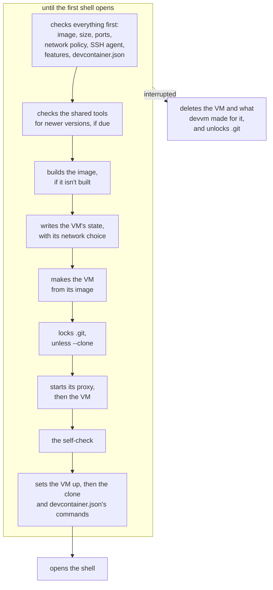

This page explains what devvm does, step by step, when it makes, opens, changes, stops and deletes a VM, and how it keeps each VM's state. [Everyday commands](../getting-started/commands.md) covers the same commands from your side, and [Settings and files](../using/settings.md) lists your settings.

## A new VM

When you run `devvm` in a folder that has no VM, devvm makes one in these steps:

1. devvm checks everything the new VM needs before it builds anything, because a build can take minutes. That covers the folder, the image, the size, the ports, the network policy choice, which it asks for when you give neither flag, the SSH agent, the backend's [features](backends.md#features) and what the folder's `devcontainer.json` says.
2. When the image names shared tools and the [daily check](../using/images.md#shared-tools) is due, devvm checks for newer versions of them.
3. devvm builds the image with its [shared tools](../using/images.md#shared-tools) if it isn't built yet ([building](images.md#building)).
4. devvm writes the VM's state, with the network choice in it, before it makes the VM. If a later step fails, the VM never starts without its network choice. devvm also clears what a VM by the same name that was deleted some other way left behind: its proxy, its own rules and its run files.
5. devvm makes the VM from its image. The VM mounts only the project folder, read-write, and the shared tools and its [agents' config folders](../using/coding-agents.md), read-only. With `--clone`, devvm doesn't mount the folder, and the VM gets its own clone of the repo instead ([working on a clone](../using/clone.md)).
6. Unless the VM is a `--clone` VM, devvm locks the folder's `.git` hooks and config ([`.git` protection](git-protection.md)). It warns when the repo's origin is an SSH remote and the VM has no SSH agent (`ssh_remote_hint`), and on Linux hosts it names the set-id files in the folder, including those an earlier VM of this folder made. When the VM forwards your SSH agent, devvm checks that the agent has keys.
7. devvm starts the VM, and with network policy it starts the VM's [proxy](network.md#the-proxy) first.
8. The [self-check](network.md#the-self-check) runs, before the setup and the shell.
9. devvm sets the VM up ([the VM's setup](../using/coding-agents.md#the-vms-setup)) and makes it reachable [by name over SSH](../using/ssh.md). It makes a `--clone` VM's clone, and then runs the commands of the folder's [`devcontainer.json`](../using/devcontainer.md#commands).
10. devvm opens a shell in the VM in its own place, so devvm ends when the shell does. Without a terminal, the shell reads its commands from devvm's input.

Until the first shell opens, nothing of yours is in the VM yet. If you interrupt devvm before then, it deletes the VM, its state, its pinned host keys, its proxy, its own rules and its run files, takes the locks off `.git`, and for a `--clone` VM removes the repo's remote for it.

## Adding to a VM

When `devvm IMAGE` adds to an existing VM in place ([adding to a VM](../getting-started/commands.md#adding-to-a-vm)), the shared tools it builds are mounted at once, and nothing is installed on the VM's disk. With network policy, the VM's proxy allows a layer's hosts while the layer's script runs.

## An existing VM

When you run `devvm` in a folder whose VM exists, devvm opens the VM as it is and starts it if it's stopped. Each time, it does these steps in this order:

1. When you give an IMAGE that names something the VM lacks, such as `devvm go` in a base VM, devvm asks before adding it in place ([adding to a VM](../getting-started/commands.md#adding-to-a-vm)).
2. devvm warns when an image the VM was made from has changed since ([outdated VMs](../using/images.md#outdated-vms)), or when there are newer shared tools than the VM's, which `devvm update` moves it to. It also checks for newer tools once a day.
3. devvm matches the VM's [agent folder mounts](../using/coding-agents.md#mounts) to the folders on this machine.
4. devvm ignores the options for new VMs, with a warning for each. The VM keeps its network policy, which `devvm network` changes, and its `.git` protection, which `devvm git-protect` changes. It keeps its size, which `devvm size` changes, its ports, which `devvm ports` changes, and its SSH agent forwarding, which `devvm ssh-agent` changes. It also keeps its backend, and ignores `--from` and `--no-devcontainer`.
5. devvm warns when the folder's `devcontainer.json` isn't the one the VM was made from ([details](../using/devcontainer.md#when-its-read)). It checks `.git` ([on each launch](git-protection.md#on-each-launch)) and, on Linux hosts, names the set-id files in the folder. It skips both for a `--clone` VM, which mounts neither.
6. A stopped VM gets the size and [SSH agent forwarding](../using/ssh.md#agent-forwarding) that its state asks for. A running VM gets them when it next starts, and devvm says so (`size_next_start`). When the VM forwards your agent, devvm checks that the agent has keys. When it uses devvm's own agent, devvm loads the keys that the agent lacks.
7. devvm starts the VM if it's stopped. A running VM with network policy keeps its proxy, unless what the proxy was started with has changed ([the proxy](network.md#the-proxy)). A VM whose network policy was turned off after it started confined also keeps its proxy, until it next starts.
8. The [self-check](network.md#the-self-check) runs, and devvm stops a VM whose network policy doesn't hold.
9. devvm sets the VM up and opens the shell, as for a new VM. A `--clone` VM whose clone wasn't made yet gets it first. On the first launch after the VM started, the `postStartCommand` of the `devcontainer.json` that the VM was made from runs before the shell opens ([commands](../using/devcontainer.md#commands)).

devvm never starts a VM whose creation didn't finish, because the VM would start without network policy (`vm_unfinished`). That happens when devvm was stopped after it made the VM but before it recorded the network choice. `devvm rm` deletes such a VM.

## Stopping a VM

`devvm stop` stops this folder's VM, then its [proxy](network.md#the-proxy). Once the VM is stopped, devvm checks `.git` as a launch that finds the VM stopped does, and it sets the locks that were waiting for the VM to stop ([on each launch](git-protection.md#on-each-launch)). On Linux hosts it also names the set-id files in the folder. It skips both for a `--clone` VM. Then devvm removes the VM's entry from the [ssh config](../using/ssh.md). A VM that's already stopped gets the same checks.

## Deleting a VM

`devvm rm` deletes this folder's VM and what devvm keeps for it: its state, its own allowlist and secret files, its network log, its `.git` locks, its pinned host keys and its ssh config entry. Other VMs, images and the project folder stay.

For a `--clone` VM, devvm first checks the clone for commits that this repo hasn't fetched and for uncommitted changes, in the clone and in the worktrees inside it ([deleting the VM](../using/clone.md#deleting-the-vm)). The repo's remote for the VM goes with the VM, and devvm keeps the work fetched from it as local branches, which [saved branches](#saved-branches) names. When the VM's image has an agent, devvm then exports the agents' history from the VM, starting it if it's stopped ([history](../using/coding-agents.md#history)), and it keeps the VM if the export fails. `devvm rm -f` deletes the VM without the export or the clone's checks, and a VM whose creation didn't finish gets neither, because it never ran.

### Saved branches

The local branches are named `saved/<remote>/<branch>`, after the remote, and devvm never overwrites a branch. If a branch named `saved/<remote>` exists, or one under it, or one it would sit under, devvm uses `saved/<remote>-2` instead, then `-3`, and so on up to `-99`. If none of those names is free, for example because a branch is named `saved`, `devvm rm` refuses before it fetches anything and keeps the VM. When that happens as devvm is about to remove the remote, it leaves the remote and its branches in place. Branch names come from the VM, so devvm quotes them when it shows them, and it skips any name that git refuses as a branch name.

## A folder made again

A VM's state records its project folder's path (`dir=`) and the folder's identity (`folder=`), which [one VM per folder](security.md#one-vm-per-folder) describes. When either differs from the folder you're in, the folder was deleted and made again, or another repo was cloned where the old one was. devvm then refuses the VM in every command that opens, stops or changes it (`vm_other_folder`), and only `devvm rm` and `devvm adopt` act on it. Each of them asks first, so without a terminal each one refuses (`vm_other_folder_rm`, `vm_other_folder_adopt`):

- `devvm rm` asks whether to delete the VM, which may hold that project's work (`delete_other_folder_vm`). It then deletes the VM as `devvm rm -f` does, with or without `-f`, so it exports no history and makes no checks of a clone, because the VM's folder is gone.
- `devvm adopt` asks whether to give this folder the VM's files, secrets and allowlist (`adopt_vm`). It then records this folder's path and identity in the VM's state and clears the inode of `.git` it recorded, so the next launch locks `.git` as if it had just appeared (`vm_adopted`). In a folder the VM already belongs to, it changes nothing (`vm_already_here`).

## A subfolder's VM

A VM's name comes from its folder's physical path, so devvm in a subfolder names a VM that doesn't exist. When the backend has no VM by that name and devvm has no state file for it, devvm checks the folders the current folder is inside, nearest first ([a subfolder](../getting-started/commands.md#a-subfolder)). It names each parent's VM the same way, with the name length of the backend a new VM would get, and it passes over only the parents whose VM has no state file. The search stops at the first parent with a state file. devvm uses that parent's VM when its backend has the VM and the state's `dir=` and `folder=` match that folder. Otherwise the current folder has no VM, so a command that needs one says there's no VM for it, and `devvm` makes a new one. A parent that was deleted and made again since its VM was made fails the folder check, and so does a nested project folder that a VM replaced through its mount, because a folder made again gets a new device and inode. Stopping there keeps devvm from skipping the nested folder's VM for the VM of a folder further out, such as the VM that replaced it. A folder with a state file of its own never uses a parent's VM, even when its backend has lost its own, so `devvm rm` there never reaches past it to a parent's. The current folder's path is physical, with its links resolved, so a subfolder that is a link to a folder elsewhere is looked up from where it points, never from the folder that holds the link.

The lookup stops before the home folder, compared by its physical path, and before the filesystem root. Those folders are refused as project folders anyway, but a VM made for one with `--unsafe-folder` would otherwise open in every folder below it. Using a parent's VM changes nothing about what it mounts, because the current folder is already inside its project folder at the same path.

`devvm` asks whether to use the parent's VM in a terminal (`use_parent_vm`), and every other command that acts on the folder's VM uses it without asking, except `devvm rm`. Each of them, and `devvm` without a terminal, first names the VM and its folder (`using_parent_vm`). `devvm rm` then asks before deleting a parent's VM (`delete_parent_vm`), with or without `-f`, and without a terminal it refuses (`rm_parent_vm`). The commands that give a parent's VM more access do the same. They are `devvm secret use`, `devvm ssh-agent` with `on` or `devvm`, `devvm network off`, `devvm policy allow`, `devvm policy rm` of a deny and `devvm git-protect off`, which ask before changing the VM (`widen_parent_vm`, `[y/N]`) and refuse without a terminal (`widen_parent_vm_refused`). They ask because the parent folder's project chose its VM's access, and a subfolder can be a project of its own that only happens to sit inside it. `devvm adopt` looks only for the VM of this folder's own path, and `devvm --here` and `devvm --clone` skip the lookup, so they make the folder's own VM. devvm passes the current folder to the backend as the shell's working folder, and `devvm ssh` and `devvm code` use it as the folder to open. For a `--clone` VM, devvm first checks in the VM that the clone has the folder, and uses the clone's top folder when it doesn't.

On the way up, devvm also notes the nearest folder below the parent's that has a `.git` of its own, a folder or a file, starting with the current folder. When there is one, the current folder belongs to a separate repo. `devvm` then asks a question whose default is a new VM (`use_parent_vm_repo`, `[y/N]`), and without a terminal it makes the new VM without asking. Every other command ignores the parent's VM and fails with `no_vm`.

## Listing VMs

`devvm ls` reads each VM's state and asks the VM's backend for its status. A backend that can't list its VMs, for example because Lima isn't installed, fails `devvm ls` only when a VM's state names that backend.

## State files

devvm writes nothing into the project folder. It keeps your settings in `~/.config/devvm` (`$XDG_CONFIG_HOME/devvm`), which [your settings](../using/settings.md#your-settings) lists file by file, and its own state in `~/.local/share/devvm` (`$XDG_DATA_HOME/devvm`):

| Path in `~/.local/share/devvm` | Holds |
| --- | --- |
| `vms/<vm-name>` | each VM's state |
| `images/<key>` | each image's record |
| `images/rebuilds/` | the [rebuild counters](images.md#rebuilding) |
| `images/from-digests` | the [digests](images.md#digests) of the container images that `--from` bases start from |
| `tools/`, `mise.lock`, `mise/` | the [shared tools](images.md#the-share), the tools lock and devvm's own mise |
| `mise.lock.toml`, `mise.lock.checked` | the `mise.toml` the tools lock was resolved from, and when devvm last [checked](images.md#versions) for newer versions |
| `assets/<hash>` | devvm's own files, [written out](install.md#devvms-own-files) where a path is needed |
| `ca/` | the certificate authority that VMs trust for the proxy |
| `oci-build.lock` | the lock a Lima build of a base [from a container image](images.md#how-its-converted) holds, a folder with its devvm's pid |
| `run/` | files for running VMs, such as sandbox profiles, proxy pids and the QEMU wrapper |
| `logs/`, `logs/runs/` | each VM's network log and proxy log, and the [run logs](../using/troubleshooting.md#a-command-fails) |
| `exports/` | the agents' history that `devvm export` and `devvm rm` save |
| `agent.sock` | the socket of [devvm's own SSH agent](../using/ssh.md#devvms-own-agent) |
| `lima/` | devvm's own [Lima home](lima.md#a-lima-home-of-its-own), unless `DEVVM_LIMA_HOME` moves it |
| `lima-vms/`, `smolvm/`, `docker/` | each backend's own files, such as the ports each Lima VM forwards, what smolvm and Docker set on each VM, and smolvm's images |

[What devvm keeps on this machine](../using/space.md) says how each of these is cleaned up, and lists what the backends keep outside this folder.

A VM's state file records the image the VM came from, its project folder, its backend and its settings, one `key=value` per line. The file lasts as long as the VM, because `devvm rm` also deletes it, so the next devvm in that folder starts fresh.

Each write replaces a file whole, so a file is never left half written. devvm makes its files readable only by you (mode 600) and its folders mode 700. Before every command, devvm makes the data folder and `~/.config/devvm` when they're missing and sets both to mode 700, whatever mode they had. A wider mode on anything beneath them then opens nothing to others, and when devvm can't set a folder's mode, it warns and goes on. The folders that hold history, logs, keys or secrets (`exports/`, `logs/`, `logs/runs/`, `run/`, `ca/` and `~/.config/devvm/secrets/`) are set to mode 700 again whenever devvm writes an export, a log, a key or a secret into them, whatever mode they had before. When a file can't be read, devvm names the file and the line, and you fix the line or delete the file.
