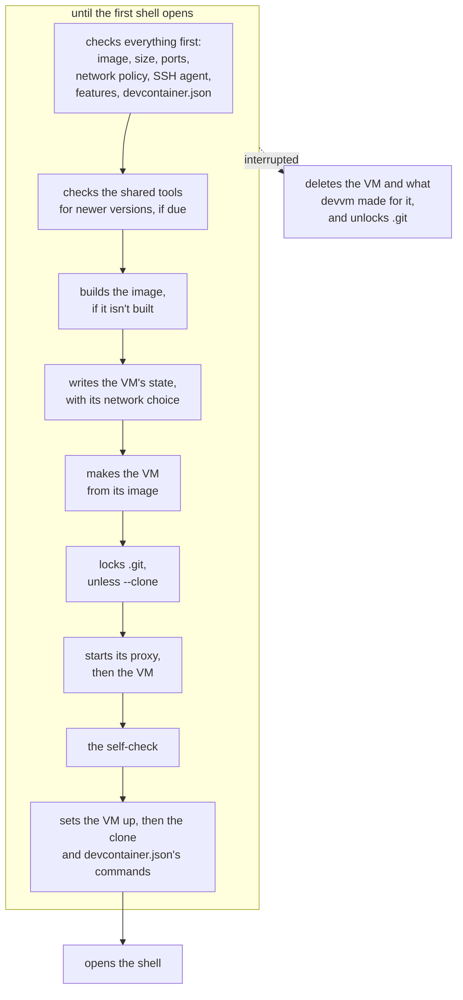

This page explains what devvm does, step by step, when it makes, opens, changes, stops and deletes a VM, and how it keeps each VM's state. [Everyday commands](../getting-started/commands.md) covers the same commands from your side, and [Settings and files](../using/settings.md) lists your settings.

## A new VM

When you run `devvm` in a folder that has no VM, devvm makes one in these steps:

1. devvm checks everything the new VM needs before it builds anything, because a build can take minutes. That covers the folder, its toolchains, agents and layers, which it shows in a list in a terminal when you give none of `--tools`, `--agents` and `--layers` ([what a new VM gets](../using/images.md#what-a-new-vm-gets)), the size, the ports, the network policy choice, which it asks for when you give neither flag and `devvm setup` chose `ask` for new VMs, the SSH agent, the backend's [features](backends.md#features) and what the folder's `devcontainer.json` says.
2. When the VM gets shared tools and the [daily check](../using/images.md#shared-tools) is due, devvm checks for newer versions of them.
3. devvm builds the image if it isn't built yet ([building](images.md#building)), then the VM's [shared tools](../using/images.md#shared-tools) that the share lacks.
4. devvm writes the VM's state, with the network choice in it, before it makes the VM. If a later step fails, the VM never starts without its network choice. devvm also clears what an earlier VM of this folder that was deleted some other way left behind: it stops that VM's proxy and link session and deletes the VM's folder in its data folder, with its own rules, its run files and its logs.
5. devvm makes the VM from its image. The VM mounts only the project folder, read-write, and the shared tools and its [agents' config folders](../using/coding-agents.md), read-only. With `--clone`, devvm doesn't mount the folder, and the VM gets its own clone of the repo instead ([working on a clone](../using/clone.md)).
6. Unless the VM is a `--clone` VM, devvm locks the folder's `.git` hooks and config ([`.git` protection](git-protection.md)). It warns when the repo's origin is an SSH remote and the VM has no SSH agent (`ssh_remote_hint`), and on Linux hosts it names the set-id files in the folder, including those an earlier VM of this folder made. When the VM forwards your SSH agent, devvm checks that the agent has keys.
7. devvm starts the VM, and with network policy it starts the VM's [proxy](network.md#the-proxy) first.
8. The [self-check](network.md#the-self-check) runs, before the setup and the shell.
9. devvm sets the VM up ([the VM's setup](../using/coding-agents.md#the-vms-setup)) and makes it reachable [by name over SSH](../using/ssh.md). It makes a `--clone` VM's clone, and then runs the commands of the folder's [`devcontainer.json`](../using/devcontainer.md#commands).
10. devvm opens a shell in the VM in its own place, so devvm ends when the shell does. Without a terminal, the shell reads its commands from devvm's input.

Until the first shell opens, nothing of yours is in the VM yet. If you interrupt devvm before then, it deletes the VM, stops its proxy, deletes its pinned host keys and its folder, with its state, its own rules and its run files, takes the locks off `.git`, and for a `--clone` VM removes the repo's remote for it.

## Adding to a VM

When `devvm tools add`, or `devvm tools` in a terminal, adds shared tools to an existing VM ([adding to a VM](../getting-started/commands.md#adding-to-a-vm)), the tools it builds join the VM's state and are mounted as devvm then launches the VM, and nothing is installed on the VM's disk. A new agent's config folders are mounted as the launch matches the VM's agent folder mounts, which restarts a running VM after asking. `devvm tools` shows an existing VM's layers but can't change them, and `--tools`, `--agents` and `--layers` change nothing on an existing VM, because a layer goes onto the VM's disk, which only [making the VM again](#making-a-vm-again) changes.

## Making a VM again

`devvm layer add LAYER...` makes the folder's VM again from a new image, its own layers with the new ones on top, and keeps devvm's settings for it and its home folder ([adding layers to a VM](../using/images.md#adding-layers-to-a-vm)). `devvm update` makes it again from the image it has, when that image or one below it has a new key, so the VM gets the image's new build ([outdated VMs](../using/images.md#outdated-vms)). The remake is one path in the VM's lifecycle, which takes the image to make the VM from, so each command only works out that image and its own refusals: `devvm layer add` names the layers the VM has already, and `devvm update` says the VM is current (`vm_current`) when nothing in its chain changed, or names what changed (`vm_changed`) before it asks.

Before anything changes, devvm refuses a name that isn't a layer, a VM made for another folder, one whose creation didn't finish and a `--clone` VM, and it checks that the VM's backend has every feature the VM needs with the new image (`Require`) and that the disk has room for a VM. Then it asks (`remake_confirm`, or `remake_confirm_clean_home` with `--clean-home`), and a parent folder's VM only in a terminal (`remake_parent_vm_ask`). The remake then goes in this order:

1. devvm builds the new image, as for a new VM.
2. It exports the agents' history as `devvm rm` does, unless `--no-export`, and saves the VM's home folder, unless `--clean-home`. The VM runs `tar --one-file-system --ignore-failed-read` in its home as its user, and devvm reads that stream on this machine and writes only what it keeps to `home.tar.gz` in the VM's folder ([the home folder's copy](design.md#the-home-folders-copy)). A failure in either keeps the VM as it was (`remake_export_failed`, `remake_home_failed`).
3. devvm records the remake in the VM's state (`remake`), stops the VM, its proxy and its link session, and has the backend rename the VM's machine to its aside name, `devvm-<hash>-old`, which is no project VM's name, so nothing else takes it for one. On Lima that's `limactl rename`, which keeps the old disk whole.
4. devvm makes the new machine by the VM's name from the new image, with what the state records: its project folder, its agents' folders, the tools share, its SSH agent, its size, its ports and its ssh port. It records that the new machine was made, and clears which of its `devcontainer.json`'s commands ran, so those that run once run again. Then it starts the VM as every start does ([an existing VM](#an-existing-vm), steps 4 to 7), which pins its new host keys.
5. devvm puts the saved home folder in, with `tar --skip-old-files` as the VM's user, so what the new image has stays the image's, and then deletes the old machine.
6. devvm records the new `image` and `chain` and ends the remake, which removes the section, then deletes `home.tar.gz` and opens the VM as an existing VM, setting it up first. With network policy, the proxy reads the VM's layers from its image, so the new layers' allowlists apply from then, as what the proxy started with has changed ([the proxy](network.md#the-proxy)). The VM's `id`, its alias and every other field stay as they were ([a VM made again](design.md#a-vm-made-again)).

Until the old machine is deleted in step 5, a failure or an interrupt runs the remake's cleanup (`remake_undone`). It deletes the new machine, renames the old one back, whose next start makes it what the state asks for, as every start does, and ends the remake. When it can't, it warns (`remake_undo_failed`) and leaves the remake recorded.

A remake that's recorded didn't finish, because devvm was killed. The next `devvm`, `devvm layer add` or `devvm update` in the folder finishes it without asking (`remake_resuming`). When the old machine is still aside, or the new one was never made, so the machine by the VM's name is the old one, devvm puts the old machine back and makes the VM again from step 1. Otherwise the old machine is gone, and the new one, made or not, never ran a shell, so devvm deletes it and makes it again from step 4 with the saved home folder, or without one, warning, when the file is gone (`remake_home_lost`). Meanwhile every other command that acts on the VM refuses (`remake_pending`), `devvm gc --orphans` never takes the VM for an orphan, though the backend may have no machine by its name, and `devvm rm` deletes the VM and its old machine too.

## An existing VM

When you run `devvm` in a folder whose VM exists, devvm opens the VM as it is and starts it if it's stopped. Each time, it does these steps in this order:

1. devvm warns when an image the VM was made from has changed since, which `devvm update` makes the VM again from ([outdated VMs](../using/images.md#outdated-vms)), or when there are newer shared tools than the VM's, which `devvm tools update` moves it to. It also checks for newer tools once a day.
2. devvm compares the VM's [agent folder mounts](../using/coding-agents.md#mounts) with the folders on this machine and names the folders that changed. A running VM gets the new mounts when it next starts, or at once when you agree to restart it.
3. devvm ignores the options for new VMs, with a warning for each. The VM keeps its shared tools, which `devvm tools` changes, and its layers, which `devvm layer add` adds to. It keeps its network policy, which `devvm network` changes, and its `.git` protection, which `devvm git-protect` changes. It keeps its size, which `devvm size` changes, its ports, which `devvm ports` changes, and its SSH agent forwarding, which `devvm ssh-agent` changes. It also keeps its backend, and ignores `--from` and `--no-devcontainer`.
4. devvm warns when the folder's `devcontainer.json` isn't the one the VM was made from ([details](../using/devcontainer.md#when-its-read)). It checks `.git` ([on each launch](git-protection.md#on-each-launch)) and, on Linux hosts, names the set-id files in the folder. It skips both for a `--clone` VM, which mounts neither.
5. devvm checks that the backend can give the VM the [SSH agent forwarding](../using/ssh.md#agent-forwarding) that its state asks for. When a running VM's size or agent forwarding differs from what its state asks for, the VM gets them when it next starts, and devvm says so (`size_next_start`, `agent_next_start`). When the VM forwards your agent, devvm checks that the agent has keys. When it uses devvm's own agent, devvm loads the keys that the agent lacks.
6. devvm starts the VM if it's stopped. The backend's start gives the VM what its state asks for: its size, the agent folders on this machine, its agent forwarding and its ports. It changes only what differs from the VM's config, together with what the VM's confinement needs, and it changes nothing on a running VM ([on Lima](lima.md#what-devvm-sets-on-a-vm)). A running VM with network policy keeps its proxy, unless what the proxy was started with has changed ([the proxy](network.md#the-proxy)). A VM whose network policy was turned off after it started confined also keeps its proxy, until it next starts.
7. The [self-check](network.md#the-self-check) runs, and devvm stops a VM whose network policy doesn't hold.
8. devvm sets the VM up and opens the shell, as for a new VM. A `--clone` VM whose clone wasn't made yet gets it first. On the first launch after the VM started, the `postStartCommand` of the `devcontainer.json` that the VM was made from runs before the shell opens ([commands](../using/devcontainer.md#commands)).

Steps 4 to 7, apart from the `devcontainer.json` check, are what every start of an existing VM by devvm does. So when an export or `devvm rm`'s check of a `--clone` VM needs the VM running, devvm checks `.git`, starts it with the size, agent folders, agent forwarding and ports its state asks for, and runs the self-check in the same way.

devvm never starts a VM whose creation didn't finish, because the VM would start without network policy (`vm_unfinished`). That happens when devvm was stopped after it made the VM but before it recorded the network choice. In a terminal and without `--no-input`, devvm asks whether to delete such a VM and make it again (`remake_unfinished`, `[y/N]`), and yes deletes it as `devvm rm` does, then makes the VM as for a folder without one. Otherwise, and for a parent folder's VM, devvm refuses, and `devvm rm` deletes such a VM.

## Stopping a VM

`devvm stop` stops this folder's VM, then its [proxy](network.md#the-proxy), its [port forwarder](ports.md#its-process-and-files) and its link session. Once the VM is stopped, devvm applies the `.git` protection chosen with `devvm git-protect` while the VM ran, checks `.git` as a launch that finds the VM stopped does, and sets the locks that were waiting for the VM to stop ([on each launch](git-protection.md#on-each-launch)). On Linux hosts it also names the set-id files in the folder. It skips both for a `--clone` VM. Then devvm removes the VM's entry from the [ssh config](../using/ssh.md). A VM that's already stopped gets the same checks.

## Deleting a VM

`devvm rm` deletes this folder's VM and what devvm keeps for it: its state, its own allowlist and secret files, its network log, its `.git` locks, its pinned host keys and its ssh config entry. Other VMs, images and the project folder stay.

After the backend deletes the VM, devvm tears down the rest in one order, which `devvm gc --orphans` follows too. It stops the VM's proxy, port forwarder and link session first. Then it deletes what devvm keeps for the VM outside its folder: a clone's remote or the `.git` locks, other VMs' links to it and the links its group made, its pinned host keys, for `devvm gc --orphans` the backend's own leftovers, and the old machine of a [remake](#making-a-vm-again) that didn't finish. Then it deletes the VM's folder, with every file devvm keeps for it there, and last its ssh config entry.

For a `--clone` VM, devvm first checks the clone for commits that this repo hasn't fetched and for uncommitted changes, in the clone and in the worktrees inside it ([deleting the VM](../using/clone.md#deleting-the-vm)). The repo's remote for the VM goes with the VM, and devvm keeps the work fetched from it as local branches, which [saved branches](#saved-branches) names. When the VM's image has an agent, devvm then exports the agents' history from the VM, starting it if it's stopped ([history](../using/coding-agents.md#history)), and it keeps the VM if the export fails. `devvm rm` asks first in a terminal (`rm_confirm`), and without one it refuses unless `--force` (`force_needed`). `devvm rm --no-export` deletes the VM without the export, the clone's checks still run and ask only in a terminal, and a VM whose creation didn't finish gets neither, because it never ran.

### Saved branches

The local branches are named `saved/<remote>/<branch>`, after the remote, and devvm never overwrites a branch. If a branch named `saved/<remote>` exists, or one under it, or one it would sit under, devvm uses `saved/<remote>-2` instead, then `-3`, and so on up to `-99`. If none of those names is free, for example because a branch is named `saved`, `devvm rm` refuses before it fetches anything and keeps the VM. When that happens as devvm is about to remove the remote, it leaves the remote and its branches in place. Branch names come from the VM, so devvm quotes them when it shows them, and it skips any name that git refuses as a branch name.

## A folder made again

A VM's state records its project folder's path (`dir`) and the folder's identity (`folder`), which [one VM per folder](security.md#one-vm-per-folder) describes. When either differs from the folder you're in, the folder was deleted and made again, or another repo was cloned where the old one was. devvm then refuses the VM in every command that opens, stops or changes it (`vm_other_folder`), and only `devvm rm` and `devvm adopt` act on it. Each of them asks first, so without a terminal each one refuses (`vm_other_folder_rm`, `vm_other_folder_adopt`), unless `devvm adopt --force`:

- `devvm rm` asks whether to delete the VM, which may hold that project's work (`delete_other_folder_vm`), and `--force` never answers it. It then deletes the VM without exporting history or checking a clone, because the VM's folder is gone.
- `devvm adopt` asks whether to give this folder the VM's files, secrets and allowlist (`adopt_vm`). It then records this folder's path and identity in the VM's state and clears the inode of `.git` it recorded, so the next launch locks `.git` as if it had just appeared (`vm_adopted`). In a folder the VM already belongs to, it changes nothing (`vm_already_here`).

## A VM whose folder is gone

A VM's folder is gone when nothing is at the path its state records as `dir` ([a VM's state](#a-vms-state)). devvm checks the path alone, so a folder made again at that path isn't gone, and [a folder made again](#a-folder-made-again) covers it, while a path devvm can't read for another reason, such as its permissions, doesn't count as gone. `devvm ls` and `devvm space` check every VM's path when they list it, and neither `devvm gc` nor retention treats such a VM as leftover state, because its backend still has it.

`devvm rm VM` finds the VM by the `name` or `alias` in each state file, and nothing else, so a folder's name never matches (`rm_unknown_vm`). A VM whose `dir` is the folder devvm runs in goes through `devvm rm`. Otherwise devvm refuses a VM whose folder is there (`rm_vm_folder_there`), and one that its backend no longer has (`rm_vm_lost`). It then refuses a `--clone` VM unless `--no-clone-check` (`rm_gone_clone`), because there's no repo to fetch the clone's work into. When the VM has an agent and `--no-export` isn't given, it refuses a stopped VM that mounts its folder (`rm_gone_stopped`), because Lima makes a missing folder that a VM mounts as the VM starts, and the export would make the project folder again. It asks next (`delete_gone_folder_vm`), which `--force` answers, and without a terminal it refuses unless `--force` (`force_needed`). Once you answer, it reads the VM's state again and checks the folder, and the VM's status when it's to be exported, once more, because the folder may have come back while it asked, another devvm may have made the VM again, or stopped it: each of those keeps the VM, with the same refusals. Last, it exports the history from the running VM, or from a `--clone` VM it starts, and deletes the VM as `devvm rm` does ([deleting a VM](#deleting-a-vm)). A failed export keeps the VM (`rm_vm_export_failed`).

## A subfolder's VM

devvm finds a folder's VM by the hash of the folder's physical path, so devvm in a subfolder finds no state file and names a new VM that doesn't exist. When the backend has no VM by that name and devvm has no state file for the folder, devvm checks the folders the current folder is inside, nearest first ([a subfolder](../getting-started/commands.md#a-subfolder)). It finds each parent's state file by the hash of that parent's path in the same way, and it passes over only the parents that have no state file. The search stops at the first parent with a state file. devvm uses that parent's VM when its backend has the VM and the state's `dir` and `folder` match that folder. Otherwise the current folder has no VM, so a command that needs one says there's no VM for it, and `devvm` makes a new one. A parent that was deleted and made again since its VM was made fails the folder check, and so does a nested project folder that a VM replaced through its mount, because a folder made again gets a new device and inode. Stopping there keeps devvm from skipping the nested folder's VM for the VM of a folder further out, such as the VM that replaced it. A folder with a state file of its own never uses a parent's VM, even when its backend has lost its own, so `devvm rm` there never reaches past it to a parent's. The current folder's path is physical, with its links resolved, so a subfolder that is a link to a folder elsewhere is looked up from where it points, never from the folder that holds the link.

The lookup stops before the home folder, compared by its physical path, and before the filesystem root. Those folders are refused as project folders anyway, but a VM made for one with `--unsafe-folder` would otherwise open in every folder below it. Using a parent's VM changes nothing about what it mounts, because the current folder is already inside its project folder at the same path.

`devvm` asks whether to use the parent's VM in a terminal (`use_parent_vm`), and every other command that acts on the folder's VM uses it without asking, except `devvm rm`. Each of them, and `devvm` without a terminal, first names the VM and its folder (`using_parent_vm`). `devvm rm` then asks before deleting a parent's VM (`delete_parent_vm`), with or without `-f`, and without a terminal it refuses (`rm_parent_vm`). The commands that give a parent's VM more access do the same. They are `devvm secret use`, `devvm ssh-agent` with `on` or `devvm`, `devvm network off`, `devvm network allow`, `devvm network rm` of a deny and `devvm git-protect off`, which ask before changing the VM (`widen_parent_vm`, `[y/N]`) and refuse without a terminal (`widen_parent_vm_refused`). They ask because the parent folder's project chose its VM's access, and a subfolder can be a project of its own that only happens to sit inside it. `devvm adopt` looks only for the VM of this folder's own path, and `devvm --here` and `devvm --clone` skip the lookup, so they make the folder's own VM. devvm passes the current folder to the backend as the shell's working folder, and `devvm host` and `devvm code` use it as the folder to open. For a `--clone` VM, devvm first checks in the VM that the clone has the folder, and uses the clone's top folder when it doesn't.

On the way up, devvm also notes the nearest folder below the parent's that has a `.git` of its own, a folder or a file, starting with the current folder. When there is one, the current folder belongs to a separate repo. `devvm` then asks a question whose default is a new VM (`use_parent_vm_repo`, `[y/N]`), and without a terminal it makes the new VM without asking. Every other command ignores the parent's VM and fails with `no_vm`.

## Listing VMs

`devvm ls` reads each VM's state and asks the VM's backend for its status. A backend that can't list its VMs, for example because Lima isn't installed, fails `devvm ls` only when a VM's state names that backend.

## State files

devvm writes nothing into the project folder. It keeps its files in two folders, and the folder a file is in says who writes it:

- `~/.config/devvm` (`$XDG_CONFIG_HOME/devvm`) holds what you write: `config.toml`, your rules for every VM in `policy`, and your own layers, features and CAs. devvm never rewrites a file of yours there. It changes single lines of `policy` when `devvm network` adds or removes a rule for every VM, it writes a new layer's files when you run `devvm layer new`, and it writes the folder's `version` ([the layout version](#the-layout-version)). [Your settings](../using/settings.md#your-settings) lists the folder file by file.
- `~/.local/share/devvm` (`$XDG_DATA_HOME/devvm`) holds everything devvm writes itself, and you never edit it. [devvm's data folder](../using/space.md#devvms-data-folder) lists it file by file, with how each one is cleaned up, and [what devvm keeps on this machine](../using/space.md) also lists what Lima keeps outside it.

The two folders use two formats. `config.toml` is TOML, which devvm reads strictly, so a key it doesn't know or a value that a key can't take stops the command, and devvm names the file and the line ([when devvm can't read it](../using/settings.md#when-devvm-cant-read-it)). devvm's own records are JSON: `settings.json`, each VM's `vm.json`, each image's record and each shared tool image's record. devvm ignores a field it doesn't know in them, so a field that a newer devvm adds doesn't stop an older one, and a change that an older devvm would read wrongly goes through the [layout version](#the-layout-version). devvm's other files are small ones of its own, such as pid files, the ssh config and the pinned host keys.

In the data folder, each VM has a folder of its own, `vms/<hash>/` ([a VM's folder](#a-vms-folder)), and the rest is shared by every VM:

- `settings.json` holds the defaults devvm's commands save, below `config.toml`'s ([where a default comes from](../using/settings.md#where-a-default-comes-from)).
- `ssh_config` is the [ssh config](security.md#ssh-into-vms) for running VMs, and `known_hosts` holds their pinned host keys, changed under `known_hosts.lock` ([locks](#locks)).
- `agent-keys.json` lists the keys added to [devvm's own SSH agent](../using/ssh.md#devvms-own-agent), with each one's file, fingerprint, `confirm` and `lifetime`, and `agent.sock` is that agent's socket.
- `secrets/` holds each [secret](network.md#where-secrets-are-saved) in a file of its own, on hosts without a Keychain.
- `images/<key>/record.json` is each image's record, and `images/rebuilds.json` holds the [rebuild counters](images.md#rebuilding), by backend, `--from` and image.
- `tools/` holds the [shared tools](images.md#the-share), each image with its record. Beside it are the tools lock, `mise.lock`, the `mise.toml` it was resolved from, `mise.lock.toml`, and `mise.lock.checked`, which says when devvm last [checked](images.md#versions) for newer versions.
- `ca/` holds the certificate authority that VMs trust for the proxy.
- `logs/runs/` holds the [run logs](../using/troubleshooting.md#a-command-fails), and `logs/tools-check.log` the daily tools check's output.
- `exports/` holds the agents' history that `devvm history export` and `devvm rm` save.
- `lima/` is devvm's own [Lima home](lima.md#a-lima-home-of-its-own), unless `DEVVM_LIMA_HOME` moves it.

`cache/` holds only what devvm makes again whenever it needs it, so it may be deleted at any time. That's devvm's own mise (`cache/mise/`), the [shared Nix cache](network.md#the-shared-nix-cache) (`cache/nix-cache/`) and the [digests](images.md#digests) of the container images that `--from` bases start from (`cache/from-digests.json`). `run/` holds what running VMs need that isn't one VM's, or whose path must be short: the QEMU wrapper on Linux hosts, the claims lock ([locks](#locks)), the sockets of port forwarders and link sessions, named by hashes, and in `builds/<name>/` each build VM's folder, laid out as a VM's folder is. devvm deletes a build VM's folder once its image is built, because an image's VM never starts again, and otherwise when it deletes the build VM.

Each write replaces a file whole, so a file is never left half written. devvm makes its files readable only by you (mode 600), and the programs it keeps to run, such as its mise and QEMU wrapper, are mode 700, as are its folders. Before every command, devvm makes the data folder and `~/.config/devvm` when they're missing and sets both to mode 700, whatever mode they had. A wider mode on anything beneath them then opens nothing to others, and when devvm can't set a folder's mode, it warns and goes on. The folders that hold history, logs, keys or secrets (`exports/`, `logs/`, `logs/runs/`, `run/`, `ca/`, `secrets/`, and the `run/` and `logs/` folders in each VM's folder) are set to mode 700 again whenever devvm writes an export, a log, a key or a secret into them, whatever mode they had before. devvm refuses to use one of those folders when it's a symbolic link or not a folder at all, so it never sets the mode of whatever a link points to. The data folder and `~/.config/devvm` may be symbolic links, such as into a dotfiles repo, and devvm follows them. When a file can't be read, devvm names the file and the line, and you fix the line or delete the file.

### A VM's folder

Each VM's folder, `vms/<hash>/`, is named by the hash of its project folder's physical path, which also ends the VM's name, and it holds every file that devvm keeps for the VM in the data folder:

| Path in `vms/<hash>/` | Holds |
| --- | --- |
| `vm.json` | the VM's state ([a VM's state](#a-vms-state)) |
| `lock` | the lock that each change to `vm.json` holds ([locks](#locks)) |
| `policy` | the VM's own [network policy rules](network.md#policy-files), which `devvm network allow`, `deny` and `rm` change |
| `run/` | what the VM's runs leave: its [port forwarder](ports.md#its-process-and-files)'s `ports.pid`, `ports.status`, `ports.lock` and `ports.known_hosts`, its [proxy](network.md#the-proxy)'s config, `proxy.json`, which holds everything the proxy started with, its password and the [company proxy](network.md#through-a-company-proxy)'s among it ([devvm _proxy](network.md#devvm-_proxy)), and its `proxy.pid` and `proxy.status`, its [secrets](network.md#how-the-proxy-puts-them-in)' bindings (`secrets.json`, `secrets.policy`), its [link session](ports.md#the-link-session)'s `links.pid` and `links.json`, the hostagent it was started on (`started`), and on macOS the hostagent's [sandbox profile](lima.md#confinement) (`sandbox.sb`) |
| `logs/` | its proxy's decisions (`network.jsonl`) and its proxy's own output (`proxy.log`), which the [log files](network.md#log-files) describe, its link session's output (`links.log`) and its port forwarder's (`ports.log`) |
| `home.tar.gz` | the VM's home folder, only while devvm [makes the VM again](#making-a-vm-again) |

devvm finds a folder's VM by the hash of the folder's path, so an existing VM has the name and the backend its state records, whichever backend you ask for. Only a new VM gets a name, which fits its backend's limit. The VM's folder lasts as long as the VM, because `devvm rm` and `devvm gc --orphans` stop what runs for the VM, delete what devvm keeps for it outside the folder, and then delete the folder whole ([deleting a VM](#deleting-a-vm)), so the next devvm in that folder starts fresh.

No VM's folder holds a socket, because a unix socket's path is at most 104 characters and ssh adds 17 to a control socket's while it makes it. The sockets that VMs need are in `run/`, named by hashes: each port forwarder's control socket, `run/port-<hash>.ctl`, and each link session's `run/link-<hash>.sock` and `run/link-<hash>.ctl`. With the default data folder, every socket fits for a home folder of up to 37 characters, and the ssh control sockets are the longest.

### A VM's state

A VM's state is `vm.json`, a JSON file that only devvm writes. It starts with the fields every VM has: the file's `version`, the VM's random `id`, its `name` and its ssh `alias`, the `image` the VM came from with its build `chain` and the `from` image its base started from, its project folder (`dir`) and that folder's identity (`folder`), its `backend` and where that backend kept it (`backend_at`), `created`, the time its backend finished making it, and `made_by`, the version of the devvm that made it, which later changes keep. A VM without `created` never starts, because its creation didn't finish. After those fields comes one section for each part of devvm that keeps something of the VM's:

| Section | Kept by | Holds |
| --- | --- | --- |
| `net` | network policy | whether the VM has network policy, and what devvm made for it: the proxy's password, the salt that ends its placeholders and the last [self-check](network.md#the-self-check)'s result |
| `git` | [.git protection](git-protection.md) | the mode, the mode chosen while the VM ran, and what locking found: `.git`'s identity, the git folders it locked besides `.git`, and a hash of what the locked files hand over to the project folder |
| `ports` | the port allocator | which ports the VM forwards, and the host ports devvm chose for its ssh, its proxy and its desktop |
| `agent` | SSH agent forwarding | the VM's choice, and the start devvm last started it with |
| `tools` | the shared tools | the VM's shared tools by name, and their images and C library |
| `secrets` | secrets | the secrets bound to the VM |
| `size` | `devvm size` | the CPUs, memory and disk asked for |
| `clone` | `--clone` | whether the VM has its own clone, the repo's remote for it, and whether its branches were copied in |
| `devcontainer` | a devcontainer.json | the file the VM was made from, its variables and commands, and which of them ran |
| `desktop` | `devvm desktop` | the desktop's password |
| `links` | links and groups | the ports the VM publishes, its links and its group |
| `remake` | `devvm layer add`, `devvm update` | while devvm [makes the VM again](#making-a-vm-again): the new image, the command, whether the home folder is kept and the history exported, and whether the new machine was made |

Each section keeps what you asked for apart from what devvm made, which sits under the section's `made`. devvm reads fields it doesn't know without complaint and keeps them when it writes the file. A file that isn't JSON, lacks one of `version`, `id`, `name`, `image`, `dir` or `backend`, or holds a section devvm can't read is refused, and devvm names the file.

A new VM's whole state is written once, with everything you asked for, before its backend makes the VM.

### Locks

Reading a VM's state takes no lock, because each write replaces the file whole. Each change takes the VM's `lock`, reads the file again, makes the change and writes the file once, so a command's changes land together or not at all, and two devvms changing one VM at once lose neither's change. Deleting a VM's folder takes the VM's `lock` too, so a change that another devvm is making to the VM's state lands before the folder goes and never after it, and a VM made again in the project folder keeps its own state. A command holds one VM's lock at a time. A change to other VMs, such as removing every link to a VM that `devvm rm` deletes, lets go of the first VM's lock and then takes each other VM's lock in turn, reading each one's state again before it changes it. What no two VMs may have, a new VM's ssh alias and the host ports devvm chooses, is chosen under the claims lock, `run/claims.lock`, which devvm takes after the VM's own lock and holds until the VM's state is written.

Every lock devvm takes is an OS file lock on an open file, which the system lets go of when the devvm holding it ends, however it ends. So a lock file is empty, it stays when its lock is let go of, and a devvm that was killed never leaves a lock held. Besides each VM's `lock` and the claims lock, the data folder has these:

| Lock | Held by |
| --- | --- |
| `version.lock` | each devvm checking the [layout version](#the-layout-version) |
| `vms/<hash>/run/ports.lock` | whatever stops a VM's [port forwarder](ports.md#its-process-and-files) and starts the next one |
| `images/locks/<key>` | the devvm [building an image](images.md#building) |
| `images/locks/rebuilds` | a devvm [changing a rebuild counter](images.md#rebuilding) |
| `oci-build.lock` | a Lima build of a base [from a container image](images.md#how-its-converted) |
| `tools.lock` | a devvm [writing to the share](images.md#building-tools) or swapping the tools lock |
| `making.lock` | each devvm making a VM or giving one new shared tools, shared, and `devvm gc --tool-images --force`, alone ([cleaning up](images.md#listing-and-cleaning-up)) |
| `known_hosts.lock` | a devvm pinning a VM's host keys in `known_hosts` or forgetting them, which reads the file again once it holds the lock, so two devvms changing it at once lose neither's change |
| `groups.lock` | a devvm [joining or leaving a group](design.md#groups), or working its links out again |
| `retention.lock` | the devvm applying the [retention settings](../using/settings.md#retention) |

### The layout version

The layout version says which folders and files devvm keeps in its two folders, and in which formats. This devvm's is 1. The data folder and `~/.config/devvm` each record theirs in a file named `version`, which holds the number alone. Before every command, after it makes both folders private, devvm takes `version.lock` in the data folder with an OS file lock and reads both files:

- When both have this devvm's version, the command runs.
- When a folder has no `version` file, as a new folder doesn't, devvm writes its own version there.
- When either one is older, devvm changes the folders to its own layout, one version at a time, and then writes its version into both files. A change that fails stops the command and leaves the versions as they were, so the next command tries again.
- When either one is newer, a newer devvm changed the folders, so this one would misread them. The command stops before it does anything, with a message that names the file and both versions ([a newer devvm changed devvm's folders](../using/troubleshooting.md#a-newer-devvm-changed-devvms-folders)).
- A `version` file that doesn't hold a whole number from 1 up stops the command too, naming the file.

Help, completion, `devvm --version` and the commands that devvm runs itself, such as the proxy, skip the check. Each VM's `vm.json`, each image's record and each shared tool image's record also hold `made_by`, the version of the devvm that made it, so a file from another devvm can be told apart.
