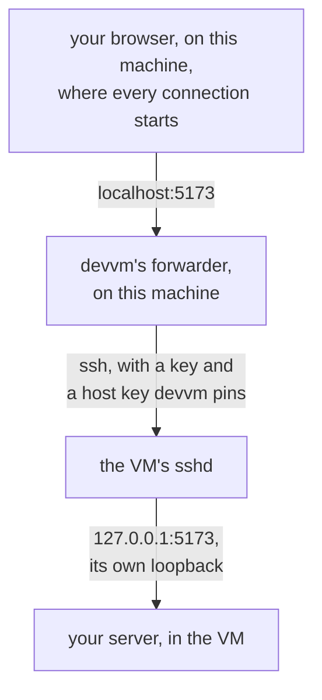
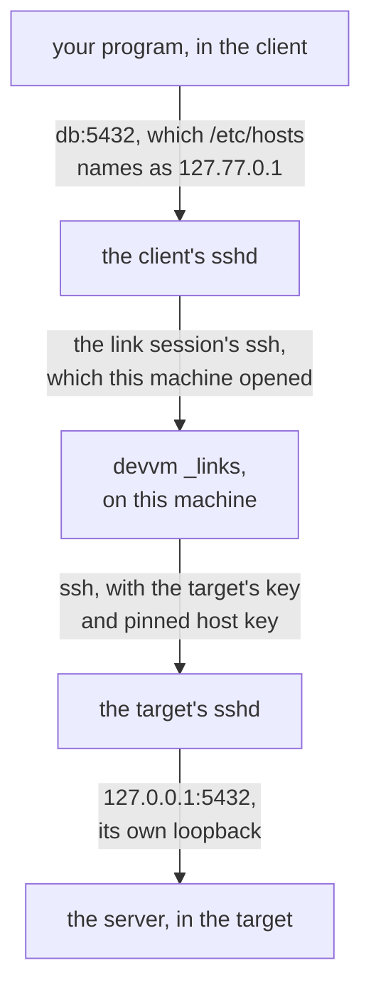

This page explains how devvm's forwarder forwards a VM's ports to this machine, which ports it never takes, and how it runs. [Ports and size](../using/ports-size.md#ports) covers choosing a VM's ports with `--ports` and `devvm ports`.

devvm forwards a VM's ports with its own forwarder, never with Lima's own forwards. [Lima](lima.md#ports) explains why, and what devvm sets on Lima instead.

## What it forwards

[Ports](../using/ports-size.md#ports) lists which ports the forwarder forwards, for `--ports all`, the default, and for a list such as `--ports 5173,8000-8010`, and how soon. A listed port also carries a server on the VM's loopback (`127.0.0.1` or `::1`) to this machine. You can list port 22, which forwards the VM's sshd to port 22 on this machine, while ssh by name keeps using the VM's own ssh port.

The forwarder never forwards a server on an address in `127.77.0.0/16`, on any VM, because that's where a VM listens for its [links to other VMs](#links-between-vms) and for [clipboard images](#clipboard-images), so neither ever appears on this machine's `localhost`. A server of the VM's own on `127.0.0.1` with the same port is forwarded as usual. It also never forwards a server on `127.0.77.1`, where the desktop's [local proxy](desktop.md#the-local-proxy) listens, because the local proxy adds the VM's password to what it sends to the VM's proxy, and on this machine's `localhost` other users and programs could use it.

## What it never takes

The forwarder never takes a port that a program on this machine has on any address. That program keeps the port and its `localhost` connections, and the forward waits until the VM's server stops and starts again.

The forwarder also never takes a port that devvm records for a VM, even while that port is free. Those are the ssh, proxy and desktop ports that devvm chooses for VMs, the VM's own ssh port, and the ports other VMs list. devvm chooses and records every VM's ssh port, whatever its tier, so no forwarder takes it in the seconds before Lima binds it ([the threat check](design.md#ports-on-lima)).

When a start, or a change of a running VM's ports, finds that a program on this machine has a listed port, devvm doesn't forward that port and warns you (`ports_taken`). The VM starts or runs on all the same, and the next start or change that finds the port free forwards it again. [Ports](../using/ports-size.md#ports) says what happens to a program that binds a port on all addresses after the forwarder has forwarded it.

## How it reaches the VM

The forwarder reaches the VM over the VM's ssh, with a key and a host key that devvm pins, and it asks for no forwarding into this machine. Only a [link session](#the-link-session) asks a VM for a remote forward, on a connection of its own, for links and clipboard images. Every connection starts on this machine, and the VM opens none to it. The VM sees each forwarded connection only as one to its own loopback, and on a confined tier the VM still reaches only its proxy.

A connection to a forwarded port, such as 5173, takes this path:

The forwarder is devvm's own, the same on every backend. The backend only says how the forwarder reaches a running VM's sshd, which is a user, a key and a port on this machine's loopback, and which file the forwarder follows to know the VM still runs, as Lima's [Ports](lima.md#ports) section describes.

## Its process and files

The forwarder runs as a hidden devvm command, `devvm _ports`, one process for each VM. devvm starts it after each start of the VM, once the backend says the VM runs, and again with the new ports when you change a running VM's ports. `devvm stop`, `devvm rm` and `devvm gc --orphans` stop it, and a VM that stops some other way ends it, because the forwarder exits once the backend's process for the VM is gone. Which ports a VM forwards is in the VM's state, which devvm reads each time it starts the forwarder, so `devvm ports` changes the state and never the backend's config, and the backend never hears of them. The forwarder's log is `ports.log` in the VM's logs folder, `~/.local/share/devvm/vms/<hash>/logs/`, and its `ports.pid`, `ports.status` and `ports.lock` are in the VM's run folder, `~/.local/share/devvm/vms/<hash>/run/`, beside the VM's host keys for its current start, `known_hosts`, which the forwarder checks the VM against, as devvm's ssh config does ([ssh into VMs](security.md#ssh-into-vms)). Its control socket is `~/.local/share/devvm/run/port-<hash>.ctl`, named by a hash of the VM's name, outside the VM's folder, because a unix socket's path has fewer than 104 characters.

devvm reads every list of ports the same way, whether it comes from `--ports`, `devvm ports` or the VM's state. Each entry is a port from 1 to 65535 or a range of them, such as `8000-8010`. When the VM's state holds a list that devvm can't read this way, such as a file edited by hand, the VM doesn't start and devvm names the value it couldn't read with `port_invalid`, so a bad entry never becomes a port the VM didn't ask for.

## When it can't forward

When a forwarder doesn't start, devvm warns you and names its log (`ports_forward_failed`), and the VM runs on without forwarded ports.

## Links between VMs

A [link between VMs](../using/links.md) carries a client VM's connections to a port that a target VM publishes. Like the forwarder, it goes over ssh, every connection starts on this machine, and it uses neither VM's network, so no backend's confinement changes and a confined VM still reaches nothing past its proxy over its own network. [The design note](design.md#links-between-vms) has the rules, the threat check and what the prototype showed.

### The addresses

Each target that a client links to gets an address of its own in `127.77.0.0/16` in that client, from `127.77.0.1` up to `127.77.255.254`, because `127.77.255.255` is kept for [clipboard images](#clipboard-images). devvm chooses it when the client's first link to that target is made and keeps it for every port of that target, so two targets can share a port. The client's `/etc/hosts` holds a block between `# devvm links begin` and `# devvm links end`, with a line `127.77.x.y NAME NAME.devvm.internal` for each target. The VM's setup replaces the block whole at each launch, and again when links change on a running client. The setup writes the file in place, never renaming over it, and only when the block changed.

A link listens at its target's address on the target's own port, never on the client's `127.0.0.1` or `::1`. At each start, the setup sets `net.ipv4.ip_unprivileged_port_start` to `0` where it's `1024`, which is on Lima's Alpine VMs, so a link to a port below 1024 listens on that port too. Lima's Ubuntu and Debian VMs already have `0`.

The addresses are internal to devvm. `devvm link` and its JSON never show them, and the forwarder never forwards them ([above](#what-it-forwards)).

### The link session

For each running client with links, or with [clipboard images](#clipboard-images) on, devvm runs a hidden command, `devvm _links VM`, as one detached process on this machine. Its pid is in `links.pid` in the VM's run folder, `~/.local/share/devvm/vms/<hash>/run/`, and its log is `links.log` in the VM's logs folder, `~/.local/share/devvm/vms/<hash>/logs/`. It keeps an ssh connection of its own to the client, never the forwarder's, which starts with no forwards and asks for each link as a remote forward from `127.77.x.y:PORT` in the client to a unix socket on this machine. Those and the clipboard's are the only remote forwards devvm asks a VM for. It reads the client's links again every second and adds or cancels one forward at a time as they change, and a cancel leaves the connections that are open. A link whose address and port a program in the client already holds fails alone, with `link_port_taken` in the session's log, which the next launch shows. Each line that the session's ssh processes print starts with `ssh:` in its log, so no line of theirs reads as one of the session's own, and devvm link add and the launch read only the session's own lines.

The process ends once the client no longer runs the start it was made for, or has neither links nor clipboard images left, and `devvm stop` stops it with the client, which ends its connections and removes its sockets.

Every VM's sshd allows remote forwards on `127.77.0.0/16` alone, with `AllowTcpForwarding all`, `GatewayPorts clientspecified` and `PermitListen 127.77.*:*`, written once into every image, so links never change or reload sshd. sshd matches the address a request names against that rule as text, so a remote forward on `localhost`, `127.0.0.1`, `0.0.0.0` or `::1` is refused. Root in the client can change sshd, so those settings protect only an honest VM. What keeps the VM from choosing where its connections go on this machine is the host's ssh client, which accepts a forwarded channel only for a forward it asked for and connects it only to that link's socket.

### Each connection

A program in the client that connects to `db:5432` takes this path:

1. The client's sshd carries the connection over the link session to this machine, where ssh connects it to the link's unix socket. The socket is mode 600, in `~/.local/share/devvm/run` (mode 700), and named by a hash of the client, the address and the port, because a socket's path has fewer than 104 characters.
2. `devvm _links` checks the link again. The link must still exist, the target must be the VM it was made for, by its ID, the port must be published, the [tier rule](../using/links.md#links-and-network-tiers) must hold, and the target must be running, as its backend says. For a client on a confined tier, the target's tier must also be enforced as the target runs, as `devvm ls` shows it, because a target that got a confined tier while it ran stays outside its proxy until its next start, and one whose self-check failed may reach the internet directly. devvm never starts the target for a connection. The link session asks the target's backend whether the target is running and how its ssh reaches it, and the connections to that target share that answer for one second, so a burst of connections asks the backend once and devvm notices a target that stops within a second. For a client on a confined tier, the check of the target's tier asks the backend for each connection, so it notices at once that the target stopped, and devvm logs the connection as refused because the target isn't running, not because its tier isn't in force. An answer that a connection closing cut short isn't shared, so the other connections ask again. devvm makes every other check again for each connection, including the check of the target's tier as it runs.
3. It carries the connection over one ssh connection that it keeps to each target, with the target's key and pinned host key, and the target's sshd connects to `127.0.0.1:PORT` in the target. That connection to a target ends when the target stops, and the next one reads the target's host keys again, because a VM whose Lima config changed gets new ones when it boots.

An HTTP client that uses the VM's proxy settings sends `db:5432` to the VM's proxy instead, and the proxy connects to the same link socket on this machine ([links through the proxy](network.md#links-through-the-proxy)). Steps 2 and 3 are the same for it, so the link's checks, its cap and its events hold for both ways in.

At most 256 of a client's connections are carried at once, and the next one is refused. A link's socket holds at most 128 connections waiting to be accepted on macOS, and `devvm _links` accepts nothing while it starts a process, so it accepts a burst of connections whole before it starts any of their ssh processes: it hands them on once 5 ms pass with nothing more to accept, once the first has waited 50 ms, or once 257 wait. Each one it accepted is carried, or refused when 256 are carried already. The ssh connection to a target takes in two file descriptors for each connection it carries, more than macOS's default limit of 256 open files allows, so `devvm _links` and the port forwarder give the ssh processes they start the higher limit that devvm runs with. Each connection carried or refused is written to the client's [event log](network.md#log-files), which `devvm network log` shows, so every VM gets an event log for its links' connections, whatever its tier.

### When links change

`devvm link add` and `devvm link rm` record the change in the client's state on this machine, never in a VM. On a running client they send its setup again, which rewrites `/etc/hosts`, and they start `devvm _links` if it isn't running. `devvm _links` reads the links again every second and writes the list that the client's proxy reads, so the proxy reaches a new link as soon as its forward is in place. A stopped client gets the change when it next starts. Links change nothing else in the VM: no link name is in its `NO_PROXY` ([the VM's setup](network.md#the-vms-setup)), so no daemon restarts, and on Lima no link changes the VM's Lima config or its ssh host keys.

`devvm rm` of a target removes every link to it from every client's state and updates the running clients, and `devvm gc --orphans` removes links to VMs whose state is gone and the sockets that a killed link session left.

### Groups

A [group](../using/links.md#groups) is recorded in each of its VMs' own state, with the name the others reach it by, so a VM made again in a folder, which gets new state, is in none. The links a group makes are links in each VM's state like the ones `devvm link add` makes, marked as the group's, so the link session, the proxy's list and every check of a connection treat them alike. devvm works out each VM's group links again from its own links and the other VMs' published ports whenever one of them joins or leaves, publishes or unpublishes a port, or adds or removes a link of its own, and it records and applies only the VMs whose links changed, as [above](#when-links-change). [The design note](design.md#groups) has the rules and the threat check.

## Clipboard images

A VM with [clipboard images](../using/clipboard.md) on reads the image on this machine's clipboard through its link session, which devvm runs for such a VM even when it has no links. Like a link, every connection goes over ssh that this machine opened and uses none of the VM's network, so a confined VM still reaches nothing past its proxy over its own network.

### The address and the socket

The link session asks the VM's sshd for one more remote forward, from `127.77.255.255:7737` in the VM to a unix socket on this machine. Links take their addresses from `127.77.0.1` up to `127.77.255.254`, so none gets `127.77.255.255`, and devvm refuses a VM's state or setup with a link that names it. The address is in `127.77.0.0/16` because every VM's sshd already allows remote forwards there ([the link session](#the-link-session)), so clipboard images change nothing in sshd. The port is above 1024 because sshd binds a remote forward as the VM's user. The socket is mode 600 in `~/.local/share/devvm/run` (mode 700), named by a hash of the VM, the address and the port as a link's socket is, so `devvm gc --orphans` deletes one that a killed session left, as it does links' sockets.

Unlike a link's socket, which `devvm _links` carries on to a target VM, this one is answered by `devvm _links` itself, in its own process, with no target, no link check and no entry in the list that the VM's proxy reads ([links through the proxy](network.md#links-through-the-proxy)). So the VM's proxy never reaches the socket, and the port forwarder, which skips `127.77.0.0/16` ([above](#what-it-forwards)), never puts it on this machine's `localhost`.

### In the VM

The VM's setup gets `DEVVM_CLIPBOARD`, which is `127.77.255.255 7737` with clipboard images on and empty otherwise. With it set, the setup installs `devvm-clip` in `/usr/local/bin`, writes the address to `/etc/devvm/clipboard`, and links `xclip` and `wl-paste` in `/usr/local/bin` to `devvm-clip` where nothing of that name is there already. With it empty, the setup removes the links that point to `devvm-clip`, `devvm-clip` itself and `/etc/devvm/clipboard`.

`devvm-clip` answers only the commands that [which agents](../using/clipboard.md#which-agents) lists. For each one, it opens a TCP connection to the address with bash's `/dev/tcp`, sends one line, `types` or `image/png`, and prints what comes back. When nothing comes back, it fails with the message that the real `xclip` or `wl-paste` prints for a clipboard without that type, so an agent treats it as a clipboard without an image. Any other command line runs the VM's own `xclip` or `wl-paste` from `/usr/bin` or `/bin`, or fails.

### Each request

1. The VM's sshd carries the connection over the link session to this machine, where ssh connects it to the clipboard's socket.
2. `devvm _links` reads one line within 2 seconds, at most 64 bytes with its newline, and it must be `types` or `image/png` exactly. Anything else closes the connection with nothing sent, and devvm logs it as `bad request`.
3. It reads the clipboard's image, at most 32 MiB, with `osascript` on macOS, which gives the clipboard as PNG data, or on Linux with `wl-paste` when `WAYLAND_DISPLAY` is set, else with `xclip` when `DISPLAY` is set, each asked first for the clipboard's types and then for its PNG, or its JPEG when it has no PNG. It reads them with the environment of the devvm command that started the session, so a session started without either variable has no reader. One read runs at a time, and its result serves every request for 3 seconds, so the types and the image that an agent asks for in one paste come from one read.
4. It checks the image's size from its header, refusing one larger than 16384 pixels on a side or 50 megapixels, before it decodes the image, so a small file can't make it allocate gigabytes. It decodes the PNG or JPEG and encodes its pixels again as a PNG, which proves the data is an image and drops its metadata and anything after its end.
5. It answers `types` with `image/png` and a newline, and `image/png` with the PNG, then closes the connection. It answers neither when the clipboard has no image or the read failed, and closes the connection with nothing sent.

Each image sent is written to the VM's [event log](network.md#log-files) as `clipboard`, with its size, and each request refused as `clipboard_refused`, with why: `bad request`, `no image`, `too large`, `not an image`, `no reader` or `reader failed`. An empty clipboard is logged only for a request for the image, because an agent asks for the types first and anything in the VM can ask for them, while a read that fails is logged for either.

### When it changes

`devvm clipboard images` and `devvm clipboard off` write the choice to the VM's state on this machine, in its `clipboard` section. On a running VM they send its setup again and start `devvm _links` when it isn't running. A running `devvm _links` reads the state again every second, as it does for links, and adds or cancels the clipboard's forward. Turning images on waits up to 10 seconds for the session to say what came of the forward, and warns with `clipboard_port_taken` when a program in the VM already holds the address and port. A session whose VM has neither links nor clipboard images left ends. A stopped VM gets the change at its next start, which starts `devvm _links` once its setup is done and warns with `clipboard_no_reader` when this machine has nothing to read its clipboard with.
