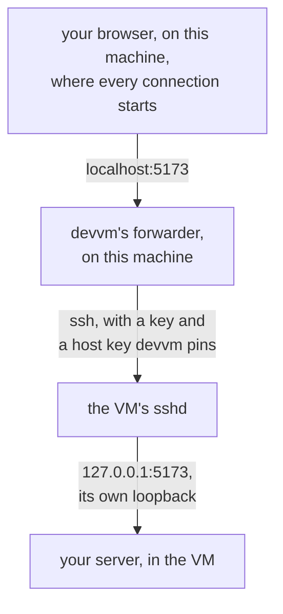

This page explains how devvm's forwarder forwards a VM's ports to this machine, which ports it never takes, and how it runs on each backend. [Ports and size](../using/ports-size.md#ports) covers choosing a VM's ports with `--ports` and `devvm ports`.

devvm's forwarder forwards ports by the same rules on every backend, and devvm uses no backend's own forwards for a VM's ports. [Lima](lima.md#ports), [smolvm](smolvm.md#ports) and [Docker](docker.md#ports) each explain why, and what devvm sets on the backend instead.

## What it forwards

[Ports](../using/ports-size.md#ports) lists which ports the forwarder forwards, for `--ports all`, the default, and for a list such as `--ports 5173,8000-8010`, and how soon. A listed port also carries a server on the VM's loopback (`127.0.0.1` or `::1`) to this machine. You can list port 22, which forwards the VM's sshd to port 22 on this machine, while ssh by name keeps using the VM's own ssh port.

The forwarder never forwards a server on an address in `127.77.0.0/16`, on any VM, because that's where a VM listens for its [links to other VMs](design.md#links-between-vms), so a link never appears on this machine's `localhost`. A server of the VM's own on `127.0.0.1` with the same port is forwarded as usual.

## What it never takes

The forwarder never takes a port that a program on this machine has on any address. That program keeps the port and its `localhost` connections, and the forward waits until the VM's server stops and starts again.

The forwarder also never takes a port that devvm records for a VM, even while that port is free. Those are the ssh, proxy and decider ports that devvm chooses for VMs, the VM's own ssh port, and the ports other VMs list. A Lima VM without network policy has an ssh port that Lima picks and devvm doesn't record, but Lima holds that port, so the forwarder can't take it.

When a start, or a change of a running VM's ports, finds that a program on this machine has a listed port, devvm doesn't forward that port and warns you (`ports_taken`). The VM starts or runs on all the same, and the next start or change that finds the port free forwards it again. [Ports](../using/ports-size.md#ports) says what happens to a program that binds a port on all addresses after the forwarder has forwarded it.

## How it reaches the VM

The forwarder reaches the VM over the VM's ssh, with a key and a host key that devvm pins, and it asks for no forwarding into this machine. Every connection starts on this machine, and the VM opens none to it. The VM sees each forwarded connection only as one to its own loopback, and with network policy the VM still reaches only its proxy.

A connection to a forwarded port, such as 5173, takes this path:

How the forwarder logs in, and when it ends, differs by backend, as the Ports sections of [Lima](lima.md#ports), [smolvm](smolvm.md#ports) and [Docker](docker.md#ports) describe.

## Its process and files

The forwarder runs as a hidden devvm command, one process for each VM. devvm starts it after each start of the VM and again with the new ports when you change a running VM's ports, and `devvm stop` stops it. devvm keeps which ports a VM forwards in its own record for the VM, so `devvm ports` changes that record and never the backend's config. The forwarder's log is `<vm>.ports.log` beside that record.

| Backend | Process | Ports record | Log |
| --- | --- | --- | --- |
| Lima | `devvm _lima-ports` | `~/.local/share/devvm/lima-vms/<vm>.ports`, which holds `all`, `none` or a list | `~/.local/share/devvm/lima-vms/<vm>.ports.log` |
| smolvm | `devvm _smolvm-ports` | `~/.local/share/devvm/smolvm/vms/<vm>.json` | `~/.local/share/devvm/smolvm/vms/<vm>.ports.log` |
| Docker | `devvm _docker-ports` | `~/.local/share/devvm/docker/vms/<vm>.json` | `~/.local/share/devvm/docker/vms/<vm>.ports.log` |

## When it can't forward

- A VM without ssh forwards no ports, and devvm warns you (`ports_no_ssh`). On smolvm, for example, that's a VM whose image has no sshd.
- When a forwarder doesn't start, devvm warns you and names its log (`ports_forward_failed`), and the VM runs on without forwarded ports.
