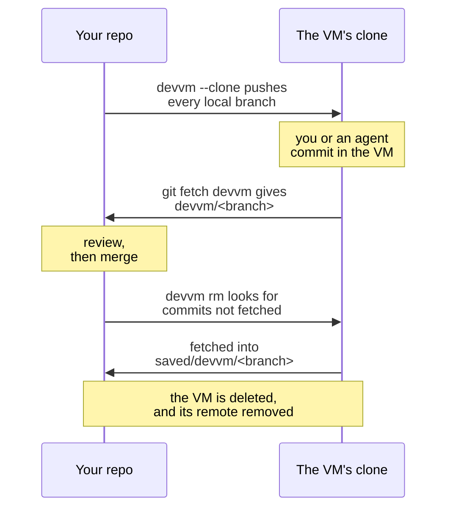

`devvm --clone` gives the VM its own clone of the repo instead of mounting your folder, so nothing in the VM can touch your working tree or `.git`. Use it when you don't trust what runs in the VM, such as an agent working unattended, and on Linux hosts, which have no [`.git` protection](../safety/git-protection.md#linux-hosts). [Files the VM writes](../safety/attack-vectors.md#files-the-vm-writes) lists what `--clone` keeps away from this machine.

```sh
devvm --clone              # create the VM, copy your branches into it and open a shell in its clone
git fetch devvm            # later, on this machine, fetch the VM's work as devvm/<branch>
git log -p main..devvm/main
```



## Requirements

- The folder is the top folder of a git repo that has at least one commit and a branch checked out, not a detached HEAD.
- git is installed on this machine. The VM's images already have it.
- You choose `--clone` when the VM is created. devvm refuses `--clone` for an existing VM that mounts its folder, so to switch, save any work in that VM, then run `devvm rm` and `devvm --clone`. Once a VM is a `--clone` VM it stays one, and you don't need to pass `--clone` again.

## What's copied

From this machine, the VM mounts only the shared tools and its [agents' config folders](coding-agents.md#mounts). Once the VM is running, devvm creates a repo in it at the same path as your folder and pushes every local branch into it. The push goes over [the VM's SSH entry](ssh.md#ssh-access-by-name), which checks the VM's pinned host keys. devvm checks out your current branch in the clone, and your shell opens there.

devvm copies only your local branches. Tags, uncommitted changes, and untracked or ignored files such as `.env` and `node_modules` stay on this machine. devvm warns you about uncommitted changes, so you can commit them and send them later with `git push devvm BRANCH`.

If the copy fails, for example because the VM can't be reached, devvm tries again the next time you run it in the folder.

## The remote

devvm adds a git remote for the VM to your repo. It's named `devvm`, or `devvm-<folder>` if `devvm` is already taken, or the VM's full name if both are. The remote's URL is the VM's full name followed by the clone's path, so git connects through devvm's ssh config, and fetching needs two things:

- Your `~/.ssh/config` needs devvm's `Include` line ([SSH access by name](ssh.md#ssh-access-by-name)). devvm offers to add it when it creates the clone, and again when you run `devvm ssh` or `devvm code`. Until the line is there, or when devvm had no terminal to ask in, fetch with `GIT_SSH_COMMAND='ssh -F ~/.config/devvm/ssh_config' git fetch devvm`.
- The VM must be running. A stopped VM has no SSH entry, so `git fetch` fails because it can't resolve the name. Run `devvm` or `devvm ssh` in the folder first.

## Fetching the VM's work

Fetching runs nothing from the VM on this machine. git only receives objects and updates the `devvm/*` branches, or creates new `saved/devvm/*` branches when `devvm rm` does the fetch. The commits themselves are untrusted, though, so treat them as you would a contributor's branch and review them before you merge them, check them out or run anything they change.

## Subfolders

When you run devvm in a subfolder of the repo's folder, devvm uses the `--clone` VM as it uses any parent folder's VM, asking first in a terminal ([a subfolder](../getting-started/commands.md#a-subfolder)). The clone is at the repo folder's path, so the subfolder's path in the VM is the same subfolder in the clone. When the clone has that subfolder, the shell opens there, and `devvm ssh` and `devvm code` give it as the folder to open. When the clone lacks it, for example because the subfolder is untracked or ignored and so never copied, they use the clone's top folder instead.

`devvm --clone` in a subfolder never uses a parent folder's VM. It makes a new `--clone` VM for the subfolder without asking, as `devvm --here` does, so the subfolder must be the top folder of a repo of its own.

## Several agents in one VM

Several agents can work in one `--clone` VM, each on a branch of its own in a git worktree of its own, so each agent edits its own copy of the files. Put the worktrees inside the clone, such as in `.worktrees/NAME`, because the clone's parent folders in the VM belong to root, and so `git worktree add ../NAME` fails there. In the VM, in the clone:

```sh
echo .worktrees/ >> .git/info/exclude         # once, so git status in the clone leaves the worktrees out
git worktree add -b agent/api .worktrees/api  # a worktree on a new branch, agent/api
cd .worktrees/api                             # then start the agent here
```

Every worktree shares the clone's repo, so the agents' branches are all in it. One `git fetch devvm` on this machine brings every agent's branch back, such as `devvm/agent/api`, and you review each one as you would any of the VM's work ([fetching the VM's work](#fetching-the-vms-work)). Before `devvm rm` deletes the VM, it also checks each worktree inside the clone for uncommitted changes ([deleting the VM](#deleting-the-vm)).

Install each worktree's dependencies in that worktree, and never share one `node_modules` folder between worktrees, because each branch can need different packages, and two agents installing at once can break it. pnpm and bun keep one package store in the VM and hard-link packages from it into each worktree's `node_modules` when both are on the same disk, so another worktree costs little download or disk.

The agents also share the VM's ports, so two servers on the same port collide. Give each worktree's server a port of its own, such as with `PORT=3001`. A VM that forwards every port, as new VMs do by default, forwards each of them to this machine's `localhost` ([ports](ports-size.md#ports)).

The agents in one VM share its network policy, its secrets, and its CPUs, memory and disk, and each agent can read and change every other agent's worktree. When the agents need different network policies, secrets or sizes, or when one agent mustn't reach another's work, give each agent a folder of its own on this machine, such as a separate clone of the repo, and run `devvm --clone` in each, so each gets a VM of its own.

## Deleting the VM

Before `devvm rm` deletes a `--clone` VM, it checks the clone for work you'd lose, starting the VM if it's stopped:

1. If the clone has branches with commits this repo hasn't fetched, devvm names them and offers to fetch them into new local branches named `saved/devvm/<branch>`. It skips a branch whose name git on this machine refuses and names it, and that branch goes with the VM. To keep such a branch, rename it in the VM with `git branch -m` before you run `devvm rm`.
2. If the clone or a worktree inside its folder has uncommitted changes, devvm lists the first 20 of them in all, with each worktree's changes under its path, and asks before deleting them along with the VM. devvm skips a worktree whose folder is gone or that git would prune, and it doesn't check worktrees outside the clone's folder. When the clone has more than 100 worktrees, devvm checks the first 100 and asks before deleting the VM, even if none of them has changes.

If either check finds something and there's no terminal to ask in, devvm refuses and keeps the VM.

Once the checks pass, devvm deletes the VM. If the remote still points at the VM, devvm then removes it with `git remote remove`, which also deletes its `devvm/*` branches and their upstream settings. Before it does, devvm keeps every `devvm/*` branch that has commits no other branch has as a new local branch under `saved/devvm/`, whoever fetched it. devvm names each branch it creates, and they're yours to review, merge or delete, as with `git branch -D saved/devvm/main`.

The saved branches are named after the remote, as `saved/<remote>/<branch>`, and devvm never overwrites a branch. When a branch is in the way, devvm uses `saved/<remote>-2`, then `-3` and so on, and if it finds no free name, `devvm rm` refuses and keeps the VM ([saved branches](../internals/overview.md#saved-branches)).

`devvm rm -f` skips both checks, but it still keeps the fetched branches as described above.
