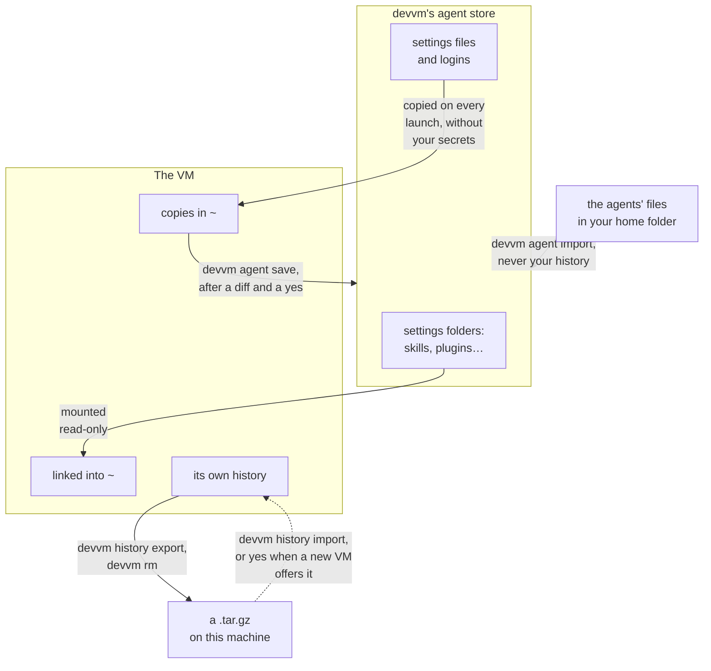

## Running an agent

An agent runs where you start it, so you start it in the VM's shell, not on this machine. On this machine, devvm opens the VM's shell, and the VM's prompt starts with `(devvm)`:

```console
~/some-project $ devvm
(devvm) ~/some-project $ claude
```

In the VM the agent sees only your project folder, and your agents' settings from [devvm's agent store](#devvms-agent-store), which it gets read-only. Whatever it runs, such as a script a package installs, runs in the VM too. You don't install any agent on this machine, because devvm installs each one in the VMs that have it.

## Supported agents

A new VM gets an agent when you check it in the list that devvm shows when you customize the VM, or when you name it with `--agents`. A VM that exists gets one from `devvm tools`, which shows the same list with the VM's agents checked, or from `devvm tools add`:

```sh
devvm                          # a new VM: type y to customize it, then check claude, codex or opencode
devvm --agents claude,codex    # a new VM with Claude Code and Codex, without the list
devvm tools                    # the VM that exists: check or uncheck its agents in the list
devvm tools add opencode       # the VM that exists: add opencode without the list
```

In the VM, you run the agent as `claude`, `codex` or `opencode`.

| Name | Agent | What devvm adds | Allowlist, on the allowlist and none tiers |
| --- | --- | --- | --- |
| `claude` | Claude Code | the newest release, with its auto-update off, since the shared copy is read-only, and its telemetry off | Anthropic's API, Claude's login and Claude Code's downloads: `api.anthropic.com`, `claude.ai`, `downloads.claude.ai`, `platform.claude.com` and `mcp-proxy.anthropic.com` |
| `codex` | Codex | the newest release, with its analytics and metrics off unless your config sets them | the OpenAI API and the ChatGPT login: `api.openai.com`, `chatgpt.com` and `auth.openai.com` |
| `opencode` | opencode | the newest release | opencode's own service and its model catalog: `opencode.ai` and `models.dev` |

Claude Code's telemetry hosts aren't on its allowlist, because blocking them costs nothing. opencode talks to the model provider you choose, so on the allowlist tier you allow that provider's API host yourself, such as `devvm network allow api.anthropic.com` ([changing rules](../safety/network.md#changing-rules)).

Agents are [shared tools](images.md#shared-tools), like the toolchains, so you can combine them with any layers and with each other, as in `devvm --tools node --agents claude,codex`. devvm follows each agent's newest release, because agents release several times a week, and `devvm update` or `devvm tools update` moves a VM to newer versions ([adding and removing tools](toolchains.md#adding-and-removing-tools)).

### Setup's default agents

`devvm setup` chooses the agents that the list checks for every new VM, and that a new VM gets without a terminal. devvm asks for them on its first run in a terminal and again in `devvm setup`'s questions, and `devvm setup --agents claude,codex` or `devvm setup --agents none` sets them without asking. They're a setting for new VMs only, so a VM that exists keeps its agents ([devvm setup](settings.md#devvm-setup)).

## devvm's agent store

devvm keeps the agents' settings and logins on this machine in a store of its own, and every VM with an agent gets that agent's settings and logins from there. devvm never reads the agents' own files in your home folder for a VM, such as `~/.claude`, `~/.claude.json`, `~/.codex`, `~/.config/opencode` or `~/.local/share/opencode`, so a VM gets the same settings and logins whether or not this machine has the agent. The one command that reads those files is [`devvm agent import`](#importing-from-this-machine), which copies them into the store when you run it, and [`devvm agent save`](#saving-a-vms-settings) copies the settings you changed in a VM into the store.

The store has two folders for each agent, and each one holds the agent's files at the same paths below it as the agent keeps them in a home folder:

- **Settings** go in `~/.config/devvm/agents/<agent>/`, such as `~/.config/devvm/agents/claude/.claude/settings.json` and `~/.config/devvm/agents/claude/.claude/skills`. You can edit these files and make or delete these folders yourself, and a VM gets the change on its next launch, as [mounts](#mounts) and [copies](#copies) describe.
- **Logins** go in `~/.local/share/devvm/logins/<agent>/`, such as `~/.local/share/devvm/logins/codex/.codex/auth.json` and `~/.local/share/devvm/logins/claude/.claude.json`, and so does a Codex or opencode login that you [make inside a VM](#codex-and-opencode-logins). Only you can read them, because devvm makes each agent's logins folder yours alone (mode 700) and each login file mode 600. On macOS, devvm keeps each agent's logins folder out of Time Machine's backups.

Each VM gets its agents' settings and logins from the store, but never your history. Transcripts, sessions and databases aren't in the store, and each VM's own stay in that VM. Before you leave an agent running unattended, read [staying safe](../safety/_index.md#the-habits) and [rogue agents](../safety/attack-vectors.md#rogue-agents).



Each row lists the agent's paths in the VM's home, and the store keeps each one at the same path below the agent's settings or logins folder:

| | Mounted read-only, linked into `~` | Copied in on every launch |
| --- | --- | --- |
| claude | `~/.claude/{skills,agents,commands,output-styles,plugins}` | `~/.claude/settings.json`, `~/.claude/CLAUDE.md`, and from the logins `~/.claude.json` ([merged](#copies), only its settings, account state and MCP servers) |
| codex | `~/.codex/{prompts,skills}` | `~/.codex/{config.toml,AGENTS.md}`, and from the logins `~/.codex/auth.json` |
| opencode | the subfolders of `~/.config/opencode` (not `node_modules`) | the files in `~/.config/opencode` (not lock files), and from the logins `~/.local/share/opencode/auth.json` |

### Importing from this machine

When you already use an agent on this machine, `devvm agent import` copies its settings and logins from your home folder into the store, so your VMs get them. With no argument it imports every agent that your home folder has files of, and `devvm agent import claude codex` imports only the agents you name:

```sh
devvm agent import              # copy every agent's settings and logins into the store
devvm agent import codex        # copy only Codex's
devvm agent import --force      # replace what the store has without asking
```

The import copies only the paths in the table above, from `~/.claude`, `~/.claude.json`, `~/.codex`, `~/.config/opencode` and `~/.local/share/opencode`, so it never copies your history, such as `~/.claude/projects` or `~/.codex`'s sessions, and never `~/.claude/.credentials.json`. From `~/.claude.json` it keeps only the settings, account state and MCP servers, so your API key and your per-project entries stay out of the store. Claude Code's plugin records name the plugins' folders by their paths, so the store's copies of the JSON files in `~/.claude/plugins` name the plugins' folders in the store, where the VMs mount them. devvm says which agents it imported and where, and an agent you named that your home folder has nothing of gets a warning.

devvm reads each agent's settings inside the agent's own folder, such as `~/.claude`, and it never follows a link out of it. A link to a file inside the folder becomes a copy of that file, and a link that leads out of the folder, by a relative or an absolute path, or to a folder, is left out with a warning that names it. A login file that's a link is left out with a warning too. So when your settings live elsewhere, such as in a dotfiles repo with links into `~/.claude`, copy them into the store yourself.

When the store already has settings or a login of an agent you import, devvm asks in a terminal whether to replace them, and the answer is no unless you type `y`. Without a terminal, or with `--no-input`, devvm refuses and names `--force`, which replaces them without asking. A replacement writes each file again and takes out what your home folder no longer has, but it keeps the store's folders, so a running VM's mounts still show them. An agent whose settings aren't in your home folder keeps the store's settings, and one without a login there keeps the store's login.

On macOS, Claude Code keeps its own login in the Keychain, and devvm neither reads it nor copies it. A VM's Claude Code logs in with a Claude Code token that devvm keeps with its secrets instead ([Claude Code login](#claude-code-login)).

### Saving a VM's settings

When you change an agent's settings in a VM, for example by installing a plugin or writing a skill there, `devvm agent save` copies them into the store, so every VM with that agent gets them. With no argument it saves every agent that the folder's VM has, and `devvm agent save claude` saves only the agents you name. devvm starts a stopped VM for it.

```sh
devvm agent save          # show what changed in the VM's agents' settings, then save them
devvm agent save codex    # save only Codex's
```

The save reads only the settings in the table above from the VM's home, and never the logins, so it never reads your history, `~/.claude/.credentials.json`, `~/.codex/auth.json` or opencode's `auth.json`. From the VM's `~/.claude.json` it keeps only the settings, account state and MCP servers, as the import does, and the VM leaves out its per-project entries before it sends anything. devvm puts that part in the store's logins folder, where the import keeps it too. A folder that the store already has is mounted read-only in the VM, so the agent there can't change it, and the save leaves it as it is. A folder that the store doesn't have yet is the VM's own until you save it, and once the VM next starts with the store's new folder mounted, its setup links that folder in place of its own ([mounts](#mounts)).

Before it saves anything, devvm shows what would change. For each folder it lists the files it adds (A), changes (M) and removes (D), and then it shows a diff of each file it adds or changes against the store's copy, with a line when a file's mode changes. The diff shows the settings files and `~/.claude.json` as a VM gets them, written out again with `devvm-redacted` in place of the values that look like secrets, so it never prints your secrets, and it says so when only those values or the file's layout changed. Every character that a terminal wouldn't show, such as a control character, a zero-width character or a character that reverses the text, appears in the diff as its code, such as `\u{200b}`, so a VM can't hide a line from you. The diff names a binary file without showing it, and it shows a file of more than 1 MiB or 10,000 lines, and every line past the first 20,000 of the whole diff, only as a count. Then devvm says that every VM with these agents runs the hooks, the MCP servers' commands and the plugins you save, and it asks whether to save them, and the answer is no unless you type `y`. Read the diff before you answer, because a hook or a plugin that a [rogue agent](../safety/attack-vectors.md#rogue-agents) added in one VM runs in every VM once you save it. devvm agent save always asks, and no flag answers for you, so without a terminal, or with `--no-input`, it shows what would change and then refuses.

devvm treats everything the VM sends as untrusted, because the agent in the VM could have changed any of it. It reads at most 128 MiB from the VM, in at most 20,000 files, folders and links, none of the files larger than 16 MiB, and when the VM sends more, or sends a path outside the agents' settings or a name with a character that a terminal wouldn't show, devvm saves nothing. Each file it saves is yours alone (mode 600), or mode 700 when it was executable in the VM, so it never keeps a set-user-ID or set-group-ID bit. A link in a settings folder that leads to a file in the same folder becomes a copy of that file. devvm leaves out any other link, any other kind of file, such as a socket, and a settings file that it can't parse whole, such as a `settings.json` that isn't JSON, and it warns you about each. When it leaves out a file in a folder, the store keeps its own copy of that file. A settings file that the VM doesn't have stays in the store. A folder that the VM sends replaces the store's folder whole, so devvm writes each of its files again and takes out the files that the VM's folder doesn't have, but it keeps the store's folder itself, so a running VM's mounts still show it.

The VM's [copies](#copies) of the settings files and of `~/.claude.json` hold placeholders, such as `devvm-redacted`, where the store has your secrets. devvm puts the store's secret back in place of each placeholder, as long as the VM's copy had that placeholder in that place and nothing around it changed, such as the URL of the MCP server that a header is for. When something around a placeholder changed, devvm leaves the whole file out and warns you, so a VM can't send a secret it never saw to another host, and you can make that change in the store's file yourself. devvm also leaves out any other file that holds a placeholder, such as a skill. No VM gets opencode's files in `~/.config/opencode` that are neither settings nor Markdown, such as a `.env`, so devvm leaves out the VM's own file of that name and keeps the store's.

## Mounts

devvm mounts the store's settings folders that exist when it creates the VM read-only, at the same path as in the store on this machine, and links them from the VM's home. Absolute paths in them, such as Claude Code's plugin paths, still work. This machine enforces read-only, so even root in the VM can't write to them. devvm mounts each folder whole, whatever the VM's network tier, so the VM reads every file in it, a `.env` or a key file in a plugin's folder included, and the git config of a private plugin marketplace whose URL holds a password. devvm takes no secrets out of these folders, because they hold plugins, skills and their scripts that the agent runs as they are. So keep secrets out of these folders, as you keep them out of the project folder ([why devvm mounts them whole](../internals/network.md#what-stays-in-the-vms-copies)). The VM follows a symlink in these folders among its own files, so a link to a file outside the folder, by a relative or an absolute path, doesn't reach that file on this machine, on macOS's virtiofs mounts and on Linux's 9p mounts alike. devvm doesn't mount a folder whose path has a comma, on any backend, and it warns you. Lima can't mount such a path ([Lima's limits](../backends/lima.md#limits)).

When you make or delete one of these folders in the store later, by hand or with `devvm agent import`, devvm notices on the VM's next launch and names the folder. A VM's mounts change only when it starts, so a stopped VM gets the new mounts as the launch starts it. For a running VM, devvm asks in a terminal whether to restart it now, which stops anything running in it, in the one question that covers every change waiting for the VM's next start, and because the mounts are among those changes, the answer is yes unless you type n ([restarting](../getting-started/commands.md#restarting-and-stopping)). If you answer no, or there's no terminal, or you pass `--no-input`, the mounts change when the VM next starts, for example with `devvm restart`.

## Copies

devvm copies the store's files into the VM's home on every launch, over the VM's own. On every [network tier](../safety/network.md#network-tiers), the copies of the logins and settings files have your secrets taken out, and the VM's proxy puts them into requests instead ([agents' logins and settings](../internals/network.md#agents-logins-and-settings)).

devvm merges the settings and MCP servers from the store's `.claude.json` into the VM's own `~/.claude.json`, so servers added in the VM stay ([MCP servers](../internals/network.md#mcp-servers)). Your API key, your answers about API keys and your per-project entries never reach the VM. devvm also replaces the secrets in the agents' settings files with `devvm-redacted`, and names what it replaced. Those are the values under keys that look like secrets, every env value and header, and the secrets in URLs and in arguments. In other text, such as a hook's command, devvm replaces the secrets in its URLs, the keys that start like a known key, such as `sk-` or `ghp_`, and the credential after `Bearer` or `Basic`, and keeps the words around them ([keys in settings files](../internals/network.md#keys-in-settings-files)). From the `env` of Claude Code's `settings.json`, the VM gets only Claude Code's own settings, such as `ANTHROPIC_MODEL`, the `CLAUDE_CODE_*`, `DISABLE_*` and `MAX_*` variables and those ending in `_TIMEOUT_MS`, but none whose name marks it as a credential, such as `ANTHROPIC_AUTH_TOKEN`. It also gets the values that only name where a secret is, base URLs without their passwords, `true`, `false` and short numbers. Every other env value, and every env value of an MCP server, becomes `devvm-redacted`. When devvm can't parse a settings file to take its secrets out, the VM doesn't get a copy of it, and neither does it get opencode's files in `~/.config/opencode` that are neither settings nor Markdown, such as a `.env`. devvm names each file it doesn't copy, and when it can't make the copy of a login, it says why.

### Claude Code login

Claude Code's login on macOS is in the Keychain and can't be shared, so VMs use a long-lived Claude Code token instead. To set it up:

1. Run `claude setup-token` on this machine and approve in the browser.
2. Run `devvm secret set claude` and paste the Claude Code token that `claude setup-token` printed (`sk-ant-oat01-…`), not the code the browser shows.

devvm saves the Claude Code token with the other [secrets](../safety/network.md#saving-and-binding-secrets), and it puts it in the environment of every VM that has `claude`, as `CLAUDE_CODE_OAUTH_TOKEN`, from the VM's next launch. A `CLAUDE_CODE_OAUTH_TOKEN` in devvm's own environment wins over the saved one. devvm neither saves nor sends a Claude Code token that isn't a setup token. The VM gets a placeholder of its own, whatever its network tier, and its proxy puts the Claude Code token into requests. devvm never copies a `~/.claude/.credentials.json`.

### Codex and opencode logins

On every network tier, the VM's `auth.json` holds placeholders, and its proxy holds the real API keys and logins. The proxy reads them from the login files in devvm's store as it needs them and refreshes ChatGPT logins there, so when the agent in the VM stops getting answers, the proxy's own log, `proxy.log` in `~/.local/share/devvm/vms/<hash>/logs/`, may say that refreshing a login failed or that you're no longer logged in that way. Log in again in a VM, or log in again with `codex` or `opencode` on this machine and run `devvm agent import --force codex` or `devvm agent import --force opencode`, and if you changed how you log in, run `devvm` in the VM's folder so the VM gets the new login's placeholders. The proxy puts in opencode's API keys for Anthropic, OpenAI and OpenRouter, and its OpenAI and GitHub Copilot logins. The VM gets opencode's API keys for other providers unchanged, and its well-known logins too, which an organization's own opencode config sets up, because devvm doesn't know which hosts those are for. devvm warns you about each. The VM gets opencode's other OAuth logins, such as Copilot Enterprise's, without their access and refresh tokens, so they don't work in the VM, and devvm warns you about each. To use such a provider in the VM, log in to it with an API key on this machine and import the login again.

You can log in to ChatGPT inside a VM too, so this machine never needs Codex or opencode. When Codex or opencode in a VM logs in to OpenAI, the VM's proxy saves the login in devvm's store, in the agent's own `auth.json`, and the agent in the VM gets only placeholders, so the VM never holds the login's tokens. The VM you logged in from uses the login at once, and every VM with that agent gets it from its next launch. A login that shows a code to type into a browser on any machine works in a VM as it is, such as `codex login --device-auth` and opencode's headless ChatGPT login. A new login replaces the one in the store, together with Codex's API key, so every VM with the agent uses the account you logged in to last. In a VM with both Codex and opencode, devvm tells their logins apart by the program that sends them. `devvm network log` shows a `login` line for each login it saved. On the open tier, a program that goes around the VM's proxy gets the login's tokens itself, and devvm saves nothing ([logins made in a VM](../internals/network.md#logins-made-in-a-vm)).

## History

Each VM's transcripts and sessions stay in that VM. `devvm history export [FILE]` saves them, and `devvm rm` saves them before it deletes a VM that has an agent. The export is a `.tar.gz` of `~/.claude`, `~/.claude.json`, `~/.codex`, `~/.local/share/opencode` and `~/.local/state/opencode` in the VM, written to FILE or to `~/.local/share/devvm/exports/<vm>-<date>-<time>.tar.gz`. An export in that folder gets a `<vm>-<date>-<time>.folder` file beside it, which names the VM's project folder.

`devvm history` lists the exports in `~/.local/share/devvm/exports`, oldest first, in a table with a header. It shows each export's file, the VM it's of, that VM's folder, the date and time devvm wrote it, and its size, with `-` for a folder devvm has no record of. Exports you wrote to a FILE of your own aren't listed, and `devvm history` changes nothing and starts no VM.

### devvm history --json

`devvm history --json` prints the same list as one JSON object, as [output for scripts](../getting-started/commands.md#output-for-scripts) describes. Each of the `exports` has its `file`, its `vm`, the VM's `folder`, which is `""` when devvm has no record of it, the `date` devvm wrote it in RFC 3339 with this machine's time zone, and its `size` in bytes.

```json
{
  "version": 1,
  "exports": [
    {
      "file": "/Users/you/.local/share/devvm/exports/devvm-website-71a99b1076d92c-20261001-120000.tar.gz",
      "vm": "devvm-website-71a99b1076d92c",
      "folder": "/Users/you/code/website",
      "date": "2026-10-01T12:00:00+02:00",
      "size": 1048576
    }
  ]
}
```

After `devvm rm`, an export is the only copy of that VM's history, so devvm keeps the exports until you ask it to delete them. `devvm gc --history` deletes the exports in that folder, and `devvm gc --history --older-than 30d` deletes only those written 30 days ago or more. An export's age counts from the date and time in its name, which is this machine's local time when devvm wrote it, so across a change to or from daylight saving time an export reaches an age such as `30d` an hour earlier or later, for `--older-than` and for the `history.age` [retention setting](settings.md#retention) alike. gc lists each one by its VM and date first, and in a terminal it asks. Exports you wrote to a FILE of your own stay where they are.

The agents' logins aren't in the export, which leaves out `~/.claude/.credentials.json`, `~/.codex/auth.json`, and opencode's `auth.json`, `account.json` and `bin`. devvm starts a stopped VM for the export as a launch does, so it locks the folder's `.git` again and checks the VM's confinement first, and the VM stays running. devvm writes the file only once the export is complete, so a failed export leaves no file and leaves an existing FILE as it was. Only you can read the file, and devvm makes the exports folder yours alone each time it writes one there, whatever its mode was before. When FILE is in a folder of your own, that folder keeps its mode. If the export fails, `devvm rm` keeps the VM, and `devvm rm --no-export` deletes it without exporting. `devvm rm VM`, for a VM whose folder is gone, exports in the same way, but only from a running VM or a `--clone` VM, because starting any other would make its folder again ([a VM whose folder is gone](../getting-started/commands.md#a-vm-whose-folder-is-gone)).

### Importing history

`devvm history import [FILE]` puts an export back into this folder's VM, so the agents' transcripts and sessions carry over when you delete a VM and make it again. Without FILE, it imports the newest export in `~/.local/share/devvm/exports` that devvm saved for this folder, going by the `.folder` file beside each one, and it never picks an export made for another folder. With FILE, it imports that `.tar.gz`, such as one you saved with `devvm history export FILE`. devvm starts a stopped VM for the import, as it does for an export. The import works on every VM, whether its base is Ubuntu's image or a Debian-, Ubuntu- or Alpine-based container image ([starting from a container image](from.md)), because it unpacks the export with GNU `tar`, which Debian and Ubuntu always have and which devvm installs in every base made `--from alpine`.

When devvm makes a new VM that has an agent, and it saved an export for the same folder before, it offers that export. In a terminal it asks whether to import it into the new VM, and the answer is no unless you type `y`. Without a terminal, or with `--no-input`, it doesn't ask, and it says which export it found and that `devvm history import` in the folder puts it into the VM. devvm imports the export once the VM has started and before its setup, and if the import fails, devvm warns and makes the VM anyway, so you can run `devvm history import` later.

An export holds what a VM wrote, so devvm treats it as untrusted. devvm never unpacks it on this machine. It streams the file into the VM as it is, and the VM's own `tar` unpacks it there as the VM's user, so it can only write what that user can write. Before unpacking anything, the VM lists the paths in the export, and when one of them is outside `~/.claude`, `~/.claude.json`, `~/.codex`, `~/.local/share/opencode` and `~/.local/state/opencode`, starts with `/` or has a `..` part, devvm imports nothing and says so. The import keeps no owner or mode from the export, so the VM user's umask applies and no file is set-user-ID. It also takes out every symbolic link that points outside the folder it's in, which is any link to an absolute path or one with a `..` part, so an agent writing to a session file can't follow a link out of its history.

The import leaves out what devvm puts in the VM itself. That's the agents' logins, `~/.claude/.credentials.json`, `~/.codex/auth.json`, and opencode's `auth.json`, `account.json` and `bin`. It's also `~/.claude.json`, whose copy in the old VM held that VM's own placeholders, and every agent's [mounted folders and copied files](#devvms-agent-store), which the new VM's setup links and copies from devvm's agent store. A file or folder the VM already has stays as it is, so importing into a VM that has history of its own adds the export's files without replacing any of its own.

## The VM's setup

Besides the agents' config, every launch sets the VM up from this machine's settings:

- its hostname, which is the folder's part of the VM's name;
- the timezone (`TZ`, else this machine's) and, when it's UTF-8, the locale (`LC_ALL`, else `LANG`);
- git's `user.name` and `user.email`, as git has them in the project folder;
- telemetry off where an environment variable can't turn it off, which is Go's, and Codex's analytics and metrics;
- `(devvm)` at the start of the prompt.

On every network tier, the launch also installs the VM's own CA and the next one, points apt, sudo, ssh, the [docker layer](images.md#docker)'s Docker and the [nix layer](images.md#nix)'s Nix at the proxy, and adds `devvm-why`, which shows what the proxy blocked lately. It also tells the agents, in `~/.claude/CLAUDE.md` and `~/.codex/AGENTS.md`, why a request may fail ([inside the VM](../safety/network.md#inside-the-vm)). The VM's secrets go in `~/.config/devvm/env` in the VM, which login shells read, and that file holds their placeholders.
