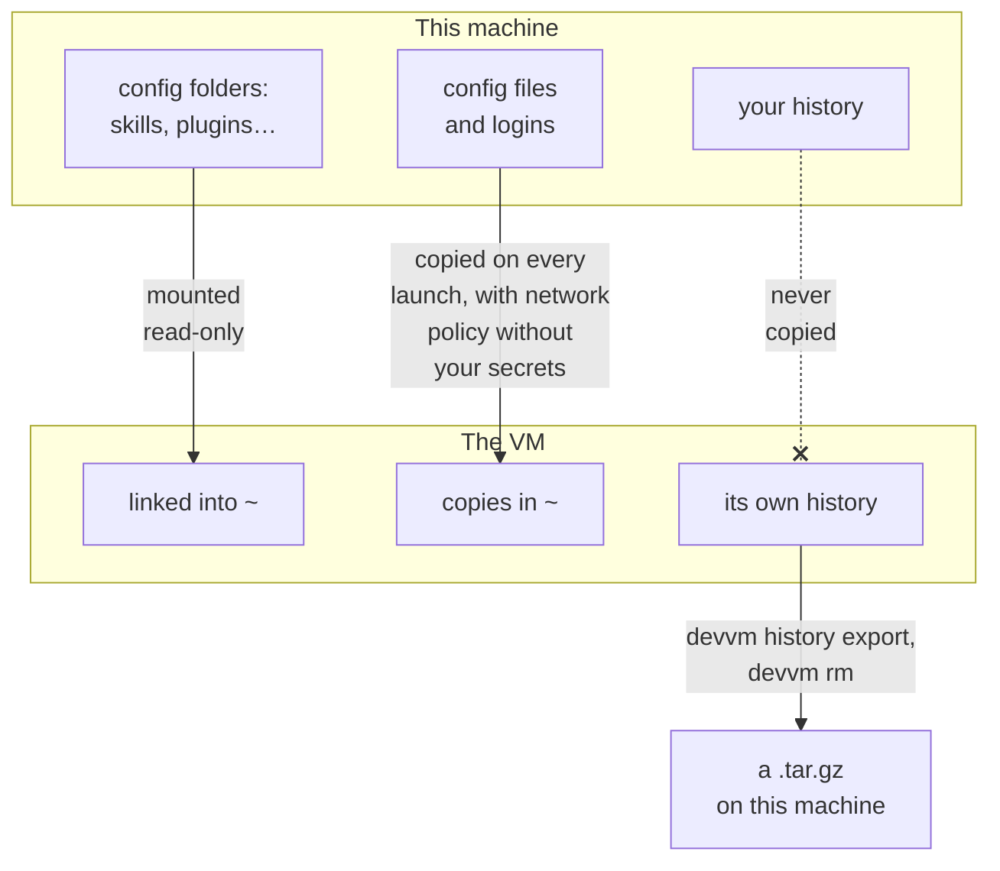

## Running an agent

An agent runs where you start it, so you start it in the VM's shell, not on this machine. On this machine, devvm opens the VM's shell, and the VM's prompt starts with `(devvm)`:

```console
~/some-project $ devvm
(devvm) ~/some-project $ claude
```

In the VM the agent sees only your project folder, and your agents' config, which it gets read-only. Whatever it runs, such as a script a package installs, runs in the VM too.

## Supported agents

A new VM gets an agent when you check it in the list that devvm shows as it makes the VM, or when you name it with `--agents`. A VM that exists gets one from `devvm tools`, which shows the same list with the VM's agents checked, or from `devvm tools add`:

```sh
devvm                          # a new VM: check claude, codex or opencode in the list
devvm --agents claude,codex    # a new VM with Claude Code and Codex, without the list
devvm tools                    # the VM that exists: check or uncheck its agents in the list
devvm tools add opencode       # the VM that exists: add opencode without the list
```

In the VM, you run the agent as `claude`, `codex` or `opencode`.

| Name | Agent | What devvm adds | Allowlist with network policy |
| --- | --- | --- | --- |
| `claude` | Claude Code | the newest release, with its auto-update off, since the shared copy is read-only, and its telemetry off | Anthropic's API, Claude's login and Claude Code's downloads: `api.anthropic.com`, `claude.ai`, `downloads.claude.ai`, `platform.claude.com` and `mcp-proxy.anthropic.com` |
| `codex` | Codex | the newest release, with its analytics and metrics off unless your config sets them | the OpenAI API and the ChatGPT login: `api.openai.com`, `chatgpt.com` and `auth.openai.com` |
| `opencode` | opencode | the newest release | opencode's own service and its model catalog: `opencode.ai` and `models.dev` |

Claude Code's telemetry hosts aren't on its allowlist, because blocking them costs nothing. opencode talks to the model provider you choose, so with network policy you allow that provider's API host yourself, such as `devvm network allow api.anthropic.com` ([changing rules](../safety/network.md#changing-rules)).

Agents are [shared tools](images.md#shared-tools), like the toolchains, so you can combine them with any layers and with each other, as in `devvm --tools node --agents claude,codex`. devvm follows each agent's newest release, because agents release several times a week, and `devvm tools update` moves a VM to newer versions ([adding and removing tools](toolchains.md#adding-and-removing-tools)).

### Setup's default agents

`devvm setup` chooses the agents that the list checks for every new VM, and that a new VM gets without a terminal. devvm asks for them on its first run in a terminal and again in `devvm setup`'s questions, and `devvm setup --agents claude,codex` or `devvm setup --agents none` sets them without asking. They're a setting for new VMs only, so a VM that exists keeps its agents ([devvm setup](settings.md#devvm-setup)).

## Config from this machine

When a VM has `claude`, `codex` or `opencode`, the VM gets your config for that agent from this machine, but never your history. Transcripts, sessions and databases stay where they are, and each VM's own stay in that VM. Before you leave an agent running unattended, read [staying safe](../safety/_index.md#the-habits) and [rogue agents](../safety/attack-vectors.md#rogue-agents).



| | Mounted read-only, linked into `~` | Copied in on every launch |
| --- | --- | --- |
| claude | `~/.claude/{skills,agents,commands,output-styles,plugins}` | `~/.claude/settings.json`, `~/.claude/CLAUDE.md`, `~/.claude.json` ([merged](#copies), without per-project entries) |
| codex | `~/.codex/{prompts,skills}` | `~/.codex/{config.toml,AGENTS.md,auth.json}` |
| opencode | the subfolders of `~/.config/opencode` (not `node_modules`) | the files in `~/.config/opencode` (not lock files), `~/.local/share/opencode/auth.json` |

## Mounts

devvm mounts the folders that exist when it creates the VM read-only, at the same path as on this machine, and links them from the VM's home. Absolute paths in them, such as Claude Code's plugin paths, still work. This machine enforces read-only, so even root in the VM can't write to them. devvm doesn't mount a folder whose path has a comma, on any backend, and it warns you. Lima and Docker can't mount such a path ([Lima's limits](../backends/lima.md#limits), [Docker's](../backends/docker.md#what-docker-vms-cant-do)).

When you make or delete one of these folders on this machine later, devvm notices on the VM's next launch and names the folder. A VM's mounts change only while it's stopped. A stopped VM's mounts change at once. For a running VM, devvm asks in a terminal whether to restart it now, which stops anything running in it, and otherwise the mounts change when the VM next starts, for example with `devvm restart`.

## Copies

devvm copies the files into the VM's home on every launch, over the VM's own. With [network policy](../safety/network.md), the copies of the logins and settings files have your secrets taken out, and the VM's proxy puts them into requests instead ([agents' logins and settings](../internals/network.md#agents-logins-and-settings)).

devvm merges your MCP servers from `~/.claude.json` into the VM's own, so servers added in the VM stay ([MCP servers](../internals/network.md#mcp-servers)). With network policy, devvm also replaces values under keys that look like secrets in the agents' settings files with `devvm-redacted`, and names what it replaced ([keys in settings files](../internals/network.md#keys-in-settings-files)).

### Claude Code login

Claude Code's login on macOS is in the Keychain and can't be shared, so VMs use a long-lived Claude Code token instead. To set it up:

1. Run `claude setup-token` on this machine and approve in the browser.
2. Run `devvm secret set claude` and paste the Claude Code token that `claude setup-token` printed (`sk-ant-oat01-…`), not the code the browser shows.

devvm saves the Claude Code token with the other [secrets](../safety/network.md#saving-and-binding-secrets), and it puts it in the environment of every VM that has `claude`, as `CLAUDE_CODE_OAUTH_TOKEN`, from the VM's next launch. A `CLAUDE_CODE_OAUTH_TOKEN` in devvm's own environment wins over the saved one. devvm neither saves nor sends a Claude Code token that isn't a setup token. With network policy the VM gets a placeholder of its own, and its proxy puts the Claude Code token into requests, and without network policy the VM gets the Claude Code token itself. devvm never copies a `~/.claude/.credentials.json`.

### Codex and opencode logins

With network policy, the VM's `auth.json` holds placeholders, and its proxy holds the real API keys and logins. Without network policy, the VM gets the file as it is, and a VM that refreshes an OAuth login can replace its refresh token and sign this machine out. An API key avoids this.

## History

Each VM's transcripts and sessions stay in that VM. `devvm history export [FILE]` saves them, and `devvm rm` saves them before it deletes a VM that has an agent. The export is a `.tar.gz` of `~/.claude`, `~/.claude.json`, `~/.codex`, `~/.local/share/opencode` and `~/.local/state/opencode` in the VM, written to FILE or to `~/.local/share/devvm/exports/<vm>-<date>-<time>.tar.gz`. An export in that folder gets a `<vm>-<date>-<time>.folder` file beside it, which names the VM's project folder.

`devvm history` lists the exports in `~/.local/share/devvm/exports`, oldest first, in a table with a header. It shows each export's file, the VM it's of, that VM's folder, the date and time devvm wrote it, and its size, with `-` for a folder devvm has no record of. Exports you wrote to a FILE of your own aren't listed, and `devvm history` changes nothing and starts no VM.

### devvm history --json

`devvm history --json` prints the same list as one JSON object, as [output for scripts](../getting-started/commands.md#output-for-scripts) describes. Each of the `exports` has its `file`, its `vm`, the VM's `folder`, which is `""` when devvm has no record of it, the `date` devvm wrote it in RFC 3339 with this machine's time zone, and its `size` in bytes.

```json
{
  "version": 1,
  "exports": [
    {
      "file": "/Users/you/.local/share/devvm/exports/devvm-website-71a99b1076d92c-20261001-120000.tar.gz",
      "vm": "devvm-website-71a99b1076d92c",
      "folder": "/Users/you/code/website",
      "date": "2026-10-01T12:00:00+02:00",
      "size": 1048576
    }
  ]
}
```

After `devvm rm`, an export is the only copy of that VM's history, so devvm keeps the exports until you ask it to delete them. `devvm gc --history` deletes the exports in that folder, and `devvm gc --history --older-than 30d` deletes only those written 30 days ago or more. An export's age counts from the date and time in its name, which is this machine's local time when devvm wrote it, so across a change to or from daylight saving time an export reaches an age such as `30d` an hour earlier or later, for `--older-than` and for the `history.age` [retention setting](settings.md#retention) alike. gc lists each one by its VM and date first, and in a terminal it asks. Exports you wrote to a FILE of your own stay where they are.

The agents' logins aren't in the export, which leaves out `~/.claude/.credentials.json`, `~/.codex/auth.json`, and opencode's `auth.json`, `account.json` and `bin`. devvm starts a stopped VM for the export as a launch does, so it locks the folder's `.git` again and checks the VM's network policy first, and the VM stays running. devvm writes the file only once the export is complete, so a failed export leaves no file and leaves an existing FILE as it was. Only you can read the file, and devvm makes the exports folder yours alone each time it writes one there, whatever its mode was before. When FILE is in a folder of your own, that folder keeps its mode. If the export fails, `devvm rm` keeps the VM, and `devvm rm --no-export` deletes it without exporting.

## The VM's setup

Besides the agents' config, every launch sets the VM up from this machine's settings:

- its hostname, which is the folder's part of the VM's name;
- the timezone (`TZ`, else this machine's) and, when it's UTF-8, the locale (`LC_ALL`, else `LANG`);
- git's `user.name` and `user.email`, as git has them in the project folder;
- telemetry off where an environment variable can't turn it off, which is Go's, and Codex's analytics and metrics;
- `(devvm)` at the start of the prompt.

With network policy, the launch also installs devvm's CA, points apt, sudo, ssh, the [docker layer](images.md#docker)'s Docker and the [nix layer](images.md#nix)'s Nix at the proxy, and adds `devvm-why`, which shows what the proxy blocked lately. It also tells the agents, in `~/.claude/CLAUDE.md` and `~/.codex/AGENTS.md`, why a request may fail ([inside the VM](../safety/network.md#inside-the-vm)). The VM's secrets go in `~/.config/devvm/env` in the VM, which login shells read, and with network policy that file holds their placeholders.
