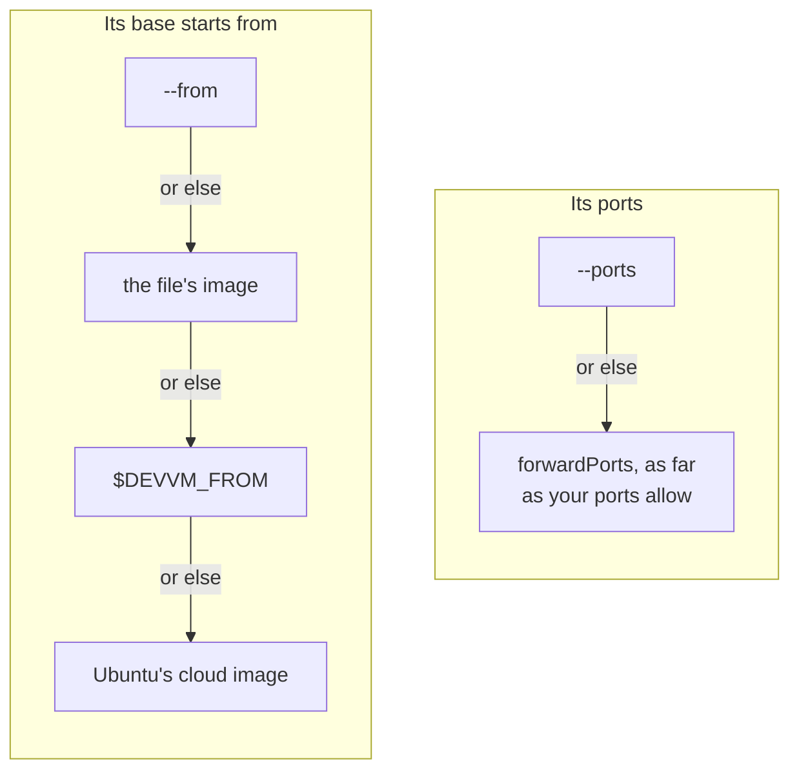

devvm supports the [Dev Container specification](https://containers.dev/), so a project's `devcontainer.json` sets up its VM. When you run devvm in a folder with a `.devcontainer/devcontainer.json`, or else a `.devcontainer.json` at the folder's root, the new VM gets that file's settings by default, as far as devvm supports them. To make the VM without reading the file, run `devvm --no-devcontainer`.

The settings devvm supports are the container image to start from, the features devvm has layers for, the ports, the environment and the commands. devvm says in one line which file it read.

```jsonc
{
  "image": "mcr.microsoft.com/devcontainers/javascript-node:22",
  "features": { "ghcr.io/devcontainers/features/docker-in-docker:2": {} },
  "forwardPorts": [3000],
  "remoteEnv": { "PATH": "${containerEnv:PATH}:${containerWorkspaceFolder}/bin" },
  "postCreateCommand": "npm ci",
  "postStartCommand": "npm run db:start"
}
```

## When it's read

- **Only when the folder's VM is made**, on every backend. Comments and trailing commas are allowed. devvm reads the file only within the folder, so it doesn't follow a link out of the folder, and it reads only a regular file of up to 1 MiB. devvm never writes anything to the project folder.
- **What you give on the command line wins.** `--from` wins over `image`, which wins over `$DEVVM_FROM`, and `--ports` wins over `forwardPorts`, and devvm says so in one line for each. The layers that IMAGE names go on top of the features' layers, as in `devvm claude`, and with a `devcontainer.json`, a folder whose toolchain devvm can't tell gets `base`.
- **An existing VM never changes.** Its state records the file's SHA-256. When the file differs from it on a launch, or is gone, or has appeared since, devvm warns once, and running `devvm rm` and then `devvm` makes the VM again from the file as it is. devvm doesn't check a VM made with `--no-devcontainer`.

A new VM takes each of these from the first place that sets it.



When devvm refuses something in the file, it stops with one line that names the file, before it makes anything. For invalid JSON, it names the line and column.

## Properties

| Property | What devvm does |
| --- | --- |
| `image` | The VM's base starts from it, as with [`--from`](from.md), where the backend can. devvm uses only an image that its registry gives anyone who asks anonymously, pinned to that digest. It never uses an image only Docker has, one only your registry login reaches, or one on this machine or its network, which is `localhost` or a registry whose address is loopback, private or link-local, by name or as it resolves. |
| `features` | `ghcr.io/devcontainers/features/docker-in-docker` is devvm's [docker layer](images.md#built-in-layers), with the backend's own rules for it. On the Docker backend, where it means no network policy, devvm doesn't ask about network policy but makes the VM without it and warns you, and it refuses the VM if you pass `--network-policy`. `node`, `python`, `rust` and `go` under `ghcr.io/devcontainers/features/` are the [shared toolchains](images.md#shared-tools). devvm ignores their options and says so in one line. It refuses `docker-outside-of-docker`, which is this machine's Docker, and every other feature. devvm never fetches or runs a feature's script. |
| `forwardPorts` | devvm forwards numbers, `localhost:N` and `127.0.0.1:N` as far as your ports allow ([ports](ports-size.md#ports)). With every port forwarded, which is the default, they're among them. devvm names the ones your ports leave out in one line and never adds them, and `devvm ports add` forwards them. It ignores other hosts' ports and says so in one line. |
| `containerEnv`, `remoteEnv` | The VM's environment, which login shells and the commands below get. `remoteEnv` wins over `containerEnv`, and devvm's own variables, such as `LANG` and secrets, win over both. A `remoteEnv` of `null` sets nothing. |
| `onCreateCommand`, `updateContentCommand`, `postCreateCommand` | They run once, in that order, once the VM is made and set up ([commands](#commands)). |
| `postStartCommand` | It runs at each start, on the first launch after the VM started. |
| `initializeCommand` | It never runs, because it would run on this machine, and devvm says so in one line. |
| `build`, `dockerFile`, `dockerfile`, `dockerComposeFile` | Refused, because devvm starts a VM only from an image. |
| `postAttachCommand`, `privileged`, `capAdd`, `securityOpt`, `mounts`, `runArgs`, `workspaceMount`, `workspaceFolder`, `remoteUser`, `containerUser`, `updateRemoteUserUID`, `init`, `shutdownAction`, `overrideCommand`, `hostRequirements`, `appPort`, `portsAttributes`, `otherPortsAttributes`, `userEnvProbe`, `waitFor`, `overrideFeatureInstallOrder`, `context`, `service`, `runServices` | Ignored, and named in one line. |
| `name`, `customizations`, `$schema` | Ignored. |
| anything else | Ignored, and named in one line. |

## Commands

A command is a string, which devvm runs with `sh -c`, an array, which it runs as it is, or an object of named commands, which it runs one by one, sorted by name. The commands run in the VM, as its user, in the project folder, in a login shell, and never on this machine. Their output goes to the [run log](troubleshooting.md#a-command-fails).

When a command fails, devvm names it in one line, and the commands after it that would run once, or at that start, don't run. devvm keeps the VM and opens it, because the command is the project's and not devvm's. With [network policy](../safety/network.md), the commands reach only what the VM's allowlist allows, like anything else in the VM.

## Variables

| Variable | |
| --- | --- |
| `${containerWorkspaceFolder}`, `${containerWorkspaceFolderBasename}` | the project folder, at the same path in the VM, and its name |
| `${containerEnv:NAME}` | in a string command and in `containerEnv` and `remoteEnv`, the VM's own `NAME` |
| `${localEnv:NAME}`, `${env:NAME}` | refused, because devvm never puts this machine's environment in a VM |
| `${localWorkspaceFolder}`, `${localWorkspaceFolderBasename}`, `${devcontainerId}`, `${containerEnv:NAME}` elsewhere | refused |

devvm leaves any other `${…}` as it is, for the VM's shell, such as `${HOME}` in a command.

## Security

The file belongs to the project, so a VM can rewrite it for the folder's next VM, and devvm never lets it run anything on this machine, reach this machine's files or environment, add a mount or weaken confinement. An `image` from it can still be any public container image, whose own code runs as root while devvm builds the VM's base, as with `--from` ([security model](../internals/security.md#a-projects-devcontainerjson)).
