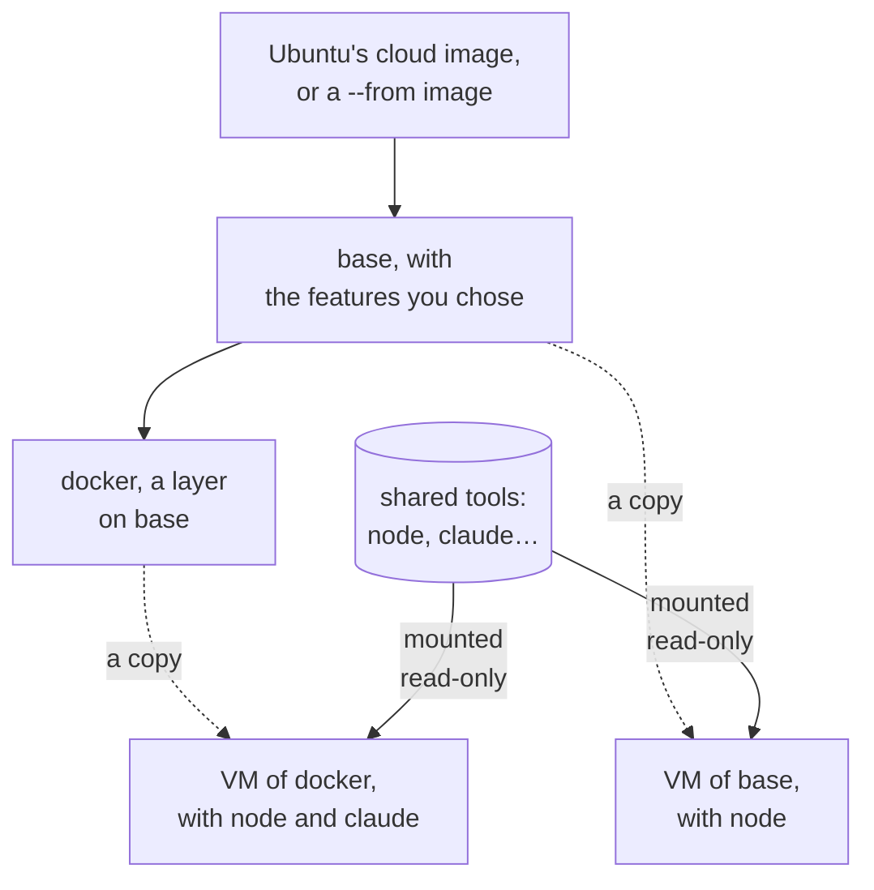
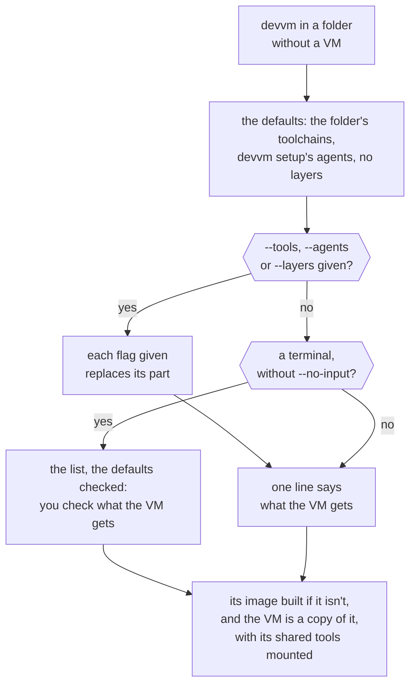

Every VM is a copy of an image. An image is `base` with your choice of layers on it, and nothing else. A VM also gets the shared tools you chose for it, such as node or Claude Code, which are mounted into it and are never part of an image. This page covers what base and the layers bring, how the shared tools work, what a new VM gets, and how to rebuild, list and delete images. [Images and caching](../internals/images.md) explains how devvm builds, pins and caches them, and [toolchains](toolchains.md) and [coding agents](coding-agents.md#supported-agents) list the shared tools.



## Base

`base` is the image that every other image is built on. It is Ubuntu 26.04's cloud image with git, build-essential, ripgrep, jq and mise added, followed by the optional [features](customizing.md#base-image-features) you chose, such as oh-my-bash and fzf. Docker comes as a [layer of devvm's](#built-in-layers), so you check it in the list devvm shows for a new VM, or give `devvm --layers docker`. With `--from`, base starts from a container image instead of Ubuntu's ([details](from.md)).

A VM made from base gets 4 CPUs, 8 GiB of memory and a 100 GiB disk unless you give it another [size](ports-size.md#size). On a small machine it gets fewer CPUs and less memory, which [the size section](ports-size.md#size-and-ports) explains.

base drops the server extras that Ubuntu's cloud image comes with, which are snapd, multipath, ModemManager, udisks, firmware updates, crash reporting, tracing tools, kernel headers, and apt's background updates and upgrades. That saves 0.9 GB of disk and 100 MB of memory per VM. The everyday tools stay, such as htop, tmux, lsof, strace, tcpdump, rsync and nano.

devvm builds base from pinned packages, but your VMs use Ubuntu's live archive, so `apt upgrade` in a VM gets the current updates.

## Layers

An image is base with layers on it, named bottom first and joined with `+`, so `foo+bar` is `bar` on `foo` on `base`. You can leave `base` itself out, which makes `base+foo` the same as `foo`. An image name never holds [shared tools](#shared-tools), which aren't layers, so `devvm build`, `devvm rebuild` and `devvm images rm` refuse a shared tool's name, such as `node`, and point you to `devvm tools`.

A layer is a script that bash runs in the image's VM as the VM's user, who has sudo. It is either one of devvm's [built-in layers](#built-in-layers) or one of yours, at `~/.config/devvm/layers/<name>.sh`. A layer's name is made of lowercase letters, digits and dashes, starts with a letter or digit, and is neither `base`, a built-in layer's name nor a shared tool's name. devvm refuses any other name in an image, and it refuses a layer whose script is missing. `devvm layer new NAME` starts a layer of your own ([details](customizing.md#your-own-layers)).

```sh
devvm build foo+bar   # builds base, foo and foo+bar, unless they're built
devvm rebuild foo     # builds foo again, and deletes the old foo and foo+bar
```

### Built-in layers

devvm ships two layers, `docker` and `nix`. You choose them like any other layer, in the list devvm shows for a new VM or as in `devvm --layers docker`, and you build one with `devvm build nix`. Like any layer, only a new VM gets them ([adding to a VM](../getting-started/commands.md#adding-to-a-vm)). Their names are reserved, so devvm refuses `devvm layer new docker` and never reads a `docker.sh` or `nix.sh` of yours. The hosts that each layer needs are in its own [allowlist](../safety/network.md#allowlists).

#### docker

The `docker` layer installs Docker's engine, CLI, BuildKit and Compose from Docker's apt repository, adds the VM's user to the `docker` group, and starts the daemon at each boot. On a base made `--from alpine`, it installs Alpine's own packages instead. A VM without the layer has no Docker.

On the [Docker backend](../backends/docker.md#the-docker-layer), the layer needs Sysbox on a Linux engine, where devvm makes a VM for it. Anywhere else on that backend, devvm refuses the layer before it changes anything, and you need a VM backend for it.

#### nix

The `nix` layer installs [Nix](https://nixos.org) with flakes and the `nix` command turned on, and [direnv](https://direnv.net) with [nix-direnv](https://github.com/nix-community/nix-direnv), so a project's `flake.nix`, `shell.nix` or `devenv.nix` can supply its toolchain. Each VM has a Nix store and daemon of its own, which no other VM and nothing on this machine shares. With network policy, VMs share their downloads from Nix's binary cache through a cache on this machine that only devvm fills. [Nix projects](toolchains.md#nix-projects) explains that cache, and how a flake's dev shell and the shared tools work together.

The `nix` layer works on Lima and smolvm, on a base from Ubuntu, Debian or Alpine. On a base made `--from alpine`, it installs Alpine's `xz` package, which isn't pinned, and runs Nix's daemon as an OpenRC service. devvm refuses the layer on the Docker backend, whose containers can't make the sandbox that Nix builds packages in ([what Docker VMs can't do](../backends/docker.md#what-docker-vms-cant-do)).

## Shared tools

The toolchains and coding agents are shared tools, not image layers. A VM of any image can have them, in any mix, such as node, python and Claude Code on base, or go and Codex on `foo`. A VM's state lists its shared tools apart from its image. [Toolchains](toolchains.md) lists node, python, rust and go, with what each brings, and [supported agents](coding-agents.md#supported-agents) lists claude, codex and opencode.

devvm builds each tool version once and mounts it read-only into every VM that has it, so any mix of tools works without building anything new, and ten VMs with node share one copy of it. The builds are in `~/.local/share/devvm/tools`. Each backend and each C library gets a build of its own, so when a Lima VM and a smolvm VM both have node 24, or an Alpine VM has it too, `devvm images` lists more than one build of that version ([what devvm keeps](space.md#shared-tools)). [mise](https://mise.jdx.dev) runs the tools:

- **They work as usual.** `node`, `npm i -g` (into `~/.npm-global`), `pnpm`, `yarn`, `pip` and `uv`, `go install` (into `~/go/bin`) and `cargo` work from any shell, including `bash -c` from agents and from editors over SSH.
- **A project's own version files win.** `.nvmrc`, `.node-version`, `.python-version`, `rust-toolchain.toml` and the `toolchain` line in `go.mod` pick their version, which installs into the VM the first time it's used. mise also reads a `mise.toml` in the project folder, and devvm trusts it without asking, because the folder is yours.
- **They're read-only.** A VM can't change the shared tools, even as root. The tools can't update themselves, and `rustup component add` can't change the shared toolchain.
- **They're mounted, or the launch stops.** When one of a VM's tools is missing or the VM can't mount it, devvm stops the launch and names the tool, and the VM never downloads its own copy in its place ([a shared tool doesn't mount](troubleshooting.md#a-shared-tool-doesnt-mount)). Only the versions that a project's own version files pick install into the VM.

devvm doesn't pin the tools' versions, because agents like Claude Code release several times a week. It follows the newest release of each tool, and Node 24 for node. The first time a tool is needed, devvm looks up its newest release, which needs this machine to be online once. When it makes a new VM, devvm also checks for newer releases if its last check was more than a day ago, and `DEVVM_NO_TOOL_CHECK=1` turns that check off.

A new VM gets the tools chosen for it when devvm makes it, and keeps those versions. `devvm tools` shows them, and in a terminal lets you check and uncheck them. `devvm tools add`, `devvm tools rm` and `devvm tools update` change them too, and none of these change the VM's disk ([adding and removing tools](toolchains.md#adding-and-removing-tools)).

## What a new VM gets



A new VM gets three parts besides base: its toolchains, its coding agents and its layers. In a terminal, devvm shows them in one list under three headings, Toolchains, Coding agents and Layers, with each part's defaults checked. Up and down move, space checks or unchecks, and enter makes the VM with what's checked. The Layers heading says that a VM gets layers only when devvm makes it.

Each part has a default:

- **Toolchains:** the ones the folder's files call for, each row naming its file, such as `package.json`.
- **Coding agents:** the ones you chose with [devvm setup](settings.md#coding-agents-for-new-vms), with a row saying so. Until you choose some, there are none.
- **Layers:** none. A layer that a project file calls for, such as `nix` for a `flake.nix`, names the file in its row but isn't checked, so you check it when you want it.

Three flags choose the parts on the command line, and any of them skips the list. `--tools` takes the toolchains, as in `--tools node,python`, `--agents` takes the coding agents, as in `--agents claude,codex`, and `--layers` takes the layers bottom first, as in `--layers docker,mine`. Each is the exact list for its part and replaces that part's default, and `none` chooses none of it, as in `--agents none`. A part whose flag you leave out takes its default. devvm checks each name before it does anything. For a name that belongs to another part, such as `--tools claude`, it names the flag that takes it, and for a name it doesn't know, it suggests the closest one.

Without a terminal, or with `--no-input`, devvm shows no list and doesn't fail. The VM gets the defaults, with any of the three flags replacing its part, and devvm says in one line what the VM gets and which flags choose others.

devvm looks at the folder's top level for the files that call for a toolchain, in this order:

| Toolchain | Files |
| --- | --- |
| node | `package.json`, `bun.lock`, `bun.lockb` |
| python | `pyproject.toml`, `requirements.txt`, `uv.lock`, `setup.py`, `Pipfile` |
| rust | `Cargo.toml` |
| go | `go.mod` |

If more than one toolchain matches, they're all checked, so `package.json` and `pyproject.toml` give node and python. A Nix project's files call for the [`nix` layer](#nix), whose row names them. Those files are `flake.nix`, `shell.nix` and `devenv.nix`, and a `default.nix` that makes a shell with `mkShell`. In a folder with none of these files, the default is no toolchains, so a VM made without a terminal or flags gets base with devvm setup's agents.

A folder's `devcontainer.json` adds what its features map to, such as toolchains or the `docker` layer, to the defaults, each row naming the file ([`devcontainer.json`](devcontainer.md)).

The VM's image is base with its layers, in the order you give them, bottom first, so `--layers docker,mine` makes the image `docker+mine`. Its shared tools are a list of their own, the toolchains first, then the agents.

If the image isn't built yet, devvm builds it first, then the shared tools the share lacks, and the VM is a copy of the image with its shared tools mounted. A VM keeps the image and tools it was made from, and the three flags change nothing on a VM that exists: devvm warns and names `devvm tools`, which [changes its shared tools](toolchains.md#adding-and-removing-tools).

## Rebuilding

When you edit a layer's script, devvm builds that layer again the next time it's used, together with every layer built on it, and it reuses the layers below. A new choice of base's features rebuilds base and everything on it in the same way.

`devvm rebuild IMAGE` builds an image again from its parent as the parent is now, where IMAGE is base or a stack of layers, such as `docker` or `foo+bar`. That's how you get the newest packages that a script installs without a pin. devvm also builds the images on it again, on the new image, the next time they're needed. When there are such images, devvm lists them first and, in a terminal, asks before it goes on. After the build, devvm deletes the old images that no VM uses.

Shared tools aren't images, so `devvm rebuild` refuses a shared tool's name, and `devvm tools update` gets their newer versions. [Rebuilding](../internals/images.md#rebuilding) explains how devvm tells which images to build again.

## Outdated VMs

A VM keeps the image it was made from. When that image, or one it's built on, changes after an edited script or a rebuild, devvm warns on each launch that the VM is outdated, and it leaves the VM as it is. To get the new image, save any work the VM holds outside the project folder, then run `devvm rm` and `devvm` to make a new VM.

## Listing images

`devvm images` prints two tables, each with a header, and it shows what a row lacks as `-`. `devvm images --backend NAME` lists only that backend's images and the shared tool images built for it. The first table lists the images on every backend by name, with unfinished builds last:

| Column | |
| --- | --- |
| `IMAGE` | its name, such as `base` or `foo+bar` |
| `FROM` | what its base started from: the `--from` image, or Ubuntu's cloud image with its release's date, `ubuntu 26.04 (20261001)` |
| `DIGEST` | the first 12 hex digits of that image's SHA-256 |
| `KEY` | its key, which `devvm images rm` also takes |
| `STATE` | `current`, `stale` when what it's built from has changed since it was built, `unfinished` for a build that didn't finish, or `building` while another devvm builds it |
| `SIZE` | the disk it takes, in powers of 1024 (`2.1G`). On macOS an image is a clone of its parent's disk, and the blocks they share count for both |
| `BACKEND` | the [backend](../backends/_index.md) that has it |

The second table lists the [shared tools](#shared-tools) that devvm has built, by the name you choose them by, such as `node` for node, pnpm and bun. The toolchains come first, then the agents, with each tool's versions newest first:

| Column | |
| --- | --- |
| `NAME` | `node`, `python`, `rust`, `go`, `claude`, `codex` or `opencode` |
| `TOOL`, `VERSION` | the tool and its version |
| `BACKEND`, `LIBC` | the backend and the C library (`gnu`, or `musl` for an Alpine base) that this build is for, because each gets a build of its own, or `-` when devvm can't tell |
| `SIZE` | the disk it takes |
| `VMS` | how many VMs have it |
| `STATE` | `current` for the version new VMs get, `in use` for another version a VM has, `unused` for neither, `not built` for the current version of a tool devvm has other versions of, and `not installed` when devvm has no version of it |

After the tables, devvm says on stderr how many images are stale or unfinished and how much disk the unused tools take, when there are any. It ends with the disk that the images and shared tools take together, and when the [shared Nix cache](toolchains.md#nix-projects) holds anything, the disk it takes of its cap. `devvm space` shows the rest of what devvm keeps ([what devvm keeps](space.md#devvm-space)).

### devvm images --json

`devvm images --json` prints the same as one JSON object, as [output for scripts](../getting-started/commands.md#output-for-scripts) describes, and devvm still says the same on stderr. `images` and `tools` have the tables' columns as fields, with sizes in bytes. An image's `digest` is the full SHA-256 of what its base started from, and `sized` says whether devvm knows its size. A tool image's `built` says whether devvm has built it, and only a built one has `backend` and `libc`. A value an image lacks, such as an unfinished build's name, is `""`. `total` is the disk the images and shared tools take together, `unused_tools` is the part the unused tool images take, and `nix_cache` has the shared Nix cache's files, the disk they take and its cap.

```json
{
  "version": 1,
  "images": [
    {
      "name": "base",
      "from": "ubuntu 26.04 (20261001)",
      "digest": "sha256:8eb876c2ccc4b6ff89e4a65d511815923b285e04503ba465809bf587f763da24",
      "key": "7a76021c46ef",
      "state": "current",
      "size": 2254857830,
      "sized": true,
      "backend": "lima"
    }
  ],
  "tools": [
    {
      "name": "node",
      "tool": "node",
      "version": "24.11.0",
      "built": true,
      "backend": "lima",
      "libc": "gnu",
      "size": 125829120,
      "vms": 1,
      "state": "current"
    }
  ],
  "total": 2380686950,
  "unused_tools": 0,
  "nix_cache": {
    "files": 0,
    "size": 0,
    "cap": 10737418240
  }
}
```

### Deleting images

`devvm images rm IMAGE|KEY...` deletes images. You name each one by its name or by the key that `devvm images` shows:

- A name means its image as it is now, on base from `--from` when you give it. A stale or unfinished image has only its key.
- Each image must be built, or devvm deletes nothing. Shared tools aren't images, so devvm refuses a name that has one, such as `node+foo`, and `devvm gc` deletes the shared tools no VM has.
- devvm also deletes nothing while another devvm is building one of the images, so run the command again once that build ends. `devvm gc` and `devvm rebuild` leave such an image alone too.
- A deleted image is built again the next time it's needed. VMs made from it keep working, because on macOS they're clones of its disk. On Linux hosts, devvm refuses to delete an image whose disk VMs are overlays of, and names those VMs.

### Cleaning up

`devvm gc` deletes four things. The first is what `devvm images` lists as stale or unfinished, on every backend. The second is the shared tools it lists as `unused`. The third is the older versions of the mise that devvm runs on this machine to look up the tools' versions, which an upgrade of devvm leaves behind, except one that changed in the last hour, because another devvm may be downloading it. The fourth is the [shared Nix cache](toolchains.md#nix-projects)'s least recently used files, while it takes more than its cap, the `nix-cache.size` [retention setting](settings.md#retention), which is 10 GiB when it's off. devvm's mise and the shared Nix cache are both in `cache/` in [devvm's data folder](space.md#devvms-data-folder), which holds only what devvm makes again when it needs it, so you can also delete that folder yourself at any time. gc lists them all first and, in a terminal, asks. Without a terminal, it deletes nothing unless you give `--force`, which deletes without asking, in a terminal too.

- `devvm gc --tool-images` also deletes the current shared tools that no VM has, such as a toolchain you tried once, on every backend and C library. `devvm gc --tool-images node claude` deletes only those tools' builds, by the names you choose them by, so `node` also covers pnpm and bun. A tool that a VM's state lists stays, including a stopped VM's. So does one built in the last hour, because the VM it was built for may not list it yet, and gc names the tools it keeps for that reason. While devvm is making a VM, or giving one new shared tools through `devvm tools add` or `devvm tools update`, that VM may not list the tools it picked yet, so gc keeps every current shared tool that no VM has, names them, and deletes the rest of what it would. Run it again once that's done. A VM that has a deleted tool builds it again when it needs it.
- `devvm gc --tool-images --recent` also deletes the current shared tools that no VM has and that were built in the last hour. `--recent` goes only with `--tool-images`, it never deletes a tool that a VM's state lists, and it changes nothing else that gc deletes. While a VM is being made or is getting new shared tools, gc refuses `--recent` and deletes nothing, so run it again once that's done. gc asks before it deletes them, as for everything else, unless you also give `--force`.
- The devvm making a VM holds a lock that the system lets go of as soon as that devvm ends, so one that crashed or that you killed never leaves gc keeping tools or refusing. A devvm that starts to make a VM while `devvm gc --tool-images` runs, or while retention deletes shared tools, waits for it to finish and says it's waiting. In a terminal, gc holds that lock while it asks you, so answer it first.
- When a shared tool that a new VM's state lists is gone before the VM's first shell, for example because you deleted it by hand, the VM's setup can't mount it. devvm then names the tools it couldn't mount and stops, and the VM stays. Run `devvm tools update` in the folder, which builds the missing tools again and opens the VM.
- `devvm gc --history` also deletes the [exports](coding-agents.md#history) of agents' history that `devvm history export` and `devvm rm` saved, which are the only copy of a deleted VM's history, and `--older-than DURATION` keeps those newer than that [duration](../getting-started/commands.md#flags-and-values), such as `12h`, `30d` or `2w`. gc never deletes exports without `--history`.
- `devvm gc --nix-cache` also deletes the rest of the shared Nix cache. VMs download its packages again when they need them.
- `devvm gc --orphans` also deletes what devvm keeps for VMs that their backend no longer has, such as one you deleted with `limactl delete` instead of `devvm rm`, and with it the hold their state has on their shared tools ([leftovers](space.md#leftovers-of-a-vm-deleted-outside-devvm)).
- `devvm gc --caches` then frees devvm's share of the backends' own caches, such as Lima's downloads of Ubuntu's cloud image, asking for each backend apart, or without asking with `--force`, which it needs without a terminal ([the backends' caches](space.md#the-backends-caches)).
- `devvm gc --retention` then applies the [retention settings](settings.md#retention) at once, which devvm otherwise applies at most once a day. They're all off until you set them.
- `devvm gc --backend NAME` acts on that backend alone, for example once you stop using smolvm. It deletes all of that backend's images, the current ones too, and its shared tools that are `unused`, and it leaves every other backend's images and devvm's own mise as they are. Without `--backend`, gc acts on every backend, whichever backend new VMs get by default. An image that a smolvm or Docker VM was made from stays, and devvm names the VMs that use it.
- When a backend that one of your VMs uses can't list its images, for example because Docker isn't running, gc warns and leaves that backend's images, shared tools, VM leftovers and caches alone. It also leaves the shared tools whose record doesn't name the backend that built them, because they may be that backend's. gc goes on with the other backends and succeeds, so run `devvm doctor` to see what's wrong with that backend, then run gc again once it answers. `devvm images` fails instead, because it lists every backend's images or none.
- gc never deletes VMs. Without `--backend` it keeps current images, and without `--tool-images` the current shared tools. It always keeps every shared tool that any VM has, including a stopped VM's and that of a VM deleted outside devvm whose state is left, until `--orphans` deletes that state.
- On Linux hosts, a stale image whose disk VMs are overlays of stays, and devvm says which VMs use it.
- After an Alpine VM is gone, the shared tools built for Alpine are unused, unless you give gc that `--from`.

[Images and caching](../internals/images.md#listing-and-cleaning-up) has the details of what counts as current and unused. To see what gc would free before you run it, and what takes the rest of the space, run `devvm space` ([what devvm keeps](space.md#devvm-space)).
